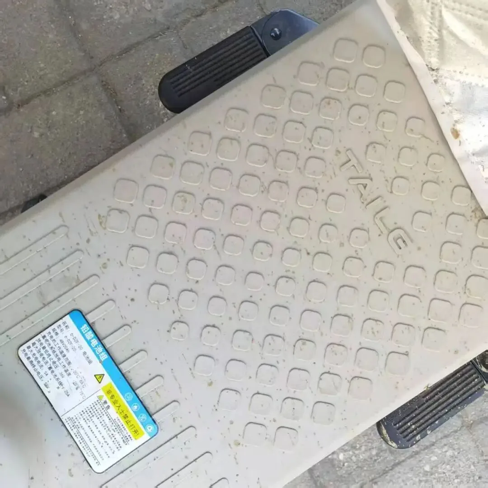

请相关部门及时关注并跟进问题。

## 1 后勤、保卫

## “【投稿】感谢宿管阿姨

感谢3号楼李若梅阿姨！必须给我们楼的宝藏宿管阿姨疯狂打call！一只巨无霸壁虎闯入宿舍，在我瑟瑟发抖不知所措求助宿管阿姨之后，阿姨拿着扫帚就进来把它请走了。再次感谢阿姨！”

## “ 夏天到了，阿姨该给宿舍的卫生间打杀虫药了”

“ 8号楼女生宿舍楼道里被安装了监控，极大地侵犯了女生们的隐私空间，电梯前室和洗衣房安装监控尚能理解，但是宿舍楼道安装监控实在无法理解！下一步是把宿舍内部也安装上监控吗？

我通过查询相关法律文件得知:‌

宿舍楼安装摄像头的目的应仅限于‌维护公共安全、防范盗窃、火灾等校园安全事故‌，不得用于监视学生的私人生活或进行与安全无关的管理。‌‌‌而舍管经常以安装了摄像头为由，每天晚上到我宿舍告知宿舍外不能放置水果等物品，我个人的隐私和生活每天都受到干扰。宿舍温度过高，少量易腐物品放在本宿舍门外完全合情合理，完全不会妨碍疏散！！

如再继续打扰，请后勤处统一提供一阴凉处放置同学们的易腐物品或者允许宿舍中使用小功率冰箱设备，学生也是人，也会有吃不完食物或水果需保存的时候！！宿舍门口一小块区域本就属宿舍区域隐私。

请相关部门不要忽视同学们的合理诉求！不要只把学生当成被管理者！请把他们当成一个正常人！谢谢！！”

“ 4月29日下午两点左右我把车停在良乡校区三号宿舍楼下，傍晚五点半左右再下去车就被崩满了泥点子。（如图 从车前盖、挡风被、座椅到整个车体全部都是 没拍全）学校不知道为了修什么东西，把楼下大家的电动车都移开了一点点，想来是维修师傅过于“疲惫”只考虑让机器进去就行，不在乎大家的车仍然在这个位置会不会被搞脏，孰轻孰重真是分明啊。

骂了显得我不为维修师傅考虑，不骂学校能不能替我把车擦干净呢我请问？

不要求你贴心地帮我们把车罩上，但既然挪了，挪远点儿的时间都没有吗？再者，是我们故意放那儿耽误了施工？提前通知我们不要停那儿很难吗？

社科大的消息通知真是烂的要死，从来没见过这么烂的。到现在宿舍连官方楼群都没有，任何施工维修的消息都收不到。只有哪天突然被敲敲打打或者电钻声吵醒了才知道，哦又施工了。通知一下是有什么难处吗？维修师傅要上来之前也没人通知，在楼里走着走着就不知道为什么遇到了异性，社科大你觉得合理吗？我不攻击维修人员，我只攻击你社科大“瞒天过海”的消息传递方式。

不是老师们是人文领域大拿，你校就能称之为人文之光了。请问是哪一点真的体谅了学生呢？”

## “摆渡车离谱老太欺负保安

广阳城→学校摆渡车 8:20 亲历吐槽

有的老太太真的好气人，欺负保安，而且不止一次，不敢相信是我们学校的老师，或者好像是考古实验室的？因为同行的老头外穿背心上写着中国考古。

保安正常上车查验校园卡。

她一开始很冲的语气说什么：你难道每个人都查吗？

保安说：我确实每个人都查，你的给我看一下

🆘坐摆渡车的人都知道 保安会查每一个人的证件，现在校园安全抓这么严，不是工作要求，保安难不成还是特别想看您老证件上的尊容？

她开始不依不饶：诶我刚刚给你看过了，你是不是找茬啊？我希望你最好是每个人都看！

🆘保安真的是每个人都看。然而争了好几轮到最后都没能让她屈尊再拿校园卡出来。

（用“再”是因为不知道她第一次到底拿了没有）

保安下车之后仍然喋喋不休，跟周围的老头老太对保安指指点点。同行的人都尴尬了，附和几句，她更来劲了。

“我觉得他（保安）上来就带着找茬”。

我真 tm 的🆘谁找茬啊，我每次都是把校园卡页面亮出来，保安看一眼就走了，谁想跟你多废话啊，啊？

下车之后还在说：“每天这么查我都认识你了，你还查我”。

🆘每天查卡的保安都不一样，您认识的是哪位啊？并且保安一天见多少人凭什么认识您啊？！

不愿意上良乡上班别把气撒保安身上！！！社科大以后不办学了，全体师生每天跪迎您屈尊从市里下良乡上班。

希望学校在摆渡车上设置刷卡机，不要让这种不愿意翻卡的手懒&爱吵架的嘴快老太上车了！

真的听的我好气😡”

## 2 毕业答辩

> “投稿本科毕业答辩安排还是应该公开透明。去年都公布了，今年遮遮掩掩是什么意思？实际上按照教务处的规定，每组都应有一位岗位教师，这个标准去年有些学院就没达到。是不是今年能达到，需要监督和公开。其他答辩细节也是如此。遮遮掩掩不是好作风。”

## 3 图书馆、自习室

> “投稿：在图书馆自习打喷嚏道歉了还被骂，请求同学们之间相互体谅吧。我们知道图书馆自习需要安静，但是如果连打喷嚏这种难以克制的自然生理反应都不容许，是否有些太过于苛刻了？想起来之前有同学因为写字的声音被骂，不禁想问这些骂人的同学，是你骂人声音大还是打一个喷嚏和写字的声音都呢？”

“现在春天不到25度的温度，正是舒服的时候，有必要在图书馆开23、4度的制冷吗？”

> “回复《自习室究竟在何方》和相关评论：这个同学反映的自习室不够的情况不符合实际，但是未经通知扔掉东西和不准将自己桌椅搬走的确很不合理。反映问题和评论不应该都理性一点吗？至少先把实情和帖文看完。评论对这个同学不去图书馆的质疑很合理，但是赞同扔掉同学东西和不准搬走桌椅就有点不合理了。”

## 4 学工

“【投稿】好多人以为社科大只有国奖、优秀团员卡单科75分，其实根本不止这些。就连评校级优秀学生干部、想在学生组织留任，都卡死单科必须75分以上，根本不看你综合成绩，也不管你之前做了多少学生工作、有多少贡献。

纯粹就是懒得好好定规则，直接一刀切。只要有一门课低于75，你之前所有的付出全都白费。就用一门短板课的分数，直接否定你学生工作和学习上所有的价值。

从这一个规定就能看出来，学校根本没用心为学生发展考虑，也不懂得鼓励多元发展。在这儿上学真的压抑，说实话真后悔考来这个学校。”

## 5 新苗

## “关于新传学院新苗评审问题：

我真的很想知道，一个毫无意义的选题、一个理论框架全靠装逼的项目，为什么最后可以拿到高分？

我只能说现在创新的门槛确实低得有点离谱，也特别低俗。是不是只要网上什么东西火了几天，就可以马上包装成“现象研究”？是不是只要往PPT里塞几个“亚文化”“弱关系”“结构洞”，再摆出一副很会做研究的样子，就能显得自己特别高级？我不知道某些同学研究SBTI这种垃圾是要干什么。概念堆得再多，框架画得再大，也遮不住研究根基不稳。

答辩讲得其实也不咋地，甚至就是装逼画饼居然也能通过。说白了，有些项目不是在做研究，而是在制造学术垃圾，给新传和文科招黑。

这样的项目居然能到“第二名”这种分数，不知道新苗评审到底看的是项目质量，还是看谁跟老师更熟？看的是研究能力，还是看谁平时更会刷存在感？看的是答辩水平，还是看更会在学院事务里混脸熟，当老师的舔狗。既然这样，以后所有科研只需要跟老师关系好就可以过了，其他同学给某些“关系型选手”烘托气氛算了。大家以后直接去研究一下怎么和老师搞好关系，怎么在各种学校组织里刷存在感，怎么让评委提前记住，可能比认真做项目更有效。毕竟从这个结果来看，老师喜欢的无非就是某些拍老师马屁、只会搞关系的装逼户了。真的招笑。”
