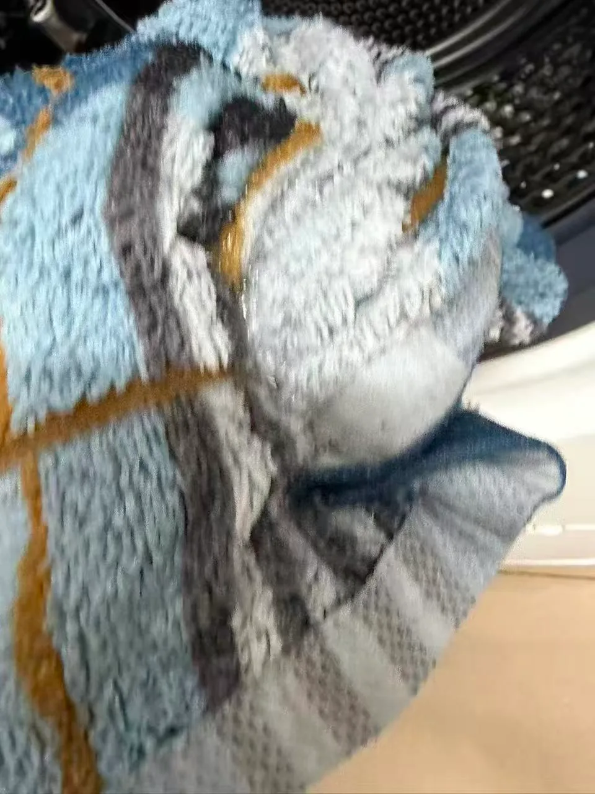
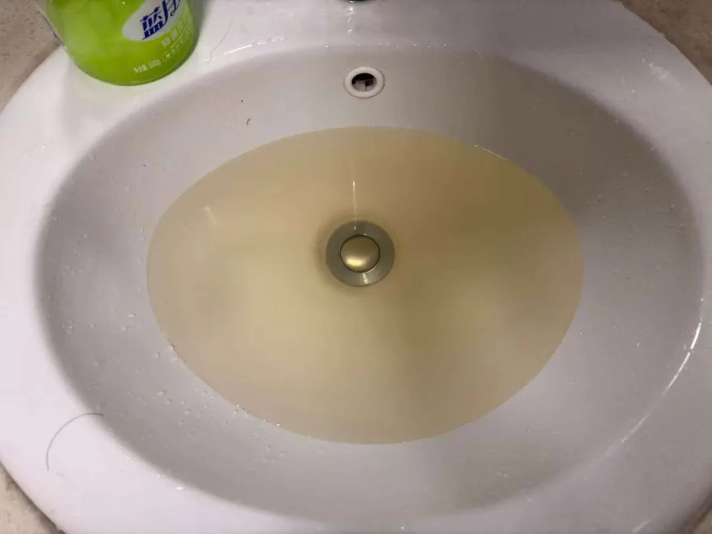

请相关部门及时关注并跟进问题。

## 1 读者呼吁

## “投稿：别把人文之光当成保姆式服务！

作为一名即将毕业的研究生，在社科大度过了两年多的时光，刚到学校时惊讶居然有这么一个发声平台，也非常震惊大家的一些尖锐、客观、有建设性的表达，这个平台本应是凝聚共识、推动学校进步的桥梁，但近来一些投稿的风向，让我不得不说几句心里话，想在毕业之前为学校发展发一份声。

有些同学似乎对“人文之光”有着极大的误解。但凡校园生活中有一点不顺心，学校没有做到事无巨细的保姆式服务，就立刻高举人文大旗口诛笔伐。然而如果人文之光仅仅意味着要求学校处处迁就个人、满足所有即时需求，那我校确实不该称呼“人文之光”，而该叫“服务之光”了。我不敢说自己完全读懂了社科大的人文精神，但我确定，它绝不是精致的利己主义，更不是对他人劳动的理所当然的索取。

我读研前曾在社会上工作过两年，也经历过本科院校的生活。平心而论，社科大对学生的照顾，无论是和其他高校比，还是和残酷的社会现实比，都已经好得太多太多。诚然，学校的行政效率还有提升空间，部分工作也确有疏漏，但瑕不掩瑜。从宿管阿姨到食堂师傅，保安门卫，从辅导员到专业课老师，绝大多数人都在真心实意地为学生着想，让我们感受到了作为“人”的尊重与关怀。这份温暖，我想绝大多数同学都深有体会。

可我实在担心，有些同学在这份过度的呵护里，失去了基本的独立能力和换位思考的意识。等到真正步入社会，不会再有领导包容你的情绪化抱怨，不会再有同事为你的失误买单，更不会有陌生人无条件迁就你的便利。到那时，你又能向谁去挥舞人文之光的大旗呢？

看看近期平台上的一些投稿，实在让人难以认同，例如：

1指责宿舍走廊摄像头喊着侵犯隐私。试问如果你丢了东西时会指责学校监控不到位吗？

2电动车被施工溅了几个泥点，就上升到学校管理混乱的高度；

3投诉食堂员工打闹，学校通知食堂，餐饮公司按照自己内部规定处理后，又反过来施压学校要求回聘?既然我们用了权利，就要承担权利带来的后果！

4学校为解决北门外卖问题，安装了外卖柜，又有人嫌外卖柜收费，要求学校承担骑手费用。

诸如此类的情绪宣泄还有很多。这些投稿的共同问题，是永远站在自己的单一视角看问题，只考虑个人的一时便利，某些建议看似是善良的发声，但完全不顾及学校的运营成本、管理难度和其他同学的利益以及现实的难度。这不是一个受过高等教育的人应有的理性与素养。

我始终认为，你要求学校成为什么样的大学，首先要问问自己是否配得上这样的大学。如果你要求社科大具备985、双一流的综合水平，那请先自省，你是否具备了与之匹配的学生素质？

你提出的建议，是真的为了让学校变得更好，还是仅仅为了满足一己私利？

你提出的诉求，是清晰具体、有据可依的，还是夹杂着大量个人情绪的发泄？

你在指责学校之前，是否认真思考过这件事的来龙去脉，是否考虑过解决方案的可行性？

你在要求别人包容你的时候，是否也给了别人同样的包容？

在此，作为一名即将离校的毕业生，我真诚呼吁各位同学，今后在社论平台发声时，能多一份理性，少一份冲动：

1. 明确初衷：投稿的核心目的是推动学校进步，而非单纯的情绪宣泄。

2. 规范表达：按照行文规范，清晰说明事情的背景、起因、现状，提出具体明确的诉求。

3. 理性思考：发送前认真考量自己提出的解决方案是否具备可行性。

4. 换位思考：多站在学校管理者、基层工作人员和其他同学的角度想一想政策的难度。

比如呼吁立即维修所有宿舍墙壁，却忽略了学校需要立项、招标、协调时间、腾退宿舍等一系列复杂流程，任何一项工作都需要人力、物力和时间的投入。

社科大是我们共同的家。它的变好，需要学校的努力，更需要我们每一个人的理性与担当。

—— 来自一名2026届硕士毕业生

”

## 2 科研经费

“科研处要不和就业指导办合署办公吧？2025年研创立项至今已14个月，经费报销到卡上0元，是在培养大家讨薪的技能吗”

## 3 科研署名

## “投稿：

《中国社会科学院大学学生科研成果奖励办法》里面要求：本科生、硕士研究生与导师共同发表的论文类成果，如导师为第一作者，导师的第一署名单位必须为中国社会科学院大学。

这不是让学生和老师打架吗，一直说要促进院所融合，在经济利益上又要引起学生和导师纠纷。

社科大很多老师都是所里研究员、副研究员。让他们把第一单位全署名为社科大，不是为难人吗，怎么可能为了学生老师自己的考核、绩效都不管了，全身心建设社科大？社科大给了老师多少补助吗？

不能既没有补偿又逼着学生和老师商量改学校为第一单位吧？老师将自己单位加上社科大已经是很大的让步了。

如果觉得导师第二单位署社科大不够好，可以砍半奖励金额，直接去掉是不是以后也可以让导师不加社科大了，反正也没什么用途。

社科大是不是在学生奖励上多考虑学生实际情况呢？还是这笔钱本身就要设置障碍别一次发太多？

一直说是科研院校科研院校，在学生科研支持上倒是没见下多大功夫，反而障碍重重。前有研创（听说还不报销，财务有重重障碍等待着），后有成果奖励办法，都在为学生设置障碍，要是不想就别发面子工程。

”

## 4 望京图书馆

> “投稿：望京图书馆的领导工作日下午14点专门到沙发区检查有没有同学睡觉，是真的太闲了没事干吗？？美其名曰躺着不好看…但凡图书馆能提供其他舒适的躺椅，谁又想躺在沙发上呢？？？非要逼同学们趴在桌子上午休，非得让同学们趴出颈椎病和腰椎病才满意？？？”

## 5 体测时间

“社论你好！过去了这么长的时间，现在倒回头来想说说体测的事儿，半年过去应该不会再有人说是单一情绪上头的宣泄，也许我们可以心平气和地讨论一下这个问题。但请无论如何不要刁难或压力体育教研部的老师们，老师们人都很好。

众所周知体测和评奖评优挂钩，这也是京区高校的默认规则。但如何执行在各高校却有所不同。以咱们学校为例，体测一天，之后的一周有半个下午的时间补测。我相信这应该是考虑到社科大只有千余本科生需要体测的情况而设置的成本合理的办法。

但是有的时候单一成本衡量是不合理的，我相信学校一定考虑到学生可能有事的情况，但这个情况往往赶不上现实的变化。去年的时候，很不幸，体测赶上了我的生理期，理论上我应该可以补测跑步项，但很不巧的是，正测和补测的时间刚好在一周的两端，也就是生理期的时间。于是我只能抓紧第一天来测，再晚一点痛经就会赶来。当时负责800的老师人很好，听说了我的情况之后，在女子组只来了三个人的情况下就赶紧安排了一组。结果是刚刚跑完我就两眼一黑躺在操场上了，缓了半天才好。那个时候也是我第一次体验到痛经快死掉是什么样的感觉，嘴唇发白，浑身打颤，想呻吟都发不出声的感觉。（为防止有人说我身体素质或者矫情的原因，特此说明本人体质虽不怎么好但不来生理期的情况下体测拿八十几还是能做到的，并且八百一般能跑到三分二十，也有从小坚持到大的锻炼习惯，一天走四万步不会觉得累。）老师人很好，提醒我旁边有备好的姜丝可乐，但是我连站都站不起来了。后面是怎么站起来走到体育馆的厕所我也不知道了，只记得我上吐下泻，将早饭全部吐出来了，之后的一周，基本上都因为痛经躺在床上。当然很不幸，这次的体测没有过75，我也失去了这一年评奖评优的机会。

至于为什么不月经最后一天才测，答，家里出事了，14号必须回去。同时，最后一天也是在生理期，运动也有风险。

当我向北大的同学吐槽的时候，她很震惊：你们学校怎么会那么赶，我们都是两到三周测，可以避开生理期再测，体育课直接可测，跟着上课的班测就是了。

但我知道这不一样，社科大的规模很小，所以成本上没办法做到那样大的规模。但或许如果能将测试的周期拉长，或者补测设在两周后隔开女生可能的生理期，或者将体测放在春季……可能我都不会像那天一样两眼发黑晕在操场上。

同样的，如果有其他的同学不小心崴了脚，或者在冬季患上了流感，那一周一天半的体测同样会无比煎熬，甚至可能会因为只是不小心崴了脚失去了这一年评奖评优的资格。

也可能是我们的体质下降了，必须斤斤计较这个分数。但我们谁都没办法保证自己不出意外，或者需不需要因为有事而回家。这段时间也没少看见研究生学长学姐因为75分的事情而进行的讨论。是，我们都明白，测评需要指标，但当指标失去合理性或者部分合理性的时候，或许是不是能够考虑进行内容上或者形式上的调整呢。

我们都太习惯用成本，“值不值”去衡量管理的效益，但自始至终最重要的，始终是制度服务的人。就像疫情期间某地为一个跋山涉水上网课的女孩建造g站的事，无论如何都是不值得，但是值得的事。

”

## 6 宿舍工作

“投稿 今日七号楼热水管道坏了 理解大家不能洗澡心情很烦躁 但是看到一位同学因为这件事在一楼对着宿管阿姨很凶的大吼大叫 很多人都看着 阿姨在旁边很无助的陪笑解释 让我看的很不舒服 毕竟是学校的问题 请不要把自己的情绪发泄在阿姨身上 要知道宿管阿姨真的都很好！

”

## 7 宿舍洗衣机

“我要投稿：社科大新换的洗衣机，不仅bug频发，7块钱理应是84分钟，我在13:37开始洗，结果14:16提示完成洗衣，可以看到这洗衣效果，非常好，还在出水，这新洗衣机不如老洗衣机，为什么要换呢，也算是老生常谈了

”

## 8 宿舍水质

## “投稿：七号楼的水到底什么时候能好…这水谁敢用啊！

”

## 9 评奖评优标准

## “评选标准

最近不知道哪位校领导拍屁股想出来的一条75分zhansha线，有一门课程成绩没有过 75 分就不让参与评优秀团员、国家奖学金、硕博连读等（不知道后面还要加入到哪个规定。。）请问75分标准的依据在哪？有没有教育部相关文件支撑？有没有结合研究生培养规律与实际做过调研？有没有征求过广大师生的真实意见？为什么不设置70分、80分？为什么不把必须发表一篇C当作标准？毕竟研究生不是应该以科研为主？

研究生阶段的课程成绩，究竟有多大的含金量，值得被抬到“一票否决”的高度？且不说有些与自身研究方向相去甚远的课程，于自身学术科研几乎没有助力，纯粹是为了修够学分；更何况，研究生课程成绩本身就没有想象中那么客观，有些课程考核标准模糊，论文、展示、课堂参与占比很高，老师给分本来就带有主观判断；还有一些老师恪守所谓的“正态分布”，为了凑分布比例强行压低、调整个别同学的分数。班里有人考得高就压一压，有人考得低就抬一抬。你最后是75还是74，有时候根本不取决于你写得怎么样，取决于班上其他人写得怎么样，取决于老师那天心情好不好。。。

研究生尤其是博士生评价的核心应当是科研，本身就业压力就很大，就业市场不看你是不是所有成绩都大于75分，没有任何用处。课程成绩达到及格线说明你没摆烂，这就够了，剩下的应该比真本事。现在倒好，科研做得再扎实，学生干部为学校学院出力再多，只要某门和研究方向八竿子打不着的课少了一分，前面所有努力归零。

校领导自己不觉得这样脱离实际、僵化教条的规定好笑吗？身为学校管理者，不深耕教学培养体系、不优化科研扶持政策，反倒拿虚无又充满水分的课程分数设限卡人。不如脚踏实地管好自己应该做的事，多想想如何提高研究生生活补贴、改善住宿生活条件、增加科研经费支持、搭建学术交流平台，多为学生办实事、解难题，而不是坐在办公室闭门造车，胡乱出台不合理的管控规则，徒增学生负担，消磨学子的初心与热情。

”

## 10 评优流程

“投个稿吧，政府管理学院学硕班的优秀毕业生评选流程堪比烂香蕉，采用了同学投票这一先进的形式，成立了隐秘的评议小组，形成了没有的评选标准。直接推荐的那个同学，评议小组也不说是满足什么条件，剩下的都是投票的产生的。之所以没有太多人反映，第一因为大家都忙着毕业了，第二是只有四个人参评。大家不想为了这一个无聊的荣誉破坏本就岌岌可危的班级人际关系，但是还是得吐槽一下这个流程，有点给优毕抹黑了。

”
