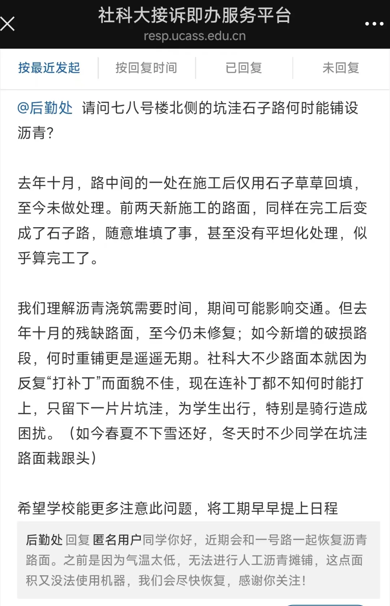
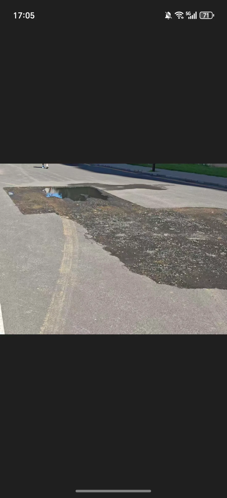
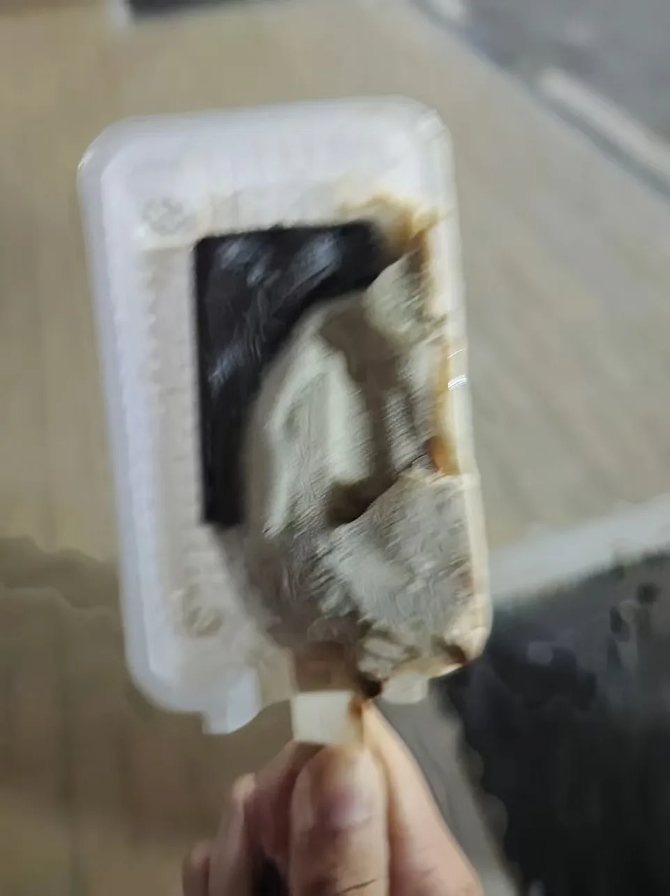

请相关部门及时关注并跟进问题。

## 1 图书馆规范

“你好，我想投稿。情侣在图书馆坐在一起自习的时候能不能不要老说话，就算是用自以为很小的音量，周围人也听得一清二楚的\[裂开\]谢谢

”

## “致图书馆管理老师：

今日，图书馆老师以"鼠标键盘声音太大影响他人"为由打断我的学习，对此我有以下三点质疑，请逐一正面回应：

一、打断行为是否有规则依据？

我使用的是普通鼠标键盘，并非机械键盘等明显高噪音设备。请问老师依据图书馆哪一条具体规定认定我的行为违规？若有明文规定，请出示条文；若无，则此次打断缺乏正当依据，请给予书面道歉，并承诺不再以此为由干扰我的正常学习。

二、噪音管理规则公示在哪里？

请问图书馆各区域的噪音管理标准公布于何处？若已有规定，请提供具体查阅渠道；若尚无明确规定，请图书馆尽快完善相关管理制度，不能以模糊标准随意干预读者学习。

三、关于"公共大厅"的环境定性问题

我所在位置为图书馆一层进出口公共大厅，本非绝对安静区域。若某同学在此区域学习，却以"受到干扰"为由投诉他人正常使用设备，请问图书馆是否同样受理以下诉求：该同学本人的存在影响了我的视觉注意力；图书馆人员进出、书架旁工作人员走动、门卫离岗巡视均对我构成干扰。若这些诉求不成立，则以键盘鼠标声音为由的投诉同样不应成立。

另，此前已有同学通过公众号反馈类似问题，未见任何老师回复。今日此事让我亲身体验，深感图书馆在读者权益保障与规则透明度上存在明显不足。请图书馆老师就以上三点给出正式、明确的书面答复。

”

## 2 助学金

## “我想问研三助学金6月份还发吗”

## 3 数据库

“社论帮忙发一下，谢谢：图书馆现在数据库越买越少了？？？明明去年jstor数据库好多本期刊还能下载，现在全没了？？？热知识：不是你象征性买几个子库把jstor链接标上去就能说明你买的数据库多。作为人文社科的专门院校，好多理工科数据库又不用买，就不能把相关领域的数据库买全一点吗？图书馆又不是专门搞做手工的，多点资金帮助学术研究吧！

”

## 4 工地施工

“投稿：七八号楼对面的工地到底是要做什么！周六早上七点多就开始轰轰隆隆开始挖，窗子紧闭都挡不住声音，这个学校疯了吧？赶工程结果封路了快两个月，也没见的勤奋出什么结果！唯一的后果就是让学生天天住在工地里！吵得人头痛欲裂，不得安生！补一下：现在8点多了，刚刚一直不断地机器忽然不响了。真的把我气笑了，不在正常施工点施工，只选午休时间和大家睡觉的时间。

”

## 5 路面维修

“路面未修已有几月，近日艳阳也高照十数日，恐怕气温也不能成为延期修复的理由了。不得不问：挤牙膏式的建筑，挤牙膏式的修复究竟要持续到何时？

近期近期，恐怕是无期

”

## 6 女厕所需求

“匿投稿:学校女男比7:3，女男卫生间数量比1:1，规划很不合理，女卫生间经常排队，课间时间还那么紧张，无法满足女性生理需求，希望学校能予以解决

”

## 7 研究生教学

## “标题：突如其来的严查研究生教学制度正在毁掉人文之光

近期学校不知道哪位领导又犯病，在全校开展轰轰烈烈的严查研究生教学政策。请问现在研究生教学也要高中化么？研究生本身就面临着巨大的就业压力，很多人还要开组会、改论文、做课题、处理导师临时安排，有的人还要实习、考公、找工作等等。近期笔者在某次课，因为一些事务晚到了几分钟，错过了老师签到，老师直接不予补签，理由是学校监控会随时查看课堂状态，教师不敢放松课堂管理，你以后干脆改名社科院高中吧。。。

真正该问的是：课程内容有没有价值？老师讲得好不好？培养方案是否合理？学生科研训练是否充分？论文指导是否到位？就业支持有没有跟上？奖助体系能不能缓解学生压力？这些真正关系到学生的实事不先问问自己有没有做到，反而在一些纯粹形式主义的东西上不断消耗学生和老师的精力，做各种无用的行政表演。一边说关心研究生成长，一边对学生的现实处境毫无理解；一边讲培养质量，一边把行政资源浪费在几分钟签到上；一边强调纪律意识，一边缺乏对教育规律最基本的尊重。实在令人唏嘘。

”

## 8 偷伞

“投稿：5 月 22 号 11:20-50 之间，偷了一食堂东门靠在内侧玻璃门上的伞的人，做贼的感觉爽吗？外面还下着暴雨。

”

## 9 校内超市

“投稿 学校美联福超市商品质量简直太差劲，晚上买了一根5块钱的雪糕，打开发现居然是化了重新冻的（因为包装袋里有盒子所以看不出来），吃了两口感觉微微发酸于是扔掉了，希望有关人员重视食品健康，同学们买东西也注意甄别

”
