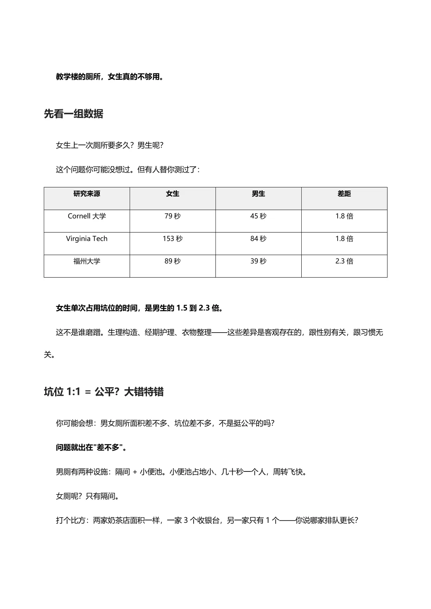
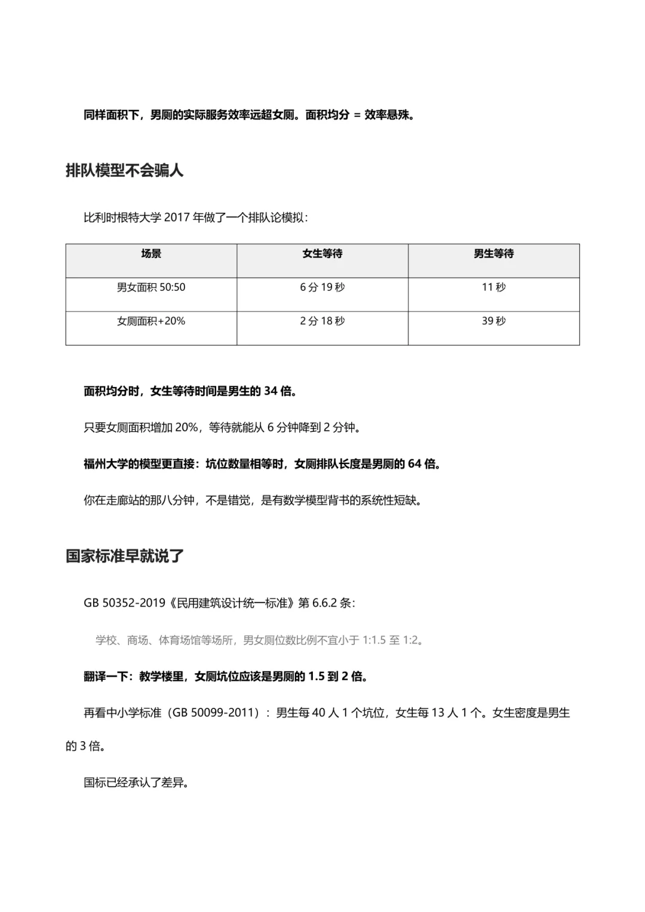
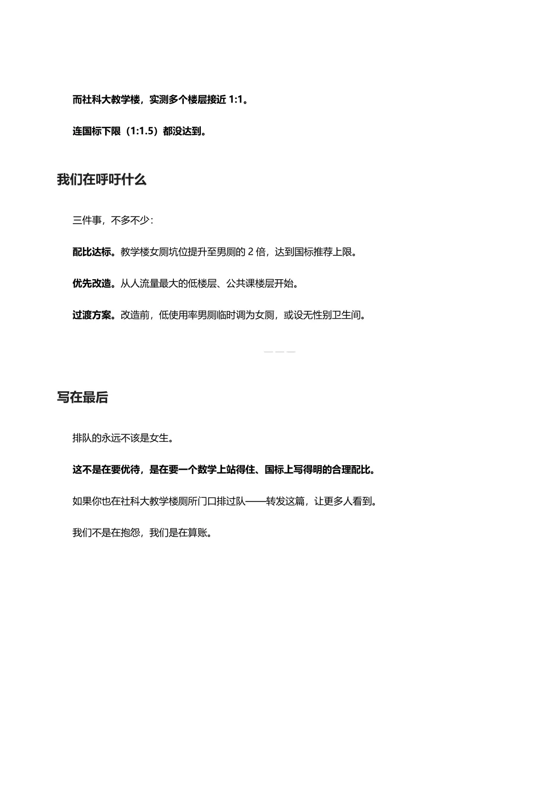
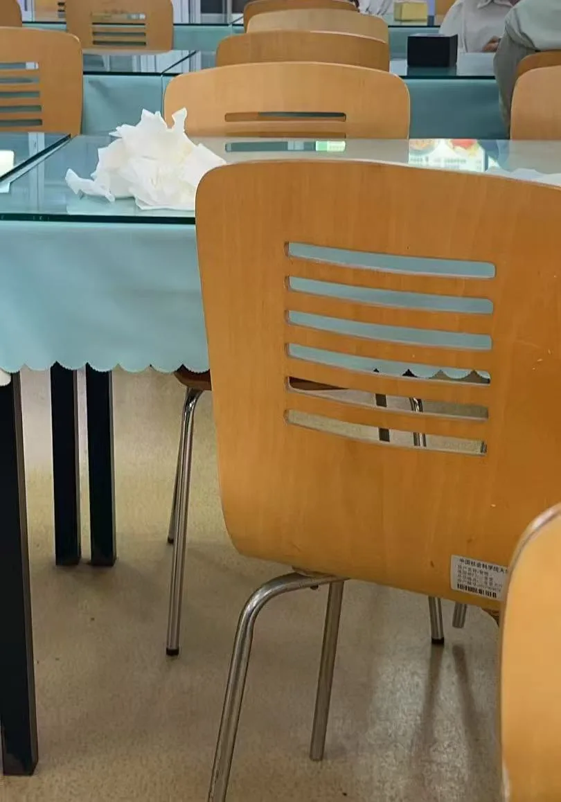
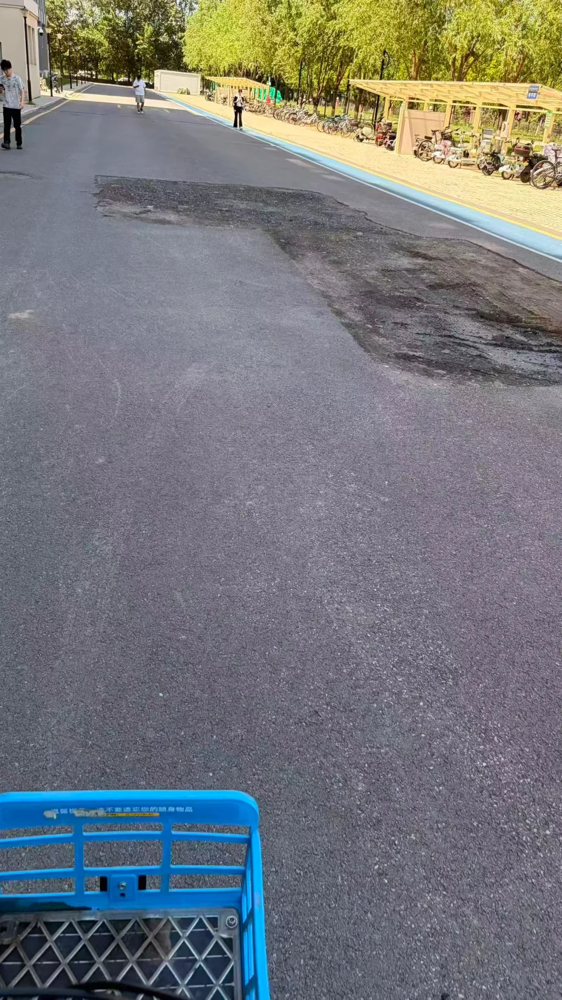
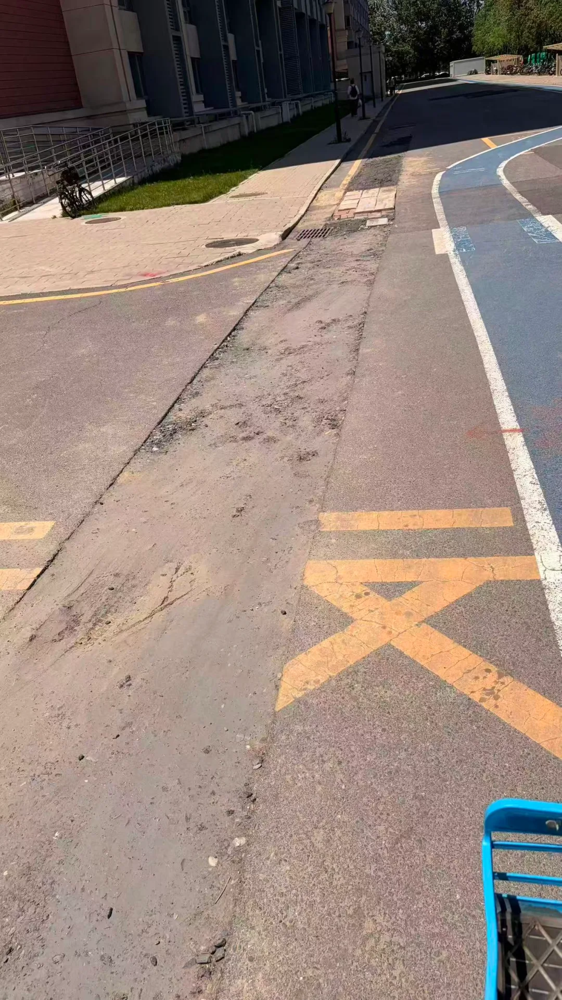

请相关部门及时关注并跟进问题。

## 1 厕所比例问题

## “投稿：

“投稿: 针对上一期的女卫生间问题。首先我是男生，且是研究生。因为在学校的课本身不多，所以本来也不觉得男女卫生间的问题是个很重要的问题。

今天下午在北综合楼蹭了一次本科生课。发现确实存在很严重的女卫生间排队问题。女性因为生理结构问题，厕所利用率远低于男性，这是全社会都存在的普遍问题，是事实。

加之本来社科大的课间有的很短，只有五分钟，我上厕所加接水也有时候觉得时间比较紧。而女同学又面临排队问题，可能会面临抢卫生间，甚至好几个课间无法上厕所的问题。

希望领导莫被同学情绪裹挟，实事求是，深入调研。真诚希望问题得到解决。

天道不公，自然的随机分配造成了现实的生理结构不同。而我们人类步入文明社会的重要标志，正是可以通过我们的智慧来克服自然的局限。性别不应该成为追求生活幸福的阻碍。 我们社科大作为人文之光，可能正是体现在此。”

## 2 公德问题

“投稿：5月28日早上一位同学擦了一桌子的鼻涕就这样把垃圾留在座位上，如图。能不能有点素质

”

## 3 修不好的路面

## “投稿，我校路面何时能修好

这些大坑，比校门外的路面先挖开，门外修好了，门内没修好

”

## 4 回应投稿

> “投稿：赞同5月25日第一条；到底是依据什么法定、或习俗规定，一个人或某机构，可以做出禁止别人用非静音鼠标的规定啊？因为个人缘故去要求、强制别人做或不做某件事，这分明就是强盗逻辑。问题的根本不在于什么被打断不打断学习，而是，你有什么权利去告诉另一个同学，你该用什么工具不该用什么工具啊？地球有义务围着你转吗？再一个，上期评论区有位同学其实说到了问题的实质，上课玩手机的时候能精准避开老师的每一句话，图书馆别人点个鼠标反倒影响你学习了？最后，虽然没去新馆学习，但是信息检索区不就是电脑区？？？不准人用鼠标？”

## 5 质问投稿

“投稿：最近校内某个平台流量吃到风生水起，哪怕部分帖子内充斥极端性言论，运营者也一定要咬死咬住这滔天的富贵，一边假惺惺地发帖表示大家可以善用举报键，一边让部分极端发言帖子和其中的极端评论继续存在着。至于运营者自己的态度，有图为证（现改为原文引用形式）：“是的，我觉得也是，先发酵一波流量，看动向明天删帖不迟”：

请问某平台运营者，这是负责任运营者该有的发言吗？该平台在早年推广时，将自己的二维码贴在外卖柜二维码旁边的事情遭到同学们差评的事情，难道这个平台的运营者已经忘记了吗？一个本应方便社科大学生交流的平台，由于追求流量的运营者的个人行为，让这个平台如此不光彩的出圈，实在令人痛心。”

“投稿：部分平台能不能管一管自己的贴子啊，有些实在是脏的不得了的话就完全不管似的，反正一打开真是吓死人。刻意引战的内容该管就得管啊！“

## 6 统一回应

## “近些日子，编辑部后台收到了大量读者的疑问与求助，在此作统一回答：

1.社论平台确实收到过商业合作邀请以及广告邀请，但公众号全部谢绝了，社论平台从创立之初就致力于为社科大师生提供一个可靠的交流平台，从未考虑过进行商业化。至于公众号的营收情况，公众号没有过任何收入，公众号也从来没有开过赞赏等功能选项，因此也不存在所谓营收情况。

2.关于为什么不发布求助类投稿。一方面，公众号不会帮助投稿者之间相互联系，而且目前留言区经常遭到集中举报，暂时还不具备发表求助类投稿的能力。另一方面，目前公众号虽然计划恢复两天一更的频次，但是考虑到大多数投稿的高度时效性，我们无法保证求助类投稿可以得到及时回复。目前编辑部计划在评论区稳定后，尝试帮助发布一下时效性要求不高的求助类投稿，并让可以回应求助者在评论区留言。

3.究竟该如何投稿，如有字数超过200字的投稿，编辑部强烈建议投稿者以稿件的word文档为附件或直接在邮件正文写下稿件的形式，将稿件发送到邮箱中，邮箱地址可见公众号的投稿须知。200字以内的稿件，我们推荐直接在公众号后台留言的形式，也请各位投稿者注意，直接留言就是投稿，如不需要投稿请在留言中说明。

4.对部分短期关注发表辱骂言论后取关者的回应：公众号运营承受多方压力，能够运营至今并获得超过13000名关注社科大校园建设的读者的支持实属不易，希望各位同学们在发表言论时尽量保持克制。如果对编辑部或者社论感到不满，并且想要表达这种不满，可以直接对公众号后台留言说出自己的不满，这样也能给公众号一个改善自身的机会，而不是对运营同学恶语相向，这样除了发泄情绪外，也无法解决任何问题。

5.如果有对社论本身的疑问或者不满与建议，是否可以投稿？答案是可以的，我们非常欢迎类似投稿，如果不想投稿只是单纯想要反馈意见，也可在后台直接留言反馈，对于所有反馈意见，我们都会进行回复。

6.关于社论未来的计划。目前编辑部计划恢复两日一更，并尽快恢复到日更的水平。同时，编辑部正在尽可能拿回原先的公众号名称，请读者们稍安勿躁”
