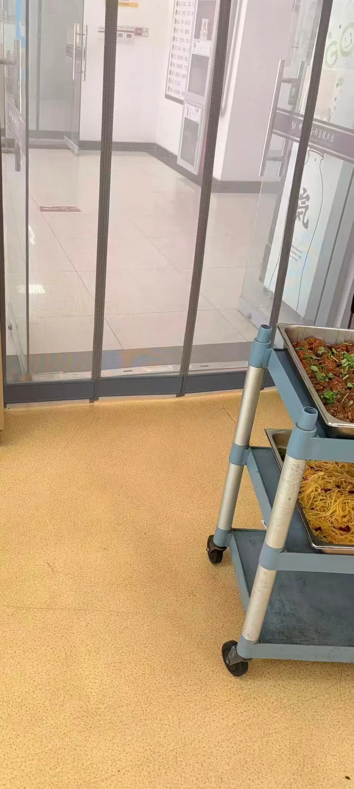

请相关部门及时关注并跟进问题。

## 1 厕所比例讨论呼吁

## “投稿：

我校卫生间不够用的情况是客观存在的，也是学校应该解决的。前两天在某树洞看大家发帖，其实男女卫生间都不够用，并且女卫生间不够用的情况显著突出。

但是卫生间不够用并不是学生的错。因为卫生间问题对同学恶语相向，无区别攻击某个性别的行为并不是一名社科大学子应有的素质。希望大家遇到问题理性讨论。

至于某些一眼反串挑起性别对立的人，请积点德吧，对同学发泄情绪并不能让你的生活更好。”

## 2 论文提交时间

> “投稿：文学院在5月29日下午发通知要求2026年春季学位申请人于6月1日16：00前，在系统内提交“正式答辩后学术规范检测”申请。但是文学院很多同学实际到5月底才完成答辩，距离答辩时间才没几天就要求提供最终版论文，在如此短的时间内要如何按照答辩意见修改？电子版论文之后要存档，应对抽检，对学生和学校来说都意义重大。这个通知毫无征兆，此前文件也未说明，是否太不为学生考虑？希望文学院可以推迟提交正式电子版论文时间！”

”

## 3 二食堂食品安全建议

“投稿，食品安全，自选的饭从后厨过来时会经过这个门帘，而工作人员选择直接将小推车推过去，门帘底部以及接触到食物了，这很不卫生，应该考虑双人作业或者先将门帘挑起再通过

”

## 4 图书馆静音键鼠问题

> “投稿：教综楼图书馆一楼使用有声鼠标的同学已在学生群体中引发广泛不满（可见社科汇与人文之光公众号中大量同学对这位同学的指责和批判），但这位同学并未在图书馆老师任何一次提醒后停止使用有声鼠标，且不以为耻，反以为荣。以这位同学为代表的，在图书馆大声敲击键盘、长期使用有声鼠标的人，会让图书馆规则显得可笑，引发一众学生的效仿，最终使得图书馆秩序变得混乱，同学们学习环境变得嘈杂不堪。事实上，一个个受不了有声鼠标声音的同学不断被迫离开，更多个使用有声鼠标，大声敲打键盘，无视图书馆安静规则的人相继落座，劣币驱逐良币的场景不断上演。如此“使用静音键鼠”的规则只能用来限制有素质、有家教、遵守规则的人，只有“老实人活该被枪指着”，而这位同学这类图书馆（激烈用语已修改，望读者自行体会当事人的愤怒）却能游刃有余地超出规则之外，享受着干扰他人的“特权”。请图书馆予以重视并认真考虑出台有效措施，如记入图书馆违约失信行为，经常性对这类人员指正，或联系其导员，真正制止这类图书馆不文明行为，还学生们一个安静有秩序的学习环境。”
