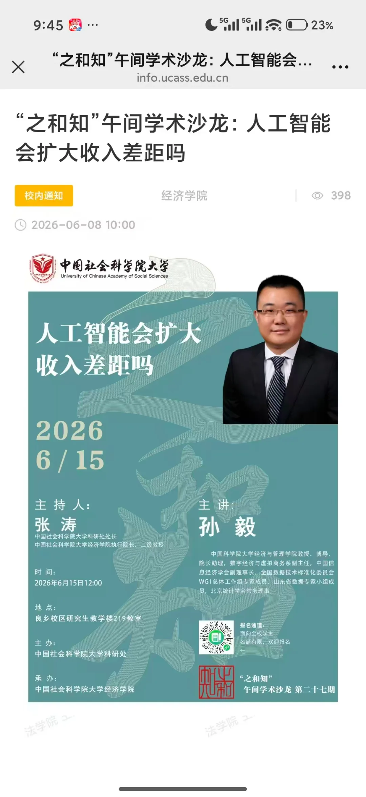
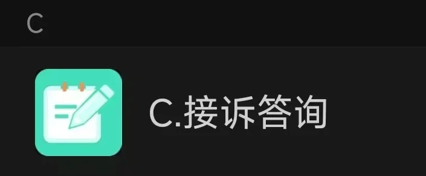
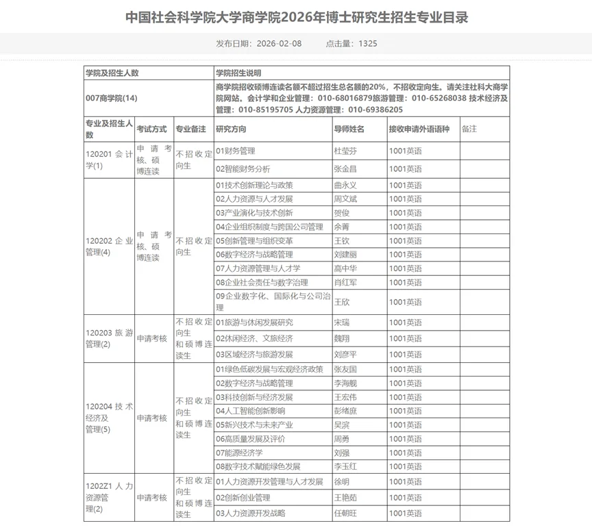
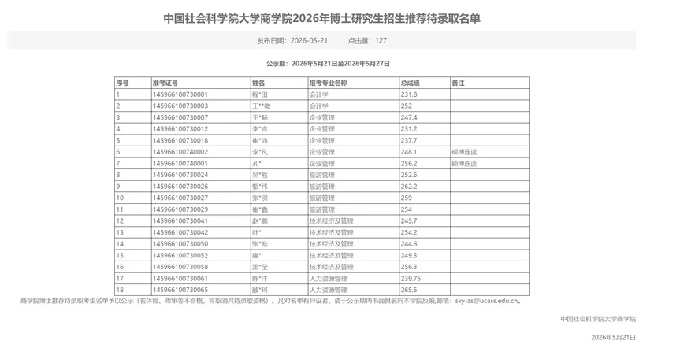
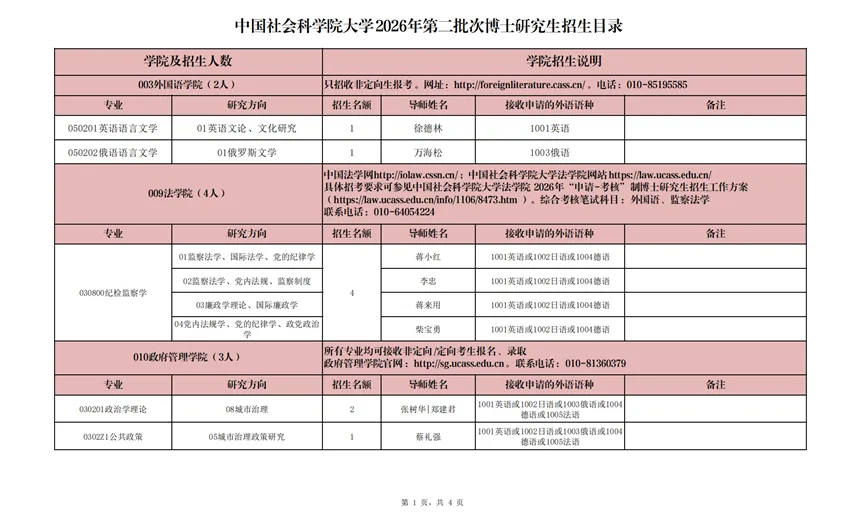
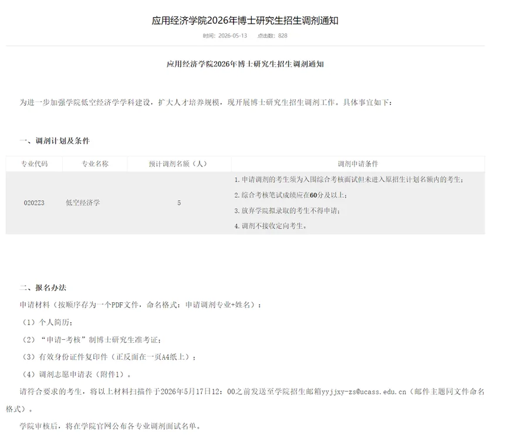
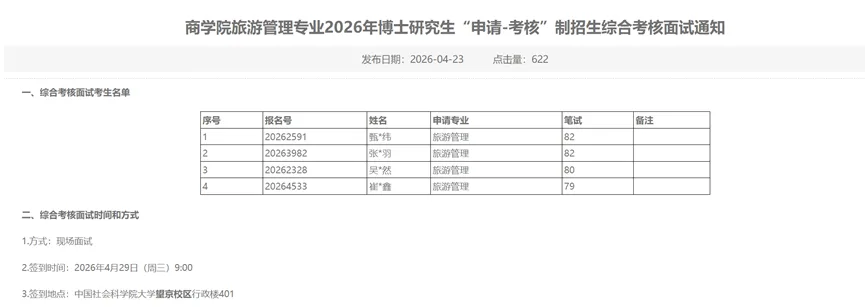
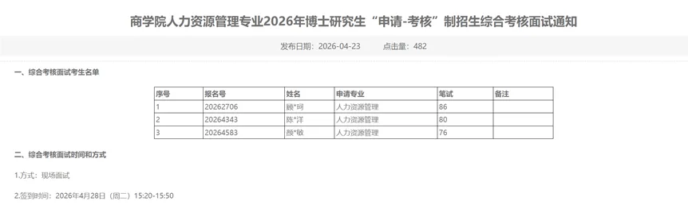
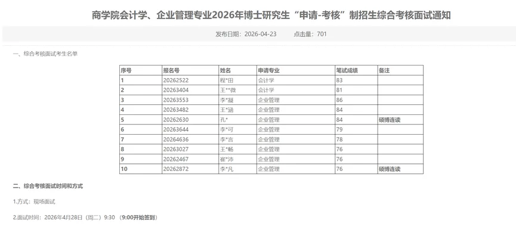
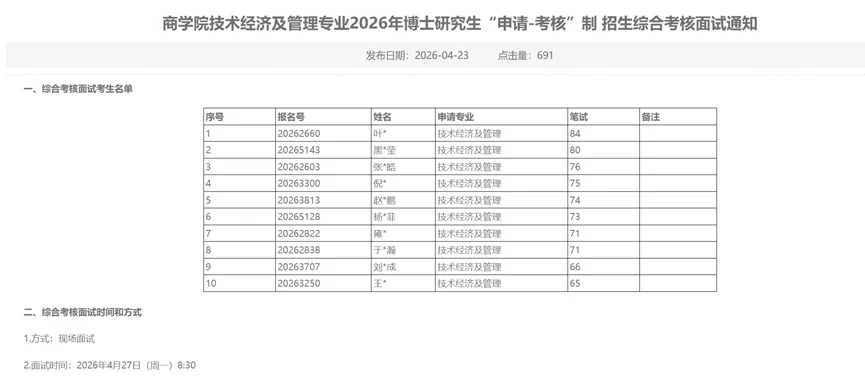

请相关部门及时关注并跟进问题。

## 1 擅闯教室事件回应投稿及后续

## “回复6.6第一篇投稿：

作为课上学生之一，需要澄清一下事实：

原投稿所称“法学院行政老师在场冷眼旁观”与实际情况不符。法学院的行政老师是在第二节课下课时到教室收取签到表，当时该男生尚未进入教室，行政老师收完表后即已离开，全程并未见到该男生，更不存在“视若罔闻”的情况。

恳请大家厘清事实，保卫处的不作为不应由并未在场的法学院老师承担，避免误伤。

。”

## “社论君您好，

今日（6月11日）法学院领导再次来到课堂上解释上周的原委和口头宣读了保卫处的声明。

首先，非常感谢各位领导在繁忙的工作中抽身前来处理这个问题。当时来收签到表的老师平日工作十分认真负责，与那位闯入的精神疾病同学在时间线上也没有任何交叉。我相信所有在场的同学也绝不会错怪这位老师，公道自在人心。也请这位同学看到之后注意自己以后的言辞举止，社论是大家共同讨论如何建好社科大的地方，陪伴学校一起成长的地方，不是发泄情绪的地方。

其次，我认为保卫处在后续处理上仍有许多不妥之处。自己部门工作的失职绝不能推其他行政老师来道歉。法学院的行政领导、老师们平日里有自己的许多工作要忙，难道还要处理其他部门的工作错误之处？更何况当时法学院的领导老师们也不在场，怎么解释得清楚呢？这次的事件不仅对学生来说是飞来横祸，对领导老师们也是无妄之灾，平白无故地增添了工作量。那位同学后来又跑去了行政楼。校园里的危险不仅仅是针对学生，更是针对每一位行政人员和老师们。学校外包了保卫服务，也是花了大价钱的，不能就这么掏钱当冤种啊！保卫处不仅仅该给学生道歉，更要给每一位领导老师们道歉，给法学院和学校道歉。

最后，希望保卫处的各位领导勇敢地承担起自己的责任来，不要躲在别人的身后。从今天的情况来看，大家对保卫处的一封口头带来的说明并不满意。下周就是最后一次课了，期待您的亲自解释。

感谢社论君！。”

“我是上周四发生某学生擅闯教室事件时，当时在教室里上课的学生，那个同学两次闯入教室的时候我都在。我想澄清一下，法学院的教务老师来到教室查课的时候，那个学生已经走了，并没有碰到。

。”

## “保卫处，“你（们）”到底在干什么？

看了6月6日社论中同学们的“吐槽”，深感触动。事实上，类似的问题在日常校园生活中并非孤例。作为校园安全与秩序的管理者，保卫处肩负着为全校师生营造安心、有序学习和生活环境的重任，师生们对此一向抱有信任和期待。但以下几项具体工作，确实让人质疑贵处的工作成效。

第一，关于课堂与校园秩序的维护。

6月6日的“【读者投稿】《良乡精神病人》”一文所描述的情况，已在校内引起广泛关注。事件中相关人员的言行明显扰乱了正常的教学秩序和校园管理秩序，而现场身着保卫处标识的工作人员却未能及时有效处置。师生们不禁要问：当校园秩序受到明显冲击时，保卫处的职责边界究竟在哪里？如果“在场”却不“作为”，那么这种“在场”本身的意义是什么？难道就是“录像”和“看护”？

第二，关于校门闸机管理的执行标准。

今年3月，由于相关特殊情况，出于校园安全考虑，学校启用了大门防撞设施，对校内外车辆及人员的进出管理进行了优化调整，严格了入校流程。这项措施得到了师生的普遍理解和支持。

但执行层面的现实却让人感到困惑。不少同学目睹部分与在校园三门执勤的安保人员相熟的校内工作人员（不乏保卫处个别老师、保安队负责人、后勤相关人员等）进出校门时不用刷脸或刷卡，闸机往往在来人尚未靠近时便已自动开启。与此同时，大量学生即便刷脸验证通过，闸机仍不予自动开启，经反复说明后仍被要求出示学生卡或电子一卡通方可放行。

我们愿意相信系统调试存在技术周期，但如果闸机对某些人可以“自动识别”、对另一些人却“必须人工复核”，那这套系统的公平性如何保障？师生的配合、遵守换来的是双重执行标准？

第三，关于电动自行车通行管理的技术落地。

2025年6月，保卫处发布通知，要求校内电动自行车全部进行注册登记，并亲自为已登记车辆统一张贴了“小院电动自行车身份证”。这项工作本身体现了管理的规范化方向，值得肯定。

然而，自今年3月以来，大量已登记、已贴码的电动自行车在出入校门时，系统仍频繁提示“车辆未授权，禁止通行”。既然已经完成了信息采集和标识张贴，识别设备却无法读取有效信息，那么前期登记工作的实际效用何在？这种“已注册登记、警报仍响”的体验，消耗的是师生对管理工作的耐心与信任。

更令人可悲的是，有同学无论是通过“接诉即办”平台反馈，还是与保卫处相关负责人、老师及安保人员面对面沟通，反馈者得到的答复始终是“正在解决”或“此事我解决不了，已向领导反馈相关情况”。但截至今日，问题依然如故。一项技术调试或数据同步工作，真的需要如此漫长的周期？

第四，关于东门停车区域的规划承诺。

东门外侧自行车及电动自行车停放区域，是贵处自行划定且通告全校的。但从去年9月以来，同学们在该区域停车时屡遭东门值班安保人员阻拦，被告知“最新规定”此处仅供不能入校的机动车辆停放，非机动车需“换个地方”。问及具体可停放位置，得到的答复是“停哪都行，就这里不行”。

如果划定的停车区域可以因未经公示的“口头新规”而随意变更，那当初划定的依据和严肃性在哪？去年10月，已有同学通过“接诉即办”反映此问题，保卫处当时的回复是：“收到，感谢您的建议。忙完这次大项活动，我们会重新规划门口停车区域。”如今大半年已过，所谓“大项活动”是否已经结束？门口停车区域的重新规划，是否已被列入工作日程？

以上四件事，件件有事实，事事有反馈记录。它们都不是复杂的高难度工程，而是管理链条中执行闭环的断裂。保卫处的每一位工作人员，都拿着学校发放的薪水，肩负着守护校园安全的重任。贵处的职责是“保卫”，保卫安全也保卫公平；保卫秩序也保卫师生对学校的信任。我们不奢求你们把工作做得尽善尽美，只希望你们能够认真履行自己的职责。你们工作的初心就是为师生排忧解难，而不是给师生添堵；就是为校园保驾护航，而不是让师生感到失望和无助。师生们并非苛责，也理解保卫处工作的繁杂与不易。但“理解”不等于“接受”，“有难度”不能等同于“不解决”啊！

我们期待的不外乎两点：要么，把能力范围内的事认真做好，通过“办好说清”，干条式的列出来，让师生们都知道你们将会怎么干；要么，对暂时无法解决的问题，给出明确的时间表和责任人，而不是无限期的“正在处理”。

校园是大家的校园。希望保卫处能够正视诉求，拿出实际行动，管理的温度与效率，全体师生都在看在眼里，记在心里。

。”

## 2 大创评审质疑

> “投稿：大创能不能公示一下评委信息？参与答辩的有些评委显然缺少相关学科的基本训练或认知，提问时也很随意，态度很不认真。能不能换专业、负责一点的人？以及以后可不可以不把一堆毫无关联的选题放在一个组里评审？”

”

“投稿：大创答辩的评委普遍知识水平不高，十分业余，不排除有一些人全程摆烂，只是为了装而装。”

## 3 保卫处工作建议

> “您好，想反馈一下校门口车辆登记问题。
 
 总看到南门保安风里来雨里去给进出车辆进行纸质登记，有时候多辆车要进校门就会形成门口拥堵。之前开车进校门是亮出证件即可，现在不仅在原有的升降杆外加了升降石墩、不停移来移去的警示三角锥，还要纸质登记，理解这个规定是要加强安保，但效率和人力的折损也不小，希望相关部门能避免把所有工作量一味堆叠给最基层员工的工作方法，提升进出校门的效率以免堵塞门口大路交通，保障行车安全”

## 4 毕业典礼时间问题

## “投稿：请问学校什么时候发学位服，离毕业只有半个月了，早点发还能错峰拍照。”

## “投稿：请学校尽快公布毕业典礼的具体日期，为什么到现在还没消息呢？。”

“提问，毕业典礼什么时候召开是一件很机密的事情吗？学位服也迟迟未发，很好奇是什么耽误进程”

## 5 通知穿越时间问题

“学校这个讲座时间是穿越了吗，有两点迷惑的地方:1，通知是九点二十多发的，但上面时间显示十点。2，讲座报名时间九点开始，还早于通知时间，点进去已经是报名满了。

”

## 6 蜜雪冰城有关

> “今天下午在校内蜜雪冰城因线下排队支付而非小程序下单被店内人员斥责辱骂，晚上听班上几个女同学也说遇到线下支付被辱骂，所以决定要发出来。希望蜜雪冰城如果不接受线下支付就请提前发出正式通知，不要让学生跑去排完队买不到东西还得被辱骂。另外，这位工作人员也是女性，麻烦也尊重一下女同学，坚持男女平等，不要对男同学正常而对女同学呵斥。”

“我们服务人员已经这么忙了，还有很多同学要来线下下单，还在店里排队。大家都在努力的活着，学生能不能体谅一下我们？店里就有小程序二维码，以后请多用小程序下单。”

编者注：本稿件为疑似蜜雪冰城服务人员投稿，并没有随附身份证明，请读者们注意辨别

## 7 二食堂厕所禁烟方案

“我校二食堂男厕所烟味泛滥问题已成为长期顽疾，虽经多人多次反应却始终未能根治。师生每次进入如厕，都会不可避免地沾染一身浓重烟味。

经观察，该问题主要源于食堂工作人员缺乏合规的吸烟场所，只能选择在厕所内违规吸烟。为从根本上解决这一矛盾，特提出以下两点切实可行的建议：

1、在食堂周边室外划定专门吸烟区：明确标识并配套烟灰缸等设施，引导食堂员工到指定区域吸烟，既尊重其个人习惯，又能彻底阻断二手烟对公共区域的污染。

2、在厕所内安装高功率排风系统：对现有通风设施进行升级改造，确保能快速、有效地排出室内烟味，最大限度降低二手烟残留对后续使用者的影响。

食堂是全校师生每日必去的公共空间，其环境质量直接关系到每个人的切身利益。呼吁学校后勤管理部门高度重视，尽快采取有效措施，为全体师生营造一个无烟、健康、舒适的就餐与公共卫生环境。

”

## 8 表扬二食堂

## “投稿：二食堂3号窗口的抄手很好吃，如果有肉多、量大的价位选项就好了。”

## 9 接诉即办为何改名？

“试问社科大，为何接诉即办改名“接诉答询”？难道是社科大各部门已经只剩下了问答的口闲，不剩办事的态度了吗？

导师提醒我们，我们切不能做“思想的巨人，行动的矮子”。社科大此平台的改名，我是百思不得其解。若是社科大失去了“即”的效率与“办”的底力的话，恐怕是要让学子在失望中变得更失望。懂了，可能人文之光社论的诉求办的大抵比接诉即办快要，不人文之光社论改名接诉即办算了。

”

## 10 致招生办

> “投稿：社科大能不能别毫无底线扩招和招调剂啊？太拉低学校档次了，一直保持小而精、宁缺毋滥的录取原则才能守住品质啊，尤其对评双一流之类的各种评审，要摆出你的含金量啊，能不能控制一下生源？！”

## “尊敬的招生办：

您好，

本人看到贵校商学院博士研究生招生推荐待录取名单，有以下疑问：

1.招生名额问题：

（1）商学院招生专业目录公布的招生人数与当前推荐待录取名单中实际招生人数不符，并无任何相关公告告知所有考生，即使有调剂或扩招名额，考生们也完全不知情，扩招名额从何而来？扩招名额分配的专业和候选考生是否内定，所以没有重新组织针对扩招名额的面试？扩招是否存在徇私舞弊的情况？

（2）在咨询相关专业导师、招生负责人后被告知贵校商学院所有专业进入面试比例严格为1：2，最初公布的面试名单也符合招生目录公布的招生人数比例，但当前待录取名单中，会计学专业、旅游管理专业甚至存在最终录取名单人数和面试通知人数相等的情况，差额面试变成了等额面试，差额录取变成了等额录取，也无任何公告通知考生这两个专业的面试比例从1:2变成了1:1。同理，人力资源管理专业面试人数为3人，最终录取2人；企业管理专业面试人数为8人，最终录取5人，亦存在录取人数与进面人数比例小于1:2的情况。

（3）按照贵校商学院进入面试的相关规定，最终会计学专业录取名额为2人，企业管理专业录取名额为5人，旅游管理专业录取名额为4人，人力资源管理专业录取名额为2人，分别应有4人、10人、8人和4人进入面试。而当前商学院存在先削减进面人数，后以未公开理由录取超出原招生名额的进面考生，存在对非进面考生严重不公平的现象。

（4）此外，参考贵校《中国社会科学院大学2026年第二批次博士研究生招生目录》，其他学院在有调剂名额的情况下，均公开相关信息并重新组织对调剂名额的审核和面试，所有符合相关要求的考生均有资格报考，而商学院完全没有任何公告或公开信息，直接公布了扩招后的推荐待录取名单，招生流程不公开不透明，难道报考贵校商学院的考生连最基本的知情权都要被剥夺吗？

2.面试名单问题：

贵校商学院“申请-考核”制笔试结果公示期为2026年4月22日至2026年4月26日，在公示期未过的情况下各专业均在2026年4月23日公布面试名单，是否存在招生流程不规范？

希望贵校严格审查以上招生流程中存在的若干问题，并正式公开告知审查结果，尊重每一位考生的信息知情权，给予每一位考生平等的考核机会。

。”
