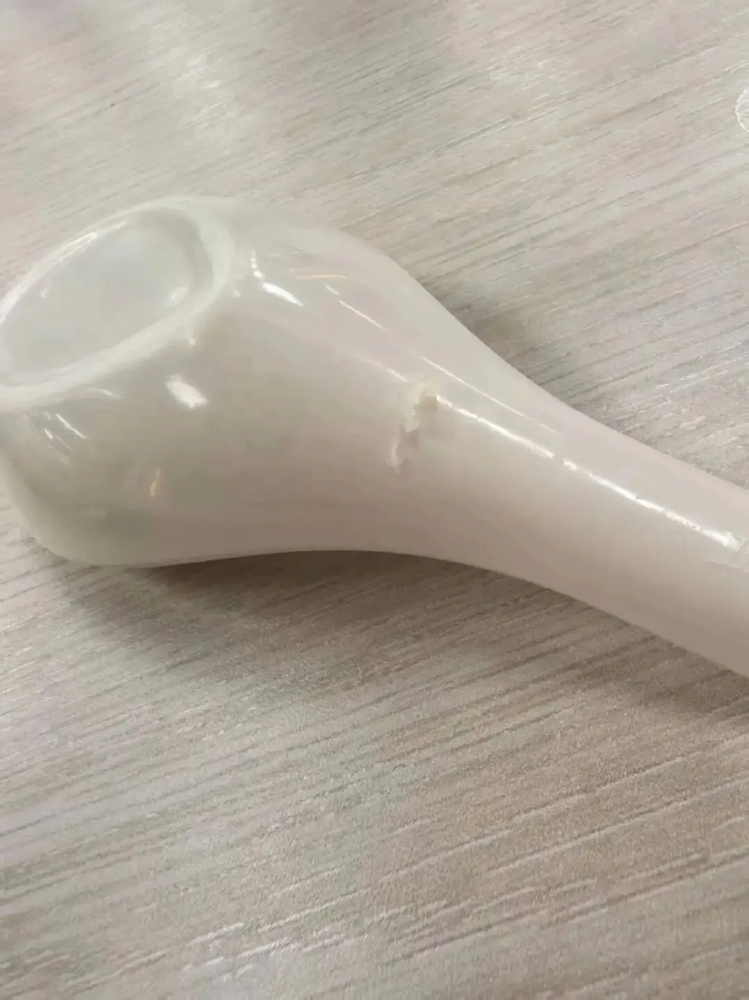

请相关部门及时关注并跟进问题。

## 1 本科招生

## “今年到一省份进行本科招生宣传的工作，想把遇到的事情和大家分享一下。

在招生宣传的时候，有一位妹妹表达出对于学术研究特别强的兴趣，她自己在该省的位次和我们往年招生位次比较契合，在最高分和最低分数区间内比较偏高，她自己做过初步考察，主要是在纠结某综合文理见长985高校和我们社科大。

当时了解完她的情况，一是作为学校的工作人员希望学校能有好的生源，这样利于形成越来越好的良性循环；二是考虑到她的专业兴趣和深造意向，来社科大就读至少在学科建设和学术培养上不会让她不满意，所以就着重地向她介绍了我们的情况，她听完分析后报考意向也特别强烈。

等晚上工作完在住处刷小红书，我对照了一下基本信息可以确认刷到的第一篇推送帖子就是她在两小时前发的，是在咨询该如何在这所985高校和社科大之间做选择。评论区有很多人结合这位同学的客观情况做分析，说得都比较中肯。但刺痛自己的是评论区很多条发言是“自己是社科大的推荐不要来社科大”等内容。最终投票结果是985高校胜利并且这个妹妹也说确定优先报考这所985高校。

我确实不确定上面自称社科大的同学能对这个投票结果到底有多大的影响，但是从情绪上来说真的感觉还是有些失落。一方面是自己个人情绪上的挫败，当时顶着大热天讲得口干舌燥，这些努力就这样被对冲了。另一方面也有些想不开，学校真的差到让大家在招生季这么重要的节点亲自推荐别人不要来我们学校吗。

现在的话语里经常会提到一个学校的博士生是不如本科生的，我属于博士生的行列，自己确实没有多优秀，曾就读的学校也不是985，不太了解985高校的情况。但就自己曾在三所高校上学的体验来说，每个学校各有特点优势和不足之处。就我们学校的情况来说，我旁听过本科生课程，感受是我们学校课程内容水分相比较而言已经很少了。基础建设上可能没有那么好，但总体生活保障还是可以的，有问题基本都能得到回应和解决。

但目前直观的感受就是有些社科大的同学没有在评论区客观做分析，反而是直接评论“别来”，感觉这种唱衰的论调挺不好的，真的情绪上有些挫败。之前有关注到我们一些同学在担心我们学校的本科生分数线逐渐下降，这当然和学校自身各种条件密切相关，但我也很难说和社交媒体上这种评论区的声音完全没有关系，在这个时代，网络和社交媒体上的信息对决策有很大影响力，高分考生也会互相沟通，我们在有些省份的招生名额就那么十几二十个，高分生源的流失对我们的影响说实话挺大的。

所以我就在想，有没有我们本科社科大的同学考研考博到别的985学校，真实地说说我们学校到底哪些地方好哪些地方差。也因为自己兼有招生工作人员和本校博士生的双重身份，希望借助我们平台呼吁大家可以多平衡地分析，而不是在社交媒体上做那种“一刀切”式的评论了。”

## 2 图书馆

## “问题反映：学校教学楼的标识设置不清晰，尤其是教学综合楼。

事件：例如6月12日的午间沙龙讲座设置在教学综合楼205，到教综楼后2楼没有清晰路标，反复寻找，最后咨询保洁阿姨才得知这边进不去，得下去一层从图书馆进。很无奈。

建议：除了本校学生，尤其是新生，外校师生、嘉宾也可能经常到校参会、参加活动，经常会在路上遇到问路的人、找教室的人，学校在路标指示这块儿尤其是新开的教综楼这块确实还有较大提升空间。建议增设指示路标，尤其是像写着教综楼205实际要从图书馆进这种错神经的地址。

到了图书馆之后不好容易找到了205，结果被现场保洁告知205没会，可能改到了405…又要从图书馆下去，图书馆和教综之间明明有一个通道，工作人员可以刷门禁进出，但尽管发生这种事了依然不给学生开门，甚至开了看到学生来了就马上关了让原路进出…太无语了

后来得知是因为报名参加讲座的人数过多，所以临时把讲座地址改到了教综405，地址变动的通知在讲座群内发了，但很多看到海报没进群的同学或者进群了没注意的同学依然走错地点。”

## “投稿：良乡校区主图书馆插座对不上

其他的座位没有试过还不确定，中文第二阅览室靠墙这边的桌上插座安装的有点低了🥲，电脑充电器的插头没办法使用，只能给整个台灯的插头拔掉用原来墙壁上的插座使用… 如果高度可调就好了，没有抱太大希望更换重置，毕竟工作量太大。所以就提醒大家如果电子设备的插头像这样的话就不建议在老图书馆这边自习/学习了（教综楼的图书馆高度合适，可以边开灯边充电）”

## 3 摆渡车

> “学校能不能增设去良乡站的班车？现在小火车班次增加，基本覆盖了全天的各个时段，后续肯定是学生进城的重要交通方式，良乡站距离学校打车五六分钟，学校班车如果能开通的话，基本可以实现无痛进城。希望学校各相关部门和领导能回应这个问题，感谢！”

## “关于增加良乡校区校车班次并延伸至房山东站的建议

近期，北京市市郊铁路房山东站即将开通，为良乡地区师生进出中心城区提供了新的交通选择。房山东站投入使用后，如果学校校车能够与市郊铁路班次形成有效接驳，将明显改善良乡校区师生进城上课、办事和通勤的出行条件。

目前，良乡校区校车班次整体偏少，即使是前往广阳城地铁站的接驳车，开行频次也较为有限，难以充分满足师生日常出行需要。良乡校区距离中心城区较远，师生进城通常需要较长时间换乘。尤其在早晚高峰时段，地铁客流量较大，通勤压力明显，现有校车安排对师生出行的支持仍显不足。

因此，建议学校增加良乡校区校车班次，并结合房山东站开通后的实际情况，将部分校车从广阳城地铁站进一步延伸至房山东站。特别是在市郊铁路进城方向列车发车前后，安排相匹配的接驳校车，使师生能够更加方便地利用市郊铁路进出城区。学校如能及时优化校车安排，增加班次、拓展接驳站点，将有助于缓解师生长期以来进出城区不便的问题，也能更好体现学校对良乡校区师生学习生活实际需求的重视。

恳请学校相关部门予以研究，并尽快改善相关校车安排。”

“铁路房山东站已开通（7月1日），每日将有18列火车往返，频率大大高于之前的良乡站，距学校也更近。希望学校之后可以研究考虑试开行去房山东站的摆渡车。”

## 4 校园空间

“7.6一大早望京校区就很热闹，还以为是哪位领导来了。结果一打听，是某校友的孩子在中戏读书，毕业作品选在了望京校区拍摄。

这就不说了，不知道是演员还是什么的一男一女，前面几步就是报告厅垃圾桶的吸烟区，人家非要在对面一排空调室外机的区域抽烟。那个区域是校区总配电室，知道的人都不会在那抽，一看就不是本校的。

在这个校区这么多年，抽烟不是好事但很多抽烟的同学老师都规规矩矩在该抽烟的地方抽，你一个外校的就能搞特殊是吧？什么级别的作品不在本校拍非得找一个外校拍？什么级别的校友孩子可以不守规矩在学校重点地带抽烟？”

## “老师没有噪音特权

6月22日一位教师携带幼龄儿童在教室内进行有声学习，建议移步至其他适合有声学习的区域后，该老师拒绝配合，声称"教室又不是个人的，我就要在这里说话怎么了，你受不了就去别的教室"；在本人提出期末复习希望体谅后，又称大学生这点压力都受不了云云，并质问本人专业，最终仍然坚持进行有声学习。我认为这位老师不妥之处有以下几点：

一、偷换概念，将他人不能忍受噪音称为“抗压能力差”，实为为不文明行为狡辩。

二、滥用公共空间，以“公共”之名行自私之实，侵犯他人安静使用权。

三、师者失范，缺乏教师应有的示范作用。社科大的学生大部分都可以做到在教室里尽量安静学习，如有其他需求移步，为什么最应为人师表的教师不可以呢？

四、缺乏同理心，漠视学生期末压力，背离教育者关怀本职。

期末周时期，希望这样的事情不要再发生了。”

## 5 毕业工作

“想问校领导怎么理解教育部41号令第六节第三十二条的？知不知道最高法田永诉北科大指导案例？你们自己规定的“办完离校手续可到学院领取毕业证”程序正义吗？是不是办不完离校手续就不给发证？

我一完成了所有学业，二没有拖欠费用，凭什么得等我办完离校手续才发证？单位等着毕业证办入职，现在卡在离校流程拿不到证，严重耽误就业！

我不是不愿意配合完成离校各项手续，但不能把后勤离校手续当成发放毕业证的前置条件。

既然学校违规卡毕业证，大家也不用就业了，档案也不用转了，也别退宿了，就在学校赖着吧，希望校方依规区分毕业资格和离校行政手续，先正常发放毕业证！”

## “校友卡审核一直不通过”

## 6 教务问题

> “投稿：为什么每一年教务处到预选的时候课程大纲都不能审核完成。看看现在一大半课程大纲还没上线，哪里便利大家使用了。简直很扯淡的事情。正选的时候，竟然有的课还没显示老师，荒唐可笑。”

“到选课季还是觉得有些事情实在是难评。我们的培养方案每年都在改，但总感觉选修课很多情况下是摆设。有的学院有的课，请教务处自查，一年一年写在培养方案里，一年一年开不出来。偌大的社科院，找不到合适的老师来上。明明有专业对口的老师，就是不去想办法请来。一次一次岗位教师聘了几轮了，真正来上课的有几个？真正按照规定上够课时的又有几个？必修课又有多少岗位教师来参与，自己清点一下就知道。

培养方案和教学规定依然是形同虚设。这两学期某些学院已经写到课表里的课，选课几天之后又删掉，这又是什么意思——可见执行效率有多低下，科教融合的成果又在哪里？这个课到底是开还是不开，能不能想办法开出来，而不是一年一年挂在培养方案里哄骗学生和审查方案的专家。”

## 7 食堂问题

> “一食堂拿出的一个勺子，如果没看错的哈，上面粘着一个干巴巴还走了形的米粒（摸起来很硬）。刚蒸好的米饭是不可能这么干的，所以这只可能是餐具没洗干净的残余。我不明白，这既不安全，还很恶心，让人怎么吃得安心？”

