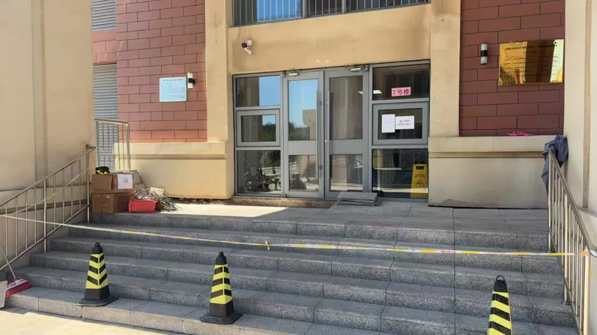

请相关部门及时关注并跟进问题。

## 1 二食堂商铺问题

“近期，因学校后勤运营公司发生变动，食堂内两家长期以来深受广大学生认可与喜爱的餐饮商户被迫停止经营并撤离校园。此消息在学生群体中引发广泛关注与强烈不满。

事实陈述

1. 上述两家商户自入驻食堂以来，始终保持稳定的菜品质量与服务水平，是食堂内客流量最大、学生口碑最佳的两个窗口，有长期的就餐数据与学生评价为证。

2. 两家商户定价合理、分量充足，符合学生群体的消费能力，是众多同学日常就餐的主要选择。

3. 本次商户退场系后勤公司变动所致，非因商户自身经营违规、食品安全问题或学生投诉而被要求撤离。

4. 截至本文发出之日，学校尚未就此次食堂商户调整事宜向学生群体发布任何正式说明，亦未公开调整的依据、流程与后续安排

我们的质疑

我们理解学校后勤管理涉及多方协调，但以下问题必须得到回应：

其一，决策程序是否正当？ 食堂服务的直接对象是全体学生，涉及学生切身利益的重大调整，为何在决策过程中未听取任何学生意见？学生的知情权与参与权体现在何处？

其二，评判标准是否合理？ 商户的去留，究竟是以学生的实际就餐选择与口碑为依据，还是仅以后勤公司的内部商业安排为转移？一家被学生用每日排队长度投票选出的优质商户，为何反而成为被淘汰的对象？

其三，信息公开是否到位？ 此次调整的决策主体是谁？评估标准是什么？是否存在招标或遴选程序？学生有权知晓，而非在商户即将撤离时才被动得知。

其四，学生权益是否被纳入考量？ 后勤公司的更迭，不应以牺牲学生的就餐质量与选择空间为代价。学校作为后勤服务的委托方与监管方，是否尽到了维护学生权益的职责？

我们的诉求

基于以上事实与质疑，我们正式提出以下诉求：

1. 公开说明：学校后勤管理部门应就本次食堂商户调整的决策依据、评估标准与后续安排，向全体学生发布正式书面说明。

2. 重新评估：引入学生代表参与此次商户调整的评估过程，将学生就餐数据、满意度评价等纳入商户去留的核心考量指标。

3. 保留优质商户：在新的后勤合作框架下，为上述两家学生公认的优质商户保留经营席位，或提供合理的续约与入驻通道。

4. 建立长效机制：今后凡涉及食堂商户重大调整，须提前公示并设立学生意见反馈期，确保学生的知情权与参与权得到制度性保障。

结语

食堂不是单纯的商业场所，它是学校公共服务的重要组成部分，直接关系到每一位学生的日常生活与切身利益。一家优质商户的离开，损失的不仅是一个就餐窗口，更是学生对学校后勤管理的信任。

我们并非反对正常的后勤调整，而是反对不透明、不听取学生意见、以牺牲学生利益为代价的调整。我们相信，学校有责任、也有能力在后勤公司更迭的过程中，守住学生权益这条底线。”

## 2 接诉即办尚在否

## ““接诉答询”是否已沦为“接诉不办”？

——惜字如金，也不应稀缺责任

近日新二食堂与新热水系统的种种问题都将后勤处推上了社科大校园舆论的风口浪尖，而作为学生直接与学校官方沟通的平台“接诉即办”改名为“接诉答询”后，学生往往要发出这样的感慨：“‘接诉答询’，难道是意味着‘接诉不办’吗？”

例如就近日二食堂、新水系统的提问（见下图，图片来源于群聊），后勤处惜字如金的回答方式令学生们难以接受：有问题，不应该摆事实讲道理吗？学生提问后一不见事实，二不见解决措施，仅用程序上的合规来搪塞、回避学生提出的问题。如果接诉答询已经是一个“打太极”的平台，那学生又有什么理由通过这个平台来沟通你们呢？

顺带一提，不知道为什么在“诉求列表”里进行检索时，只能检索到已回复的“我要表扬”，其他检索内容，特别是与“我要答询”“我提意见”相关的内容，只能看见自己提的，是看不见别人提的。不知这是小程序bug还是某种掩耳盗铃作风？希望有Bug趁早修，不要让失望再成为愤怒。”

## 3 休假小建议

“投稿：目前很多高校以适当调休的方式，将中秋国庆中间的三天连起来一起放，避免了学生的来回奔波，希望我校也可以参考这种做法，将中秋国庆连起来放个小长假。”

## 4 对基建处的质问

“投稿，基建处一个假期都在干什么？开学了开始修宿舍楼门口了，直接把7号楼东边堵上了，学生还得绕一圈绕道西边才能上楼。简直是懒政怠政，平时不作为，新生不来，校内道路修了两个月，新生一来，围挡撤了路平了草打了，就会在新生家长面前装样子

”

## 5 形式主义班会

> “投稿：大家都30岁的博士生了，学校的班会能不能尽量精简，需要大家一起商讨的班级事务大家就直入主题，不属于班级事务的事情，大家又不是幼儿园小朋友或者小学生，能不能别动不动就汇报这汇报那的啊。”

## 6 社科大填词

## “《我的社科梦》

80平米的宿舍

还有三个温柔的好室友

评优能顺利全通过

毕业就有好工作

每天房山线很通畅

没有早晚交通高峰

天天去良乡过生活

看繁华的街道

我能科研 还有时间

去院部部委 历史研究院

我逛商场 我去朝阳

这样的日子好悠闲

师生的关系很友善

从来不发什么社论

本科毕业不差钱

有就业来兜底

这就是我的社科梦

它很小也很普通

我不求变成龙和凤

我只想活在幸福中

这就是我的社科梦

它很简单也容易懂

踮起脚尖就能够到

不是悬在半空中

人人遵守有关

作弊都会有处分

食堂好吃吃得便宜

顶级大学五年就能评上

就业率 很坚挺

毕业生腰板很硬

机会相对很公平

不管是干部还是普通同学

这就是我的社科梦

它很小也很普通

不求变成龙和凤

我只想活在幸福中

这就是我的社科梦

它很简单也容易懂

踮起脚尖就能够到

不是悬在半空中

这就是我的社科梦

它很小也很普通

我的要求它不算高

但也没想象的那么轻松

为了我的社科梦

我必须要有行动

做一个勤劳的大卷B

幸福才能揽入怀中

这就是我的社科梦

它很小也很普通

我不求变成龙和凤

我只想活在幸福中

这就是我的社科梦

它很简单也容易懂

踮起脚尖就能够到

不是悬在半空中

这就是我的社科梦

它很小也很普通

我的要求也不算高

但也没想象的那么轻松

为了我的社科梦

我必须要有行动

做一只勤劳的大卷狗

幸福才能揽入怀中

我活的越快乐

我就越爱我的母校

我们一起向前冲

这就是我的社科梦

”

## 7 图书馆文明倡议

“投稿：教综图书馆一楼的沙发区域以及靠近东侧厕所的卡座会消毒清理吗？看到有同学脱了鞋在上面，有点恶心。”
