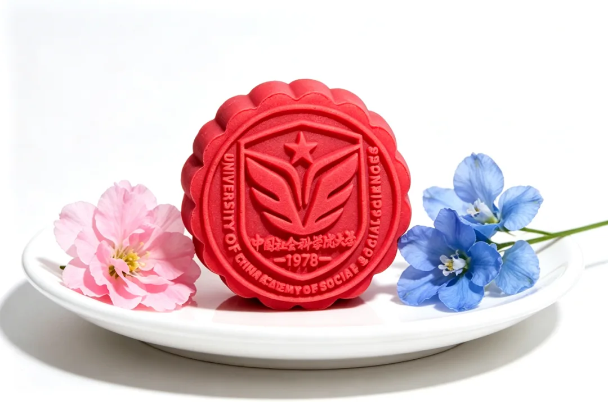
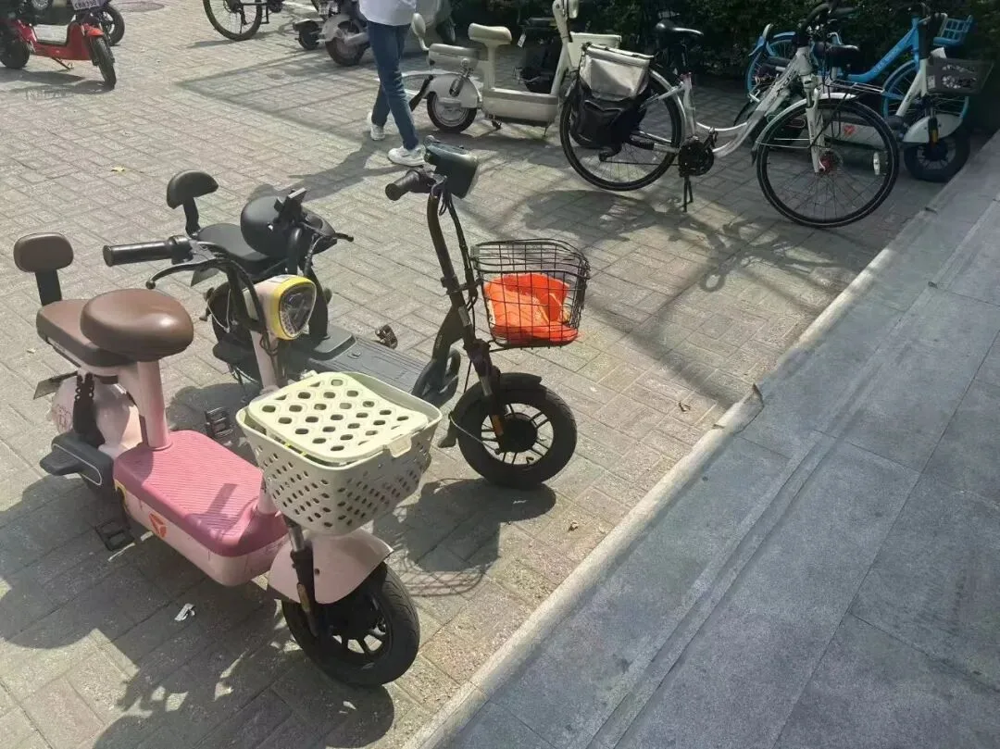

请相关部门及时关注并跟进问题。根据后台收到投稿的反馈与实际情况。公众号决定开放评论区给求助类投稿或寻人类投稿，不收取任何费用，但我们将不接受任何广告内容。我们会将求助类以及寻人类求助内容以公众号评论的形式发在评论区。但需要说明的是，此类求助类以及寻人类投稿，公众号无法为其背书，请同学们注意辨别。

## 1 学工

> “您好，投稿：本科生期末考试成绩存在巨大的错误！请问我们的期末成绩可以复核吗？手改卷登分统计出错不是一次两次了。像马原这样的大班课，老师为了追求效率而批改得迅速且随意，最后导致期末成绩有很大错漏。建议彻底清查期末考试情况，将所有批阅后的试卷返回或展示给同学，同学能够重新复核、统计成绩。手改卷固然是有“做分”“捞人”的空间。这个很好。老师的问题导致改卷错漏频出，凭什么让我们学生买单？马原一两百人的大班，老师红笔一划了事。您省了时间，可我们一个学期的背诵、写论文的付出，就被这么随意地打发了？”

> “泥🐍统筹规划能力的严重缺失，超出预定时间的演讲居然还要配套签到打卡，从早上八点半到场馆到中午十二点，演讲内容篇幅层次不齐，临时起意的活动层出不穷，完全不考虑原有时间规划，耽误学生行程，以心理咨询为主题的发言完全不考虑在场学生的情绪感受，完全让人无法理解此演讲的意义是什么。是为了让食堂更加拥挤激发老生和新生的矛盾？是为了让新生在入学不到一周的时间里接受贵校的服从性测试？还是单纯想挤压新生的吃饭时间，让新生在下午军训的时候晕倒？作为一所以人文之光自称的学校，泥🐍今天的操作真的令新生失望”

> “新生提问，想知道学校社科汇平台是学校组织还是学生或是校外自营的？开学看到有线上线下大量宣传，二食堂都有摊位，还以为是官方的，点进转发的卖月饼链接看到月饼校徽是错的，如果是非官方运营学校是不是应该规范一下给个说法？这样冒用校徽是不是不太好，背后运营企业“北京责任之石网络科技有限责任公司”也像是针对社科大的”

## 2 专硕

## “投稿：

《社科大新传专硕两年记》

两载黉门六万倾，

首年两季八门横。

堂前尽把浮词贩，

纸上根基未养成。

才脱水堂逢九月，

迎头便令议题成。

问卷田野皆生涩，

半桶文章赶路程。

秋招公考齐催马，

申博求职各相争。

校中杂务朝朝至，

表册通知日日增。

平日育才人不见，

临忙偏要振威声。

课浅师疏休细问，

毕业条条铁槛横。

会场必须留身影，

实习六月始能呈。

口说专才重实务，

偏拿学术作权衡。

教未能追名校质，

规先敢与北清争。

浅池反催千里棹，

自学自渡自谋生。”

## 3 后勤

> “您好我有个问题想反应以下，这个问题我在今年四月末就已经反应过，结果9.6早上九点，在完全没有实现通知的情况下，8号楼开始有电钻的声音，持续了半个小时以上，噪音强烈且在休息的同学受到惊吓，要么就恢复带有宿管阿姨的寝室群要么就每次施工前进行告知，这很困难吗？”

> “宿舍水表改装实在是给大家带来很多不便，现在洗手台热水就算扫码也经常放不出来，以后学校搞这种能不能提前调研一下问问同学们，也不要只找认识同学糊弄一下就完事了，如此大改动牵扯到所有人生活劳烦各位领导老师上心”

> “很痛心，在后勤处咨询二食堂变动问题被后勤处当小孩糊弄。先跟我说除了重庆小面和无名缘档口变动外其他都是原来的师傅，在我点出自身老生身份，认识原来的食堂档口工作人员后马上改口说人员流动是正常现象。为什么欺骗学生？为什么欺骗学生?为什么欺骗学生?基本的面对质疑与问题的勇气都没有了吗?极为痛心，深表遗憾。”

## “社论君您好，投稿：电动车、自行车不要直接停在食堂、教学楼等建筑门口。”

## 4 图书馆

## “投稿，老图书馆是不是该消杀了，这几天每天都能见到好几只这种小虫子”

