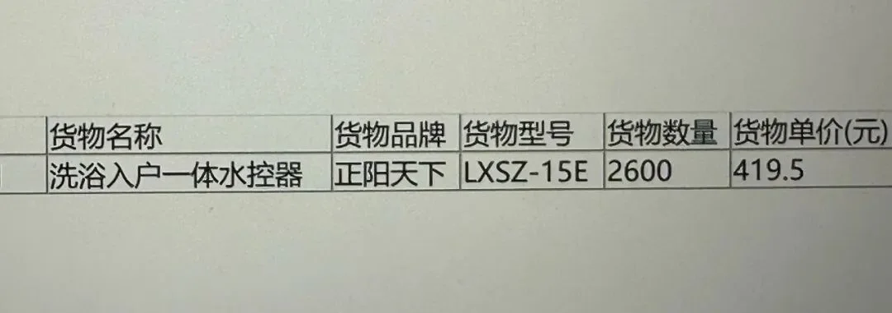

**由于近段时间投稿较少，目前稿件为三天前左右投稿，还请投稿人见谅。请相关部门及时关注并跟进问题。**

## 1 招生工作问题（此稿于上周四投稿）

“您好，投稿。学校招生工作一直不积极，学生建议不采纳，领导层面不重视，行政层面不出力。现在分数线已经崩盘且持续下落，期待的双一流也迟迟没有消息。现在就连最基本的招生劳务竟也发放的如此之慢——7月初上报，现在9月快要中旬了还没到账。虽然知道同学们并不是冲着少得可怜的劳务，但是学校态度不能不摆正吧？希望学校能够尽早发放参与招生的同学的劳务，更希望学校领导对招生工作重视起来，对高招宣传重视起来，把高招分数提振起来。暑假那篇《狗尾续貂》已经让社科大名声又被黑了一把，甚至不少评论已经对社科大的学生开启了嘲讽模式，难道学校那么多领导这么大事情一个都看不见吗？我们不是想给行政增添事务，毕竟这本来就是咱们的本职工作。我们只是担忧自身以后的就业，外部环境越来越差的同时学校认可度越来越低，学校想让前几届进来的学生怎么办，想让即将毕业的学长学姐们怎么走入社会？所以，请所有领导从现在尽快解决劳务发放问题开始，重视起来一起招生与就业事务，务必倾听学生心声，务必抓好招生工作，务必不要砸了学生们的出路。

”

> “投稿 高招劳务问题。看到有同学在接诉答询上反映了劳务问题，七月就交了劳务报表但是学校方面回答10月才会发放。去问了一下高中同学，得知许多学校的招生劳务在暑假就已发放，我们学校每年要等到10月份才会发，感觉是不是有点晚了一些，恳请学校领导和行政人员考虑讨论一下相关事宜。”

## 2 水费相关疑问

> “您好我想问一下咱们以前的那个水费到底是打谁账户上了为啥我们宿舍好像没人收到呢”

“您好，反映一下宿舍的热水表问题，目前淘宝同款，仅需380元一个，还赠送软件，但学校的中标金额是419.5元。采购数量2600个，如此大宗的采购不应该更便宜吗？这如何解释呢。

”

## 3 时间安排质疑

“一个即将评选双一流的学校，不应该是一个朝令夕改的学校，不应该是一个无组织无纪律的学校，不应该是一个罔顾漠视大学生作为一个成年人，一个完全民事行为能力人的人身自由权。。

学校的朝令夕改，对重大的事关大量学生活动的集体安排，没有可信的安排计划，不仅仅体现在这次的讲座拖堂问题。包括之前x日x院晚上，一会说要训练，一会说要讲座，难道训练和讲座不是提前就应该定好的吗？下发的军训期间时间安排表只能起到一个参考的作用，而不是学生可以放心地去相信，可以不假思索地去执行。今天在时间安排表上，明确地说上午的讲座时间是9点到11点半，备注是“学工部，纪委办公室”。两个半小时的讲座时间难道还不够两个部门进行宣讲吗？如果不能，就应该在日程安排表中明文写出预计好的结束时间。学生需要根据日程安排表来安排自己的时间，擅自破坏日程安排表，尤其是像今天这样拖堂近40分钟的严重地破坏日程安排表，是完全地不尊重学生作为一个成年人，一个拥有完全民事行为能力的成年人，自己安排自己时间的权利，本质上是将大学生依旧当作高中生对待，认为可以随意地支配其个人时间。

如果你的日程安排表明文地写着要开会开到12点半，我们作为本校学生，当然应该遵照学校合理合法正当的教务（大学生发展与心理课程第第一节课）安排，该上的课应该根据学生守则去上。但是学校既然明确地写出此课是在11点半结束，那为什么要公然地在新生开学还不到一周的时候，破坏自己的公信力呢？哪怕你先把签到码在11点半的时候亮出来呢？一遍根据学生守则要挟学生，另一边却在不提前通知学生的情况下擅自拖堂，挤占一个成年人的合法私人时间，新生的人权何在？学校的公信力何在？哪怕是作为一节正课，按照学校的安排，这节课在11点半的时候就结束了，剩下的都是下课时间，是学生的个人时间，凭借签到考勤侵占学生的近40分钟的个人时间，完全没有将学生作为作为一个平等的角色进行对话，侵犯学生的人身自由。

有人可能会说，学校又不是强制把你关在140，怎么就限制了你的人身自由呢？这句话的逻辑与————（此处因公众号平台限制，我们做了文字处理，请各位读者自行感受此处投稿人的愤慨）。利用考勤制度公然要挟学生，侵占学生的个人时间，这难道是一个号称“我们高擎人文之光”的学校应该做的吗？

”
