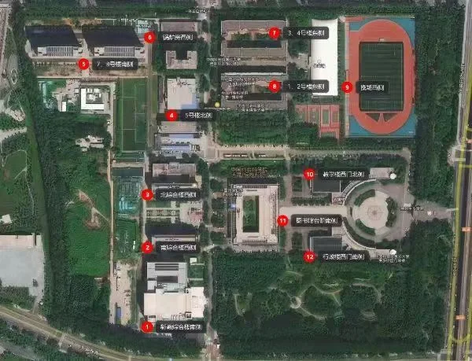
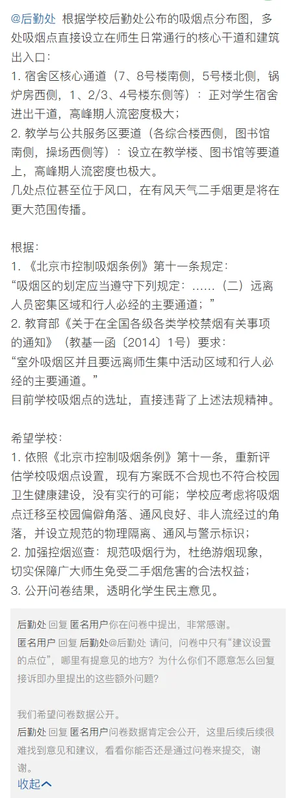
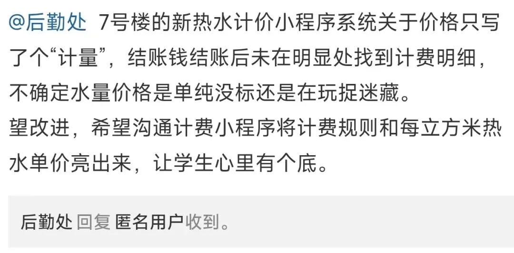
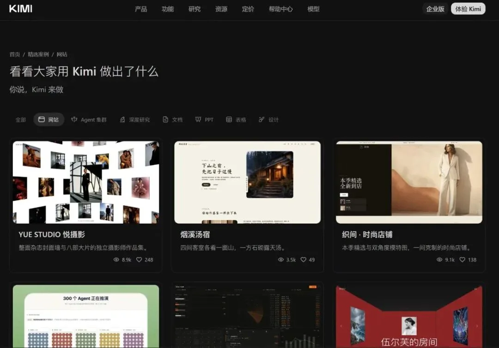

**请相关部门及时关注并跟进问题。**

## 1 吸烟点设置

“投稿：

企业微信里弹出了《关于征求良乡校区指定吸烟点位设置意见的通知》，拟设置12处吸烟点。

据个人几年的观察，skd吸烟的人有但不是很多，想抽一般都是自己找地方解决了，有在宿舍楼道抽的，有边走边抽的，有在食堂门外抽的，有在学校马路对面抽的，所以个人的观点是skd的控烟问题没有严重到需要统一管理，统一设置多至12处吸烟点的程度。

原本我们提倡的是无烟校园，言外之意吸烟是规则外行为。如果设置了吸烟点是否意味着给了吸烟者一个政策背书，“看校园内允许吸烟而且贴心设置了12处吸烟点方便我们”？

而且吸烟点会产生集聚效应，即几个人聚在这里边吸边聊。征求意见的点位有图书馆台阶南侧，研教楼西侧出口，都是同学们经常出入的地方，这反而会增加师生吸入二手烟的概率，不利于师生的身体健康。

不知是什么契机让skd后勤部门发出了这个征求意见问卷。如果是出于教职工或提供生活保障人员的需要，那么也请不要在学生宿舍楼下、图书馆和教学楼门口设置吸烟点！”

> “投稿：良乡校区指定设置十二个吸烟点是要干嘛\[笑脸\]鸟大点地方吸烟点密度这么高，刮点风以为烟尘暴来了。无烟校园很难吗，你多走两步出校门吸能怎么样呢\[笑脸\]不是说设置吸烟点不合理，是说这么高密度的户外吸烟点除了给烟民一个合理借口随便熏人，完全没有规范的意义。或者你吸烟点都搞成密封的我绝对不说什么，不过你社也够呛能拨款到建这种设施上\[笑脸\]”

“投稿：

良乡校区芝麻大点的地方设置12个吸烟点。尊敬的后勤处领导，你设一个吸烟点在你的板房办公室门口就行，毕竟你也总喜欢在那里抽烟，独抽抽不如众抽抽，所有人都到你那抽烟吧\[玫瑰\]”

“关于学校发布的吸烟区征集点位内容，拟设置的吸烟点竟然高达12个，覆盖校园各个区域，实在是令人难以理解。

《北京市控制吸烟条例》第十二条明确规定，国家机关、企事业单位、社会团体和其他社会组织应当将控制吸烟工作纳入日常管理，依法划定禁止吸烟区域，制止违法吸烟和不文明吸烟行为。同时，条例还明确提出：“鼓励国家机关、企事业单位、社会团体和其他社会组织自行实施全面禁烟。

试问学校，学校是否属于北京市行政区域内的单位？是否属于条例所规定的企事业单位？究竟有没有考虑过北京市的控烟规定？

既然北京市已经明确提出鼓励相关单位实施全面禁烟，为何学校反其道而行之？禁烟是没有的，鼓励抽烟的点位却安排得如此之多、如此之全面。12个吸烟点究竟是在控烟，还是在给吸烟划地，分而治之，进而将烟味弥漫全校？

烟雾会飘散，烟味会扩散，二手烟并不会被一个所谓的“吸烟区”隔绝。学校作为教学场所，更应该重视师生健康，思考如何减少烟草暴露、治理二手烟，而不是把吸烟点从无到有、从少到多地铺设到校园各处。”

“小小的良乡均匀设置了12个吸烟点，既帮助了不抽烟的同学可以合理aa二手烟，也让我们能都成为一流大学完美腌制的熏肉。

意见征集是不是先斩后奏现在才想起来学生，灭烟柱都装好了才问意见？”

> “本人抽烟利益相关，有的老师抽烟你也不可能一棍子打死不让抽，设置抽烟点总比不设置全校区到处都随意抽烟强，不过12个确实有点多了，社科大地方不大，可以避免在人流量大的地方设置吸烟点”

“

把“吸烟区”设在要道，是在服务烟民，还是在毒害全校？

——评后勤处吸烟点“意见征求”与“接诉答询”的太极艺术

近日，后勤处公布了校园吸烟点分布图，并煞有介事地开启了所谓“征集意见”。细看这十二处点位，师生的反应几乎是一致的：从宿舍大门到教学楼西侧，从图书馆南侧到操场西侧，十二处点位全部落在师生每日通行的主要通道与集中活动区域上：

社科大本就不大。若照此方案落地，师生往返宿舍、食堂、教学楼、图书馆、操场的日常动线，将不可避免地经过吸烟点；那么师生无论去上课、去自习、回宿舍还是去锻炼，一出门便必须“沉浸式”吸入二手烟。

相关规范写得很清楚：

北京市控制吸烟条例》第十一条第二款：

> “吸烟区的划定应当遵守下列规定：（一）设置明显的指示标志和吸烟有害健康的警示标识；（二）远离人员密集区域和行人必经的主要通道；（三）符合消防安全要求。”

教育部《关于在全国各级各类学校禁烟有关事项的通知》（教基一函〔2014〕1号）第二条：

> “严格限制在高等学校内吸烟。所有高等学校建筑物内一律禁止吸烟，也不得设置吸烟室……根据实际情况可在室外露天区域设置少量吸烟区，并要设置明显的引导标识和'吸烟有害健康'等提醒标识。吸烟区设置应符合消防要求，远离师生集中场地和必经通道。”

再看此次征求意见的程序。后勤处下发的《关于征求良乡校区指定吸烟点位置意见的通知》，把十二处尚不合规的点位直接列为选项，让师生在“满意 / 不满意”之间勾选。问卷中只有“建议设置的地点”一项，没有设置意见反馈栏——质疑点位合法性的意见无从落笔。用问卷的“满意率”来决定一个点位是否成立，等于用程序形式替换法定标准：问卷可以决定“选哪一个”，但不能决定“能不能设在这里”。这是典型的以程序形式掩盖实质问题。

更令人费解的是后勤处在"接诉即办"平台上的回复。

同学在接诉即办平台依规提出上述法律依据与整改诉求后，得到的答复是：

> “请在问卷中提出，非常感谢。这里后续很难找到意见，看看你是否愿意通过问卷提交。”

既然接诉即办平台“很难找到意见”，那这个官方诉求通道的功能是什么？既然问卷不设意见反馈栏，让人去问卷里提意见岂不是明晃晃地把师生当猴耍？

“接诉即办”变成了“接诉推诿”。把尚不合规的方案先摆上桌、再以问卷形式追认，对法定义务不作回应，这样的做派，实在配不上人文社科高等学府应有的治理底线！

我们在此呼吁：

一、依照《北京市控制吸烟条例》第十一条第二款重新评估全部点位：挑选校园偏僻、通风良好、非人流主要通道的位置，重新发布问卷，并在征求完毕后在合适的位置设置指示标志、“吸烟有害健康”警示标识与必要的物理隔离。

二、规范游烟与吸烟区域：公布校内吸烟行为的劝阻与处理细则，明确师生劝阻的依据与渠道，让不愿吸二手烟的师生有规可循，学校也不应只做禁烟活动的背景板。

三、公开数据与办理结果：公开问卷原始数据，正视师生的健康诉求，停止在平台之间来回转办。

校园的空气属于全体师生。希望后勤处正面回应。

以下附后勤处“接诉答询”相关答复记录（公开发表已获得该投诉同学同意）：

”

## 2 发展有理，一流无过

“又一批新鲜血液来了。新人是不熟悉规矩的。所以，可以趁机降低标准，让新生以为“自古以来”，以为一向如此。但是，由于本校大部分专业不是两年制，所以老生还是占个大多数的。大家的眼睛还是雪亮的，不妨讲讲新学期以来的变化，好教新同学不要以为“自古以来”就是这般拉胯。学生能看见的事大多是吃、住、学这样的小事。但小事上也不能倒退，否则今日一退，明日一退，积累起来恐怕就从四非增至十八非了。

上篇 吃

第一是吃。首先的变化是二食堂。它明显地难吃了。就我们目前看到的，二食堂大概发生了这样一些事情。今年夏天的时候，或许是学校换了领导的缘故，不知道为什么食堂换了一个代理，就是现在的这家万喜。对档口而言，和过去代理没区别，收盘、洗碗工还是原配。

问题是，二食堂档口是没有自主定价权的，他们的定价是由二食堂总代理和后勤处共同决定的。抽成都是30%，租金占一块，规定的食材成本不能低于55%，水电，设备，管理费开支也没少。但是由于巨额地租和抽成，所以如果他们严格执行代理的标准，他们早就赔得裤衩子都不剩了。所以为了能活下去，他们必须想办法压成本，但是他们的成本价又是由加盟商控制的。所以他们的做法是做假账。于是后勤处和代理的账本也许是按照他们虚报的成本在运转。

因为换了代理，所以代理要和档口重新谈合同，再加上后勤处又找到了新的收入来源，开始给职工楼收床位费，部分档口还有一笔加盟费，成本压力更大了。很多档口就希望新代理能够压一压价。但代理显然做不到。于是就有几个档口没谈妥走掉了，等开学之后，原本走掉的那几个档口又想回来，于是试着联系同学们给校方施加压力，显然没啥用。

剩下几个档口为了活下去，开始创造新的营收方式，比如金日升那一家就又加盟了一个云贵蘸水烫菜。有档口套餐过去单价从16改14，本学期又改回了16。烤盘饭的定价开了一个三方协商会，称重改到2.8每两，商家的对策是米饭开始收费一块钱。每单15元的均价并未改变，大伙儿吃的还是这么个价钱。但是每单位重量对应的成本价标准是降了的。所以这种努力事实上可能降低了大伙儿的餐食质量标准。

还有换代理增加的其他成本。职工食堂的宿舍原来不收费，现在按学生标准收。床位费每月加了300。有的铺面还提到了培训费、设备支出。这些成本，最终都是由消费者买单的。

成本增加，质量下降最明显的结果是二食堂销售量下降了25%。我们判断的依据是数盘子。按照收盘子洗盘子员工的说法，以前餐具回收一天能回收五车半，但是开学之后平均只有四车，盘子数量同比下降了25%。现在的二食堂就呈现出了这样一种凋敝的景象。

大伙都说食堂排队越排越长，越来越挤，但实际上二食堂客流量开学以来是变少了的。好吃的都走了，不很显然... 有同学说：“现在二食堂对我吸引力大大减少啊..... 而且有的时候会直接去吃麦麦。”排队变长，人变少，说明出餐变慢了，或许预制菜少了？

话说，二食堂这些年来一直在菜品单调收费高的路上滑下去，原来党校食堂还能点餐，有个对比，现在只和外卖竞争，标准低了不少。

第二是外卖。外卖柜现在要向骑手收费了，原来似乎是不用的。大批骑手为了省钱只好把外卖挂栏杆上。这下就不能不提外卖柜建设的初衷了。疫情第二年，为了让外卖不被盗，为了保持卫生，学生会和保卫处的同志们千方百计地协调了外卖柜进校，谈的时候就是免费的，这是作为进校条件的。外卖员才能在门内区间骑行。

中篇 住

一是水费：多少方多少钱不透明，在接诉答询上反馈要求看价格，但只回复“收到”。看来后勤是个AI。

更需要注意的是热水隐形计费，出水不按时间，开后立马关就扣了钱，据解释说和时间无关，和水量有关，但有时候没出水排气也扣钱。有同学反映闸转换到热水后，还没到供热时间，不出热水也要扣钱。总之，钱是多收了的。热水这么贵，同学们计较一些也正常。

根据我们的测量，在7号楼，热水现在价格是不低于41元每吨，为什么是不低于41元呢，是因为没法确定在洗手池温度调到最高的前提下，他有没有掺凉水，如果掺了凉水，就说明他至少比41元要高。这就意味着，更换水表后的热水后的水费，肯定是不低于更换水表前的。鉴于开学至今热水费仍未公开，我们自然有理由怀疑“不低于”背后究竟是什么。同时，热水管道刚开始放的那部分水肯定是冷水，这一部分冷水也是按热水计价的。

二是洗衣机。新的洗衣机皮带疲软，无力。洗不带劲，甩亦不干净。连续几次取出滴水的衣物。滴。水。的。

此外，关于要求水费公开的问题，两周前就有同学在接诉答询上提出诉求，（见下图）在人文之光公开后，既没有得到进一步回复，也没有看到后勤部采取任何实质行动。这使得我们不得不重申：有问题，不应该摆事实讲道理吗？学生提问后一不见事实，二不见解决措施，仅用程序上的合规来搪塞、回避学生提出的问题。如果接诉答询已经是一个“打太极”的平台，那学生又有什么理由通过这个平台来沟通你们呢？

以及，不在“诉求列表”里进行检索时，只能检索到已回复的“我要表扬”，其他检索内容，特别是与“我要答询”“我提意见”相关的内容，只能看见自己提的，是看不见别人提的。不知这是小程序bug还是某种掩耳盗铃作风？希望有Bug趁早修，不要让失望再成为愤怒。

下篇 学

降转的课业负担加码了。已修过同样的习概课要再搞一遍论文。教务处说以前修的课不让直接学分替代，要重新写论文，已经修过的成绩占2/3，新写的占1/3。纯粹是吃饱了撑的。当然，我们的教科处仍然大言不惭地称之为学分提高的缘故，但即使学分提高，习概最后的成绩分布又没有变化，更何况习概是个怎样的课，习概的论文是怎样创作出来，教务处难道自己心里没数吗？转专业同学本来就是奔着兴趣来的，已修课程自然是很认真的。这时候让你反刍一遍，消磨对学科的热情和动力，算是体罚吗？看来还是不能给老爷们添麻烦，不然要打击报复穿小鞋的。

当然，各种通知朝令夕改早已是本校的特色了，每年开学军训时，教务处都会发放一个时间安排表，每年这个时间安排都没有被执行，于是，受到欺骗的学生每年都会从各种渠道向学校表达不满，相应的，学校的脸皮厚度超乎想象，它绝不羞愧，绝不反思，绝不进步，同样的问题一年又一年的反复，似乎是要向每一届新生展示学校的无上权威。教务处的老爷们只需要喝个茶改个通知，所有的冲突与不便却都要学生来承担。

有同学去行政楼打英文毕业证，行政楼老师说去新综电梯口打，这位同学跟她要了一个电话，就怕那儿没有。果不其然，新综当然没有，然后他就去了南综，南综当然也没有，这位同学便给老师打了三个电话，居然根本打不通，回去之后去问那个老师，结果发现这位老师分不清南北综，她想说的是北综！

很难想象，行政处的老师分不清哪个是南综，哪个是北综，哪个是新综！

国庆与中秋假期之间仅隔三天，中秋放假三天后还要再上三天课，随后才放国庆。这种碎片化安排，不仅打乱了学生的学习与作息节奏，也消耗了学生的精力；中间三天夹在两个假期之间，学生难以收心，教师也难以开展连贯教学，教学质量恐怕很难尽如人意。

很多同学因此希望两假连放，这样也便于提前规划休息或出行，让假期真正起到调整身心、提高后续学习效率的作用。正因如此，学校在制定假期计划时，应充分听取学生意见，考虑学生实际生活便利，而不是关起门来独断专行，用一纸通知消解学生的期待。

总而言之，新学期的skd在一些小地方是退步了的。我们关注这些退步，不等于它在其他地方没有进步。但是，如果没有这些退步，它不就搞得更好了吗？进步更快些，总能从四非更快地建成三点五非、三非、二点五非，大家一起努力吧！”

> “本学期再次迎来了招生人数的新高峰！在良乡呆了两三年以上的同学可能都有体会，食堂，图书馆等公共区域这学期是人挤人，不得不另寻出路。在人数逐年增加，难以保证正常的学习生活质量的情况下学校依然没有基建的行动。一站式学生社区、扩增校区面积的规划依然看不见。非常失望，继续扩招继续良乡人挤人吧”

## 3 图书馆AI建设

“AI 不是审美霸凌的理由，更不应沦为敷衍的遮羞布

——人文学府不应带头滥用 AI

近日，学校图书馆上线 “生成式人工智能专题导航”网站。这本该是一项弥补技术鸿沟的数字基建，然而打开页面的那一刻，令得学生们惊呼：丑哭了！

胡来的字号、乱飘的文本块、滥用的黑体字体、违和而劣质的二次元风格 AI 图像，乍一看，还以为是 2010 年代初的劣质模板复活。这实在不像是一个 2026 年能上线的网站，更不像是一个人文社会科学高等学府的官方网站！AI 参与各类生产工作确实是大势所趋，它极大地降低了建站与设计的技术门槛。但是，我为什么还是要批评这个显然用 AI 辅助制作的功能网站呢？

因为我们从来不是反对 AI 的辅助，而是反对在工作中缺乏责任感的“人”。

AI 的水平各异，有些 AI 确实能生成精美的页面——在行业优秀的案例库里，我们能看到极具设计张力的 AI 协作成果：

但是，当劣质的 AI 产物大摇大摆地挂上高校官方门户，暴露的不仅是工具的拙劣，更是审美把关的责任缺失。

如今的哲学社会科学界，越来越多的 AI 劣质语料正在侵蚀学术生态，难道不正是不负责任的使用者造成的吗？

作为人文社会科学的高等学府，最不该做的就是用未经审视的 AI 拼贴搞表面工程，把粗制滥造包装成“拥抱技术”，给师生带来视觉上的审美霸凌。

说句个人的真心建议：与其上线这样一个粗制的网页，不如踏踏实实与大厂合作，给学生们批放点批点切实的算力与 Coding Plan 额度，这样更有利于学生拥抱 AI 时代，不是么？”

## 4 编辑部调查投票
