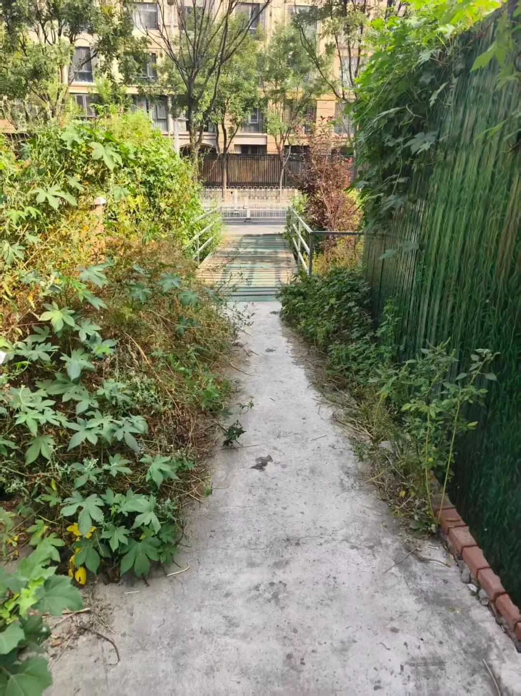

**请相关部门及时关注并跟进问题。**

## 1 图书馆

> “投稿：坐标良乡校区教综楼图书馆1楼，图书馆是同学们读书学习的地方，真的很想请在馆大声吧唧嘴吃东西的人多走几步路出去吃啊，应该没人想在焦急忙慌的赶ddl时听到大声吧唧嘴吧······ 谢谢！”

## 2 后勤

> “食堂饭能稍微做好吃一点点吗？每天啥时候都排队好久，买到之后难以下咽；”

> “此前对学校的种种怨言实属误解。学校让学生大扩招、食堂大排队、档口大更换、自习大爆满并非保障不力，而是校方高瞻远瞩的校地合作新篇章——引导广大学子出校消费，助力房山经济全方位蓬勃发展。”

> “学校可以清理下外卖柜的杂草，维护外在整洁”

> “新水表系统其实不全一无是处，至少不用担心洗一半没热水的情况了，尤其不想再经历冬天洗一半下楼充水卡这种事了！”

“宿舍换了新的热水水表系统之后，除了热水似乎比以前更贵了之外，用起来还特别不方便，反映几个问题。

1\. 热水关掉之后，过几分钟再想开就必须重新扫码。 现在用热水，扫码启动后一旦把水关掉，过几分钟这次扫码就失效了，再想开热水必须重新扫。最典型的就是冬天上完厕所出来，想洗个手用热水，因为之前已经关水隔了几分钟，热水出不来，得重新拿出手机扫码才有热水，不然就只能用冷水。冬天本来就怕冷手，洗个手还得专门带手机扫码，特别折腾。洗漱、洗东西也一样，每次中间停一会儿没接着用，下一次就得重新扫。

2\. 每次用热水都得把手机带进卫生间/浴室，有损坏隐患。 因为每次用热水都要扫码，同学们不得不把手机带进卫生间。卫生间潮湿、水汽大，长期把手机放在这种环境下，很容易受潮、进水。手机是学生重要的学习和生活工具，因为用热水把手机弄坏，实在得不偿失。

3\. 不同同学的使用需求没有被兼顾。 一部分同学确实希望按实际用量精确计费；但也有一部分同学更想像以前一样，预存费用后随开随用，不需要每次扫码。目前系统只有一种扫码模式，没有给同学自主选择的空间，习惯传统用水方式的同学很不适应。

建议：

1\. 在手机热水界面增加"连续用水/随开随用"模式选项。 让同学自己选：喜欢按用量计费的继续扫码，希望连续、不间断使用的，可以预存费用随开随用，不需要每次都重新扫码。

2\. 发放实体热水卡。 需要连续使用热水的同学，把实体卡放在计费器读卡感应区即可持续出水，用完移开卡片就停止计费。这样可以避免把手机带进潮湿卫生间，也比每次扫码方便。

3\. 请技术部门评估现有硬件是否支持实体卡刷卡功能。 如果设备本身具备刷卡感应模块，希望学校尽快开通实体卡办理渠道。”

> “为什么学校安水表不事先征求学生意见？每次用热水都要扫码，时常忘记扫码或用完后忘记关闭。而且价钱明显比之前贵不少，之前2人间两个人一周每个人至少洗三四次澡，加早上洗漱热水，50元能用至少一个月。现在9月才过一半，用水比以前少的情况下，一个人已经花了25元，涨了一倍？中间差价被谁吃了？”

## 3 良乡爱情故事

“那年秋天C女士从北理工良乡校区北门出来，房山线已经挤得像沙丁鱼罐头。北理工在良乡占地三千多亩，是中关村校区的三倍大，但大有什么用，大不能让她离市区近一公里。良乡校区离天安门三十公里，离本部三十五公里，去市里单程一个多小时是常态。她每天早上七点半出门，从良乡大学城北站上车，过广阳城、篱笆房、长阳、稻田、郭公庄，换九号线，再换十号线。她闭着眼睛都能数出每一站的间隔时间。

P女士在中国社会科学院大学读研二。社科大在良乡高教园区长于大街，同学们都戏称自己是在河北上大学。更狠的自嘲是“辛瓜地民办三本”，因为学校2017年才挂牌，没赶上985、211、双一流任何一个评比，至今是个三非。P女士每天早上在良乡大角麦当劳做兼职，然后回长于大街。

她们第一次说话是在大学城北站。P女士的校园卡被挤掉了，C女士捡起来看见“中国社会科学院大学”几个字。C女士说社科大的？P女士说北理工的？然后都没再说话。北京太大，大到两个人站在一起也像隔着整个房山线。

后来她们去麦当劳。P女士用员工折扣买了两杯咖啡，C女士在纸巾上画房山线，说你看，良乡大学城北、广阳城、篱笆房、长阳、稻田、郭公庄，换九号线。P女士说你画这个干嘛。C女士说怕迷路。P女士说你每周都走还怕迷路。C女士没说话。她真正怕的是，这条线她走了三年，每一站都熟，但没有一站让她想下车。

C女士有个高中同学Y女士，在市区当老师。每周五C女士都去见她。Y女士喜欢赵鹏，赵鹏是C女士本科同学，在良乡做乐队，偶尔去北理工旁边的小酒馆演出。三个人在麦当劳吃饭的时候，Y女士看赵鹏，赵鹏看手机，P女士看C女士，C女士看Y女士。

P女士问你喜欢她？C女士沉默。P女士用吸管戳着麦旋风，说没关系，你在良乡的时候能不能先喜欢我一点点。

C女士没说好也没说不好。北京太大了，大到一个人可以同时喜欢两个人而不用负责。

她们在一起了。说是在一起，其实就是把各自的生活拼到一起。P女士带C女士去长于大街吃烤冷面，去北理工北湖看鸭子，去龙湖天街看电影。C女士在徐特立图书馆改论文，P女士在麦当劳早班后给她带咖啡。那阵子C女士导师催初稿，P女士的问卷还没发完。她们常坐在麦当劳良乡大角店，桌上摆着电脑、咖啡、考公资料和没吃完的薯条。人均消费三十三块的麦当劳，是良乡大学城最体面的去处。良乡打开外卖软件，翻来覆去就那么几家，肯德基麦当劳必胜客，沙河大学城的朋友说你们良乡好歹还有个龙湖天街，P女士回她一句你来住一年试试。

C女士改一段论文，P女士填一份问卷，抬头时窗外是良乡大角晚高峰的车流。谁也没说话。有些话说不出口，是因为说出来就真的了。

C女士是家里第一个考上985的人。她妈在老家跟人说的时候，语气里全是骄傲。但骄傲不能当房租，不能当实习工资，不能当她在北京留下的任何凭证。她学的是社科类专业，身边人都在考公，她也考，考了两次，进面一次，没上。P女士比她更清楚那种感觉——社科大的学生出去，别人问哪个学校，说“社科大”，对方愣一下，说哦，是不是那个什么科学院？她说对。对方说，那是985还是211？她说不算。对方说哦，那挺好的。

她学会用“挺好的”结束这个话题。

直到那个深夜Y女士打电话哭。赵鹏伤了她。C女士从北理工宿舍跑出去赶末班房山线。P女士说去吧。列车穿过长阳、稻田、郭公庄。第二天下午C女士回良乡。P女士在良乡大学城北站出口等她，手里拎着麦当劳早餐。P女士说凉了。

C女士说对不起。

P女士低头又抬头。她说C女士你人很好，可你心里有一趟永远不晚点的车，只是不往我这儿开。

P女士毕业去了望京。社科大有个校区在望京附近，但她去的是另一家公司，做用户运营，试用期工资七千五，房租三千二，通勤五十分钟。走之前约C女士在刺猬河边。昊天塔在远处亮灯。那座塔建于隋朝，现存的是辽塔，通高四十四米，站了一千年了，看着良乡从县城变成大学城，看着人来，看着人走。

P女士说良乡的秋天很短但够我记住你了。C女士说我送你。P女士说不用房山线我比你熟。

她转身走了。米色风衣被风吹起来。C女士想起P女士在麦当劳借她充电器的样子，想起P女士在社科院大学图书馆前等她的样子，想起P女士端着咖啡穿过良乡大角天桥的样子。她什么都没说。

三年后C女士在良乡大角天桥看见P女士。P女士剪了短发，手里拿着一杯麦当劳咖啡。C女士走过去。P女士说C女士你好吗。C女士说我很好你呢。P女士说我也很好。

她们站在天桥上，看拱辰大街车流。良乡变了。华冠还在，刺猬河还在，昊天塔还在。北理工良乡校区还在，社科院大学还在，麦当劳还在。只是她们不再并肩。

P女士说回来参加朋友婚礼一会儿去良乡大学城北坐房山线。C女士说我送你。P女士摇头说不用你以前就不顺路。

她走下天桥汇入良乡大角的人群。C女士看着她的背影忽然明白，有些人像房山线：你以为她只是路过，其实她曾是你整段旅程的终点。

C女士后来搬到了中关村校区。楼旧了，宿舍小，没有阳台，跟良乡的四人间没法比。但她发现住在这里之后，去五道口只要二十分钟，去实习单位只要半小时，去任何一个“北京”只要出门就行。她突然想起良乡那些封校的日子，学校把北校区和东校区之间的马路封上，组织学生在马路上蹦迪，南操场变成万人蹦迪现场。那时候她觉得学校在尽力了，现在她才知道，那叫困兽之斗。

良乡没有东京塔。但每到秋天昊天塔的灯亮起来，就像替谁守着一个没说出口的答案。而良乡爱情故事每天都在房山线上发生。

只是不是每个人都有结局。”

## 4 吸烟管理

“利群坦（Liqunthan）

事先声明，（1）本人不是烟人；（2）本人支持所有建筑物内一律禁止吸烟；（3）本人支持代际禁烟令；

叠甲结束

9月16日上午，skd后勤部门通过企业微信等渠道，推出了《关于征求良乡校区指定吸烟点位设置意见的通知》，附带有暂时拟设置的12处吸烟点以及可以针对每个吸烟点的设置进行投票的调查问卷。这一规定无疑在学生群体内引发了巨大争议，其中，反对意见大致可以总结为两种：一种认为暂时拟设置的12处吸烟点的位置并不合理；另一种则认为专门设置吸烟点这一行为本身就是不可理喻的。

就上述两种意见，首先，本人是十分支持前者的，12个拟设置的吸烟点对于我们这样一个小小的校园而言实在太多了，这么多吸烟点既不能起到对二手烟的抑制作用，反而有利于二手烟在全校园内的扩散与覆盖；其次，拟设置的12处吸烟点中绝大多数都设置在人流量大、师生出入频繁、与日常生活的便利程度息息相关的位置，不知道是后勤部门哪个领导脑子抽了“地图上作业”随便标的点位，对此本人已在调查问卷中严肃选择“不满意”以表反对。

然而，对于第二种意见，本人持反对观点。

有人提出，“原本我们提倡的是无烟校园，言外之意吸烟是规则外行为。如果设置了吸烟点是否意味着给了吸烟者一个政策背书”。然而，恰恰相反的是，如果无烟校园只是一个“提倡”，那么在校园内吸烟也仅是一个“提倡外”行为。恰恰是因为无烟校园没有制度化，因而吸烟行为也仅能被在道德上谴责，而不能转变为在明文规定禁止吸烟的区域可以被制止乃至惩处的对象。

还有人指出，根据《北京市控制吸烟条例》之规定，国家机关、企事业单位、社会团体和其他社会组织应当将控制吸烟工作纳入日常管理，依法划定禁止吸烟区域，制止违法吸烟和不文明吸烟行为。同时，条例还明确提出：鼓励国家机关、企事业单位、社会团体和其他社会组织自行实施全面禁烟。

> “试问学校，学校是否属于北京市行政区域内的单位？是否属于条例所规定的企事业单位？究竟有没有考虑过北京市的控烟规定？既然北京市已经明确提出鼓励相关单位实施全面禁烟，为何学校反其道而行之？”

那我问你，“国家机关、企事业单位、社会团体和其他社会组织应当将控制吸烟工作纳入日常管理，依法划定禁止吸烟区域，制止违法吸烟和不文明吸烟行为”是不是属于积极义务型规范，学校设置吸烟点是不是对该规范的遵守和执行。

那我再问你，“鼓励国家机关、企事业单位、社会团体和其他社会组织自行实施全面禁烟”是积极义务型规范还是允许型或授权型规范，是强制性规则还是半强制性规则，还是调整性规则？

在“吸烟问题”已逐步发展为一项政治正确的当下，我们很容易将“设置吸烟点”这一妥协性质的举措，与那些个与全日制校园性质不同的场所，或是我们头脑中的那个“禁烟乌托邦”作比较，而恰恰忽略了当前skd面临的实际的吸烟情况。什么是skd面临的实际吸烟情况？是连高等学校建筑物内全面禁烟都没有得到彻底执行，而在室外更是想吸就吸，随地大小吸的一种前“法律”、前规范状态。本人在此套用霍布斯有关“自然状况”的论述。当前skd的实际吸烟情况，就是吸烟的自然状况，是“一切烟人对一切人的战争状态（Such a war is of every Dingzhen against every man）”。为了摆脱这种吸烟的自然状况，为了结束这种吸烟的前法律、前规范状态，我们需要相互订立信约，需要将每一个人的力量、权利与意志托付给一个使所有人遵守以追求共同利益的共同权力——而这就是利群坦（Liqunthan）的诞生。

因此，相较于我们头脑中的那个无烟校园乌托邦，设置吸烟点的举措当然是妥协的、保守的。然而，与我们实际面临的吸烟的自然状态相比，设置吸烟点的举措无疑是一个阶段性的进步与胜利。我们应当以光明正大的、程序合规的方式与姿态取得这一向最终的无烟校园的目标行进的进步与胜利，而不是停滞在毫无建设性的意见中歇斯底里。

最后是本人关于校内吸烟群体的一些观察

在校内吸烟的，当然有不少是学生，可能也有个别教师，但更多的是校内的教职工群体或后勤工作人员。他们吸烟的情形与场合既是随意的也不是随意的：随意在于随地大小吸，不随意则在于他们吸烟的时机与缘由总是与具体的情景与活动相关联，有人卸货后在超市外的台阶上吸烟，有人做完饭洗完碗后坐在食堂后门吸烟，有人一边拉着散发着腥臭味的桶一边吸烟——一言以蔽之，他们的体力劳动生活。

本人无意将吸烟问题的讨论导向某种对无产阶级的泛滥的同情，一如我拒绝为吸烟行为赋予任何经济上或是文化上的意义：吸烟不是为了充军费造航母，吸烟也不是为了独立性与近代/现代性。但是，还原至最基本也最客观的药理作用和生理反应，吸烟是一部分体力劳动者，或是焦虑、忧愁、疲惫的人们，麻痹自己，缓解自身焦虑、忧愁与疲惫的方式。然而，是的，这种行为具有不可置疑的成瘾性。更重要的在于，吸烟行为不可避免地会对他人、非吸烟者的身体健康造成危害，所以我支持也坚信会有社会范围内全面禁烟实现的那一天。

在我看来，上述情况一定程度上反驳了“没几步路走到校门口吸烟”的意见，因为考虑到教职工群体当前吸烟的缘由和情形，要求他们全部到校外吸烟，是不现实，至少在落实层面是困难的。因此，在校内寻找一处既能最大程度的避开人流，又对于教职工群体而言具有可触及性的点位，在此处设置吸烟点，是实际可行的。

最后，为了能更好、更积极、更彻底地解决教职工吸烟问题，尽快实现真正意义上的无烟校园，笔者在此也有一些小小的思考和建议，仅作抛砖引玉：例如在维持现有待遇的前提下，适当扩充教职工队伍，实施轮班，降低个体每小时工作强度；给吸烟的教职工发放戒烟药，鼓励教职工戒烟，并给予戒烟成功的教职工以口头表扬等等。

> “我看和成天下搞得不错，口腔纤维化极大丰富，人物方块度快速实现赶迷你超MC，如果校医室再量购入含氨基比林、非那西丁、咖啡因、本巴比妥的药物，再加上全面禁烟制度，就是我们理想中的无烟社会。”

（相关讨论见《【读者投稿】吸烟管理争议巨大 校园建设前路漫漫》第1条）
