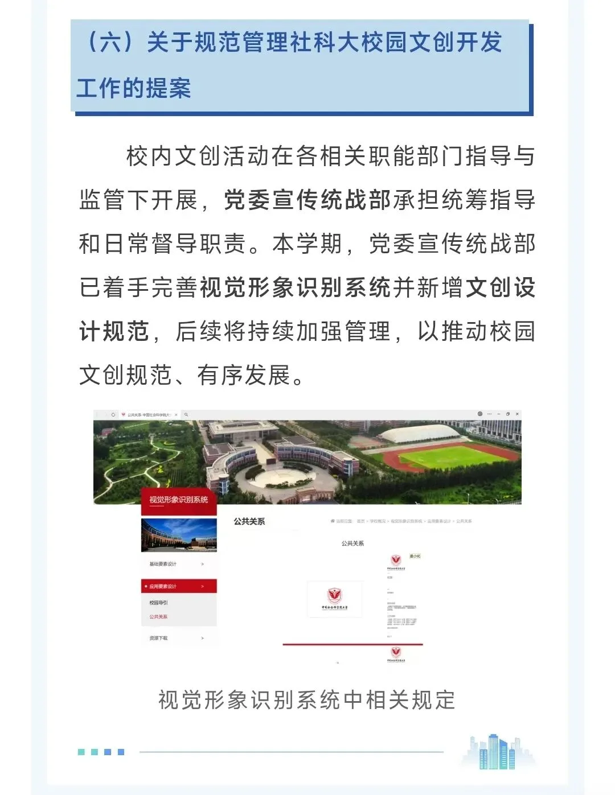

**请相关部门及时关注并跟进问题。**

## 1 文创管理

“校园月饼售卖岂能沦为“糊涂账”？

中秋将至，校园月饼本应是学子寄托情思、学校传递关怀的寻常之物。然而，今年“社科汇”突然取代往年学生会，站上食堂门口的售卖摊位，却让这桩小事生出三重疑云，值得学校管理层直面作答。

一问授权：谁给了“社科汇”进场资格？

往年由学生会等校内组织售卖月饼，虽谈不上制度完备，至少主体清晰、归属明确。今年经营主体悄然易主，事前既无公开说明，事后亦无授权公示，学生只能从摊位位置和招牌上自行揣测。校园不是自由市场，食堂门口更非谁想摆就能摆的“黄金档口”。若确有授权，请拿出文件；若无授权，那便是擅自占用校园公共资源经营，学校当立即叫停并追责。最怕的是，授权在抽屉里、关系在暗处，唯独学生蒙在鼓里。

二问资质：食品安全底线谁来守？

食堂门口是师生每日必经之地，人流量大、聚集性强。在此公开售卖月饼，就必须接受比普通摊位更严的审视：食品经营许可证有没有？从业人员健康证齐不齐？进货台账、生产厂家、保质期能否随时备查？这些不是苛求，而是食品安全法最基本的要求。若“社科汇”拿不出资质，学校却默许其在校内公开售卖，那便是把全校师生当作食品安全的风险承担者。一旦出事，学校一句“系第三方行为”就能撇清吗？备案在哪里？预案在哪里？责任主体又是谁？

三问资金：收益到底进了谁的口袋？

更具讽刺意味的是，一个非官方平台，打着校园的旗号、占着学校的地盘、做着学生的生意，收益却可能流入私人或第三方账户。请问：这笔钱是进了学校财务，还是进了某个经营者的腰包？如果是学校收益，为何不走官方渠道、不由官方组织？如果是个人收益，那便是借校园名义牟利，吃相未免难看。资金去向不透明，损害的不仅是学生的钱包，更是学校管理的公信力。

校园不是生意场，学生更不是待割的韭菜。

“社科汇”卖月饼一事，表面看是一桩节令买卖，实则暴露出校园商业活动准入不清、监管缺位、利益归属不明的老问题。学校若继续沉默，任其模糊运作，损害的将是自身治理的严肃性。我们呼吁：公开授权文件，亮出食品资质，说明资金流向。三件事，一件都不能少。

否则，月饼再甜，也盖不住这桩生意里的馊味。”

“一个社科学生的一天

早上，出宿舍楼看到的是“印象社科”文创广告；来到教室，打开手机是“社科汇”月饼广告；中午来到二食堂吃饭，经过了“社科拾光”的文创展柜；晚上来到一食堂，门口依旧有摆摊的文创。原来，我来到了社科文创大学。

如果没记错，一年前的学代会就有提案规范文创管理了吧？不知道这一年校办和宣传部的耿专员们是在忙什么？怎么文创越管越多了，甚至往年研究生会学生会的月饼今年都被拿下给社科汇了，平时耿专员拿经费高价买文创报销捞点就算了，月饼这种同学们每年都要买的也要捞是不是太不体面了”

## 2 推优

“马院本科推优人选谁在拍板

目前实施的推优流程是意向同学报名、民主评议、班级团支委制定具体量化标准决定人选、最后上报

一、不带情绪，只谈问题

1.团支委制定的标准是否公正？

所谓“标准”压根不公开，咱也不敢说，咱也不敢问。部分班级团支委自己瞎编出一些“硬杠杠”(依旧是不公开），很多各方面都优秀的同学推不上

2.团支委制定标准是否“因人设法”？

由于团支委是先看到候选人的材料，再制定评选标准，那么其中某些有私心的干部完全可以根据某位候选人的情况制定有利于/不利于TA的量化标准

3.没有回避制度。

团支委的部分甚至全部成员都是推优候选人(如果不是，那只能说明在这之前已经凭借种种便利把自己推上去了)，对不在团支委没有发言权的候选人明显不公平

3.基于以上，马院团总支和党支部有没有尽到监督义务？

当然了，本科生团总支的学生干部也是推优候选人，自己监督自己当然是很容易的啦

二、我们有哪些诉求？

1.取消团支委直接卡候选人的权力，设置能真正起作用的监督机制，别找那么一两个新生干事来开会糊弄过去，新生对着老登们根本不敢说话，一个弄不好就被扣上跟学长学姐接洽沟通能力不足的大帽子

2.重新审核自团支委有权卡候选人这项制度确立以后的推优名单，流程究竟合不合规，因为什么卡掉候选人，已经推上去的合不合格，学院应当给个说法

3.(只是个建议）在推优开始前，由班级中非推优候选人的团员(数量过多则采用抽取或报名制）协商产生推优量化考核标准，并由团支部全体表决通过后，才能开始推优民主评议和材料提交，防止团支委在卡人的时候因人设法

以上是全部投稿内容”

## 3 感谢

> “投稿:感谢数学教研室和后勤处的老师们为参加数学建模的同学们每队在南综五楼协调出一间房间用于比赛，还贴心的准备了零食，全程没有收取任何费用，再次感谢老师们”

## 4 后勤

“投稿  热水供应问题

社科大热水时间是不是有点奇怪？为什么只有早上和晚上？

第一，如果要去所里上课的话，早上六点起床是没有热水的。七点十五校车就发车了，不可能七点还在洗澡。得考虑每日返所同学需求。所以热水供应时间至少得提前到六点。

第二，上午上完课很累，想洗个澡结果中午没热水？！有时候上午没课的话，想睡个懒觉中午起床洗澡也不行。为什么中午没有热水供应？至少10点到下午2点应该有供应吧。

第三，非热水供应时段既然没有热水，为什么还要收热水水费？这不是白吃白占吗？没有东西收个什么钱。

谢谢🙏”

“社论君，俺要投稿！！

刚刚，看到风味餐厅那条发在校园门户的“庆中秋活动”通知，属实让人觉得无语。一个档口发个月饼让人尝一口，加上消费满一单送杯330ml的饮料，这就叫“校园活动”了？我在学校的餐厅排队吃饭领赠品这叫参加校园活动？餐厅运营方搞个满赠，换个“月圆食韵 情满校园”的标题，就能发校内通知了，“活动”这两个字什么时候这么廉价了？后勤处的管理人员连活动最基本的定义都不知道了吗？你们还能称得起老师这两个字的称呼吗？更离谱的是发通知的渠道。校内通知是发给全校师生看正事的，不是用来给你招来的餐厅打广告的。今年新中标进来的商家，借用学校的公共渠道给自己引流，这算怎么一回事？再说了，咱能不能先干点正事？风味餐厅现在什么水平在校师生心里都有数——菜难吃、价不低，跟之前相比差远了，平时吐槽的人少了？自家饭菜做成那样，不想着怎么把菜做好，中秋节送块月饼、送一杯饮料就想“回馈厚爱”“略解思乡之情”？我思乡是因为想吃口好的，你送杯饮料是几个意思，越喝越想家吗？饭做得难吃是能力问题，拿满赠冒充活动、借学校通知给自己贴金，是态度问题。能力问题可以改，态度问题没得救。好好思考思考，办点事儿吧！！！”

## 5 倡议

“关于人文之光投稿的一些建议:

能别把公众号当做自己写小说的地方吗……这个平台更多是给大家反馈实际问题的吧，莫名其妙写一些主题不明没头没脑无病呻吟的小故事会不会有些占用公共资源了”
