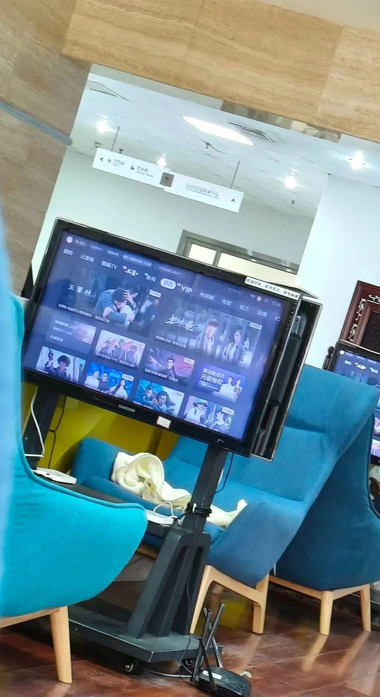
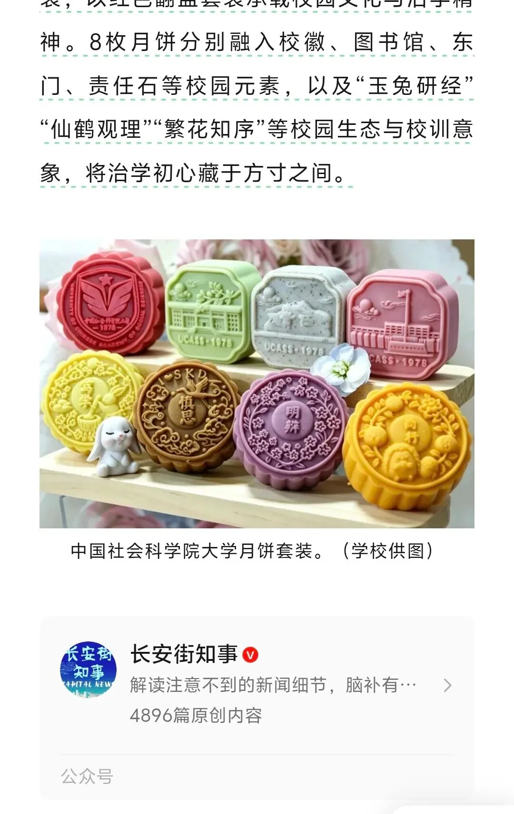

**请相关部门及时关注并跟进问题。**

## 1 评奖评优

> “投稿：对学校国奖评选制度的评价是：拉完了。领导们多多少少看一下这些规则吧，没想到文科最高殿堂搞抽象艺术也这么顶尖，不过应该也无伤大雅，随便糊弄过去完事儿了。风里雨里，双一流等你！”

> “为什么必须科研处认定的项目才好用，这有什么必要么？学生有证明不就行了，一年老师项目那么多！为什么评奖之前不把细则明确好呢？！？！还有一堆项目贡献率的问题，各个班级为了奖学金龙争虎斗了属于是！！！”

“  对于应用经济学院外文期刊论文是否按规定报备、是否符合计分条件，我存在疑问：

一、学院已明确，未报备的境外期刊论文“在奖学金评审时不予认定”。本次纳入计分的相关论文，是否逐项核验了审批材料？能否公示必要的核验结果？无法提供有效证明，是否默认符合要求？学院自己发布的要求都可以被绕开，公信力何在？制度难道只约束学生，不约束学院的审核和评选？

二、如果未报备的境外期刊论文仍可计分，学校的报批要求和学院评奖前的通知究竟有何效力？学院依据什么权限作出例外，是否获得授权？学院的裁量权难道可以凌驾于学校要求之上，评奖前一套标准，计分时另一套？

三、按流程报批的学生承担了时间和程序成本，一步一个脚印投稿国内期刊的学生同样付出了辛苦。如果报不报备最终没有区别，甚至不遵守规定还能获益，对守规矩的学生公平何在？

我的异议针对的是成果审核和规则执行。既然学院已经明确宣布“未报备不予认定”，就应当对所有参评者统一执行。不能让遵守规则的人承担成本，却让未遵守规则的人通过不透明的例外获得利益。”

> “  学院评审学业奖学金究竟是否合理？从一开始的极短时间内限期上交材料，到后来的在学院评审过程中可以补交材料，甚至到了拟公示名单出来后依然可以在公示前提交意见。如果为了彰显公平，为什么不在一开始公开宣布评选材料的确切公开截止时间，反而一开始公开声称过期不候，后期又声称有同学提交了补充材料，甚至于评审后还表示可以接受意见。”

## 2 后勤

> “  投稿良乡校区:今天得知重庆小面档口重新开业，心里特别高兴，这当然离不开后勤处老师、二食堂经理从中协调，也很感谢喜欢小面的同学们的争取，使我们二食堂变得越来越好。我个人的作息和饭点是不规律的，所以去二食堂吃饭的次数比较多。与我而言，二食堂这学期最大的变化就是自选餐的质量和口味明显变好了，不仅新添了豆浆机，而且尤其这几天做的锅包肉和溜肉段都特别好吃，没有传统锅包肉醋精的呛味。这点尤其推荐。而且，其他档口还增加了诸如土豆泥拌饭，擂饭的其他花样。在小院三年，我直观地感受到餐车建起来了，蜜雪冰城和瑞幸开起来了，一食堂贴心地安排师傅用大勺盛免费汤，二食堂大家想吃的菜品，经理都尽可能地满足大家。所以，由衷感谢这些改变背后起推动作用的相关领导老师、经理、工作人员和积极提意见的同学们。”

“一、共享洗衣机推送时间严重不准

宿舍新更换的共享洗衣机，自从换了新设备以后就一直存在一个问题：只要衣服稍微多一点，或者洗被套、被子这类大件物品，洗衣程序就会经常超时，实际洗涤时间远远超过预估时间。更麻烦的是，手机微信推送通知仍然按照最初的预估时间来发，提示"洗衣完成"。每次收到推送跑过去，结果洗衣机根本没洗完，还要再等半小时、40分钟，有的时候甚至要等一个多小时。同学在洗衣房和宿舍之间来回跑好几趟，既浪费时间又影响日常安排。希望学校联系洗衣机服务商，把后台推送逻辑改一改，根据洗衣机真实的运行结束状态来推送通知，不要拿预估时间当真，让同学收到推送再过去就真的洗完了。

二、热水费偏贵，新表走字过快

最近热水换了新表之后，大家普遍反映水表比以前"灵敏"了很多——这个灵敏是打引号的，说白了就是似乎跳得更快了。现在洗一次澡差不多就要将近4块钱，说句夸张点的话，洗个澡的费用都快赶上在小县城打一趟出租车的起步价了。目前热水费40块钱一吨，据了解有些民办学校的热水费才30块钱一吨，我们这边贵了将近三分之一。对于每天都要洗澡、卫生习惯比较好的同学来说，一个月光热水费就要花掉120块左右，一学年下来这笔钱几乎跟住宿费一样了，等于额外又多出一份住宿费。希望学校重视这个问题，督促热水服务商把价格降下来，参照合理标准调到30块钱一吨左右，减轻同学们的负担。

三、食堂午间高峰排队严重，希望增开外部供餐点

这学期学生人数明显增多，食堂午间高峰排队的问题比以前严重了很多。中午下课赶到食堂，各个窗口都排着长队，有时候排到快一点钟停止供餐了，队伍还是很长，排到后面的同学可能就吃不上饭了。考虑到食堂室内空间有限，建议学校参考其他高校的做法，在食堂外面增设一些临时餐点、流动摊位，增加午间供应，分流主食堂的就餐压力。这样既可以缓解排队问题，也能给同学们多一些就餐选择，不用都挤在食堂里面。

四、良乡火车站校车接驳迟迟未落实

上学期北京通勤火车增加了班次之后，很多同学都建议学校开通良乡火车站的接驳校车，方便坐火车进城的同学。当时学校方面回应说要重新招标，但这件事一直拖到现在也没有落实。希望校车线路能从广阳城地铁站延伸到良乡火车站，直接对接进城火车的班次，这样坐通勤火车的同学下了车就能坐校车回学校，不用再绕路。也希望学校能加快招标进度，早点把这个接驳线路落地。”

## 3 保卫处、校园门户建议

“投稿：保卫处可否考虑将学校各门的闸机，换成入校刷脸验证、出门自动开门的模式？每次出门都需要再刷脸很麻烦，有时候走得急刷不出去，还容易造成后边“追尾”。更是给保安造成不小的压力，需要时时看着按按钮放行。

直接换成出门自动的不就行了吗？很多高校的闸机其实都是出门自动，这样可以提高效率，给师生方便。换一下也不需要多少钱吧。

恳请相关部门严肃考虑一下。”

> “  投稿，新的校园门户很难用，不好用，且经常网络报错，入口一点都不清晰，还不如老版本，一股子AI味。”

## 4 图书馆

> “  图书馆视听空间占座问题：到底是人在休息还是书包在休息注：投了接诉答询，图书馆方答曰《如果你发现ta占座超一小时你可以去服务台举报》，请问午休时间不过短短一小时，图书馆方有过一下脑子再给我解决方案吗”

> “  新图书馆是改造成室内露天野餐营地了吗？天天有人带葡萄、小番茄还有各种水果进来大快朵颐。且不说那个塑料袋和保鲜盒被翻得哗哗响有多搞人心态，吃完桌上一滩黏糊糊的果汁水渍也不擦，现在一楼悦读经常有小黑虫，请问新图日常巡视的老师是对这方面完全零监管吗？保证没人占座就行了吗？图书馆自习区连个最基本的吃东西规范都立不住，真当大家是来看小情侣野餐的？”

## 5 月饼风波

> “  持续关注文创月饼事件后续。社科汇的ai文章回应了个啥呀?大家关心的两件事：社科大月饼的相关授权的哪个部门公开或私下允许的?线下试吃环节的工作人员健康证是否具备?别用什么做公益转移视线，感动自己呢?”

“  看这几天大家追着月饼骂，真没太大必要吧。本校同学自己创业本来就很难，赚点辛苦钱也是在给咱们学校做文创推广啊，包装和设计的心意大家有目共睹。

社科汇项目从起步开始校办等部门就是支持且知情的，属于正常合规孵化。大家低头不见抬头见，对同校校友宽容一点不好吗？没必要什么事都上纲上线。”

“  社科汇的回应口口声声说自己是“纯民间运营，与官方无关”，急着撇清行政责任。

行，那请问 9 月 24 号长安街知事发的那篇北京高校月饼推送，文末那张月饼特写下面明明白白标注着——（学校供图），这四个字哪来的？

如果你们真是民间商业团队，凭什么能代表学校向市级主流媒体报送官方宣传通稿？

如果真是学校相关部门审核并报送给媒体背书的，那社科汇为什么一被质疑就光速在校内发文切割？

做宣发的时候疯狂搭便车装官方，一聊到具体问题就瞬间变回“纯民间学生自发组织”。这种薛定谔的官方背景，到底在把谁当猴耍？”

“  社科汇回应通篇在那打感情牌，又是“学生社团化运营”，又是“大家戴手套切月饼很辛苦”，感动谁呢？真正的问题一个都没说明白。

社科汇销售运营主体“北京责任之石”，注册资本就 5 万块钱，联系方式留个个人 QQ 邮箱，注册地址看起来像集中挂靠的。今年华科月饼就出了食品安全问题，如果发生在社科大呢？一个空壳微型公司拿什么给全校同学兜底？还是说拿各位领导的政治生涯给社科汇兜底？

发试吃的时候推在校同学出来当挡箭牌，真到追究责任的时候背后就一个 5 万块的空壳公司。别拿情怀掩盖商业捞钱了，真的难看。”
