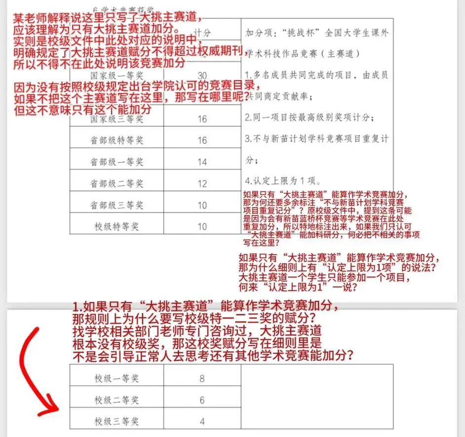
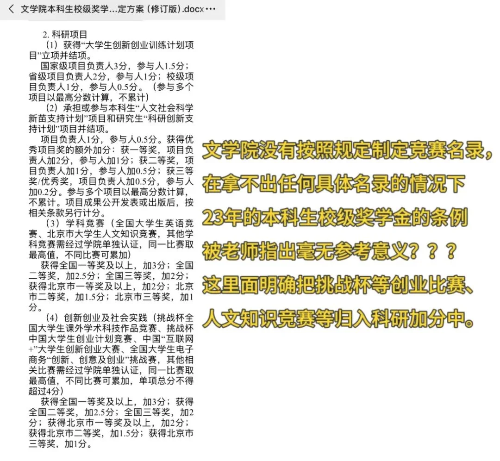
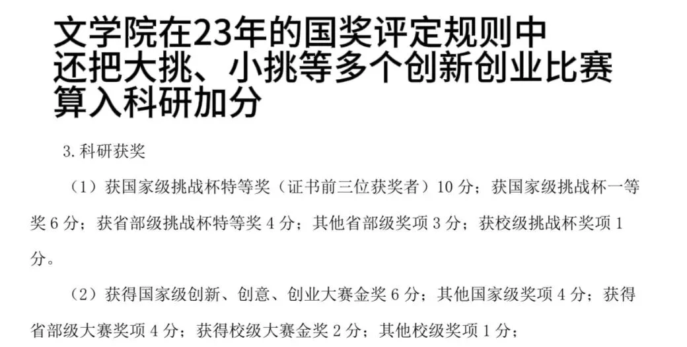
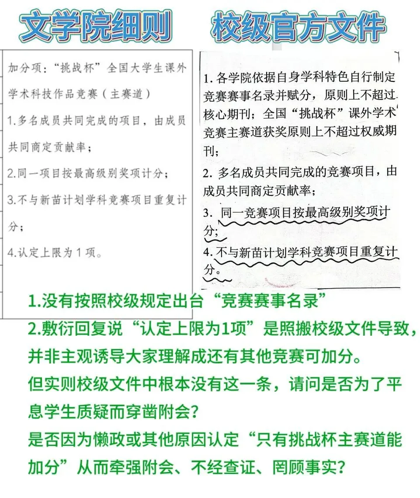

**请相关部门及时关注并跟进问题。**

## 1 校园空间

> “在图书馆的时间越久，图书馆读者的素质之低越能刷新我的认知。昨天在305，遇到三位女士带着达美乐进讨论室大块朵颐；在三楼走廊，有一位女士竟然在跟家人视频聊天，喋喋不休；今天在305，遇到一位女士，集出声大叹气、座位上吃东西于一体。图书馆的行为规范底线究竟是什么，难道我要每天给这些人作提醒才能换到安静的环境吗，还是我要一直向馆方投诉？”

> “噪声污染问题。学校南门对面公园每天吹拉弹唱，从早到晚，在教室关着窗子都能听到，最近听着更近更大声了。学校能去提醒一下吗？不要使用音箱！不要使用扩音器！0人想听。”

## 2 实习

> “中国社会科学院大学语言实验室，克扣学生工资，发工资极慢，事儿极多。某位老师阴阳怪气有一手，压榨实习生，压榨各种实习生，把自己的个人情绪带到工作上的同时工作差错又极多。每一个在她手底下待的人没有一句好话，我的工资可以不要，但是诚恳地希望不要再有任何同学对语言实验室和某老师抱有任何幻想，不要参加任何项目任何项目任何实习任何实习！！！！！！”

## 3 奖学金

“关于文学院奖学金评定细则争议及评审过程不当言论的情况

就本年度奖学金评定过程中，文学院竞赛加分细则条文矛盾、评定标准依据不足、评审沟通答复不当、评审教师发表主观性不当言论等相关问题，提出申诉，恳请学院予以核查、复盘并给出公开、公正、合规的官方答复，望党委学生工作处重视、监督。

本次申诉全程基于书面文件、客观事实与正常规则质询，始终理性沟通、依规维权。本人希望学院正视制度漏洞、纠正评审偏差、规范评审工作，保障学生合法评优权益，维护奖学金评定工作的公平公正性。现将具体情况如实说明如下：

**一、申诉起因：针对奖学金学术竞赛加分细则的合理性质疑**

本年度学院奖学金评定细则中，对研究生学术竞赛科研加分条款界定模糊、条文自相矛盾。班级评议小组全体成员在统一解读细则后，一致认定本人所获竞赛奖项符合科研加分标准，相关评定结果已完成班级公示且全员签字确认。

但在学院层级复核过程中，有评审老师单方面提出仅“挑战杯大挑主赛道”可认定为学术竞赛科研加分，其余同类权威竞赛、挑战杯专项赛道均不予计分。该解读与细则文本字面含义、常规逻辑解读、校级文件规范及往届评定惯例严重不符。本人针对该解读的合理性、文件依据提出多项合规质询，全程以事实、条文、官方文件为依据沟通求证，属于学生对评优规则的正常疑问与权利核实，无任何违规闹事、恶意纠缠行为。

**二、学院竞赛加分解读存在的八大逻辑漏洞与依据缺失问题**

学院单方面界定的“仅大挑主赛道可科研加分”结论，无法与现有书面细则、校级官方文件相互印证，多处条文无法自洽，具体矛盾疑点如下：

1\. 校级奖项赋分条款无对应适用场景，存在规则误导性

学院细则明确标注了学术竞赛校级特、一、二、三等奖的具体赋分标准，但经本人咨询学校相关职能部门核实，大挑主赛道无校级级别奖项设置。若学院认定仅大挑主赛道可计分，细则中专门增设的校级奖项赋分条款完全无适用场景，条文设置毫无意义，客观上会引导学生认定存在多项可计分学术竞赛，规则设置存在明显漏洞与误导性。

2\. “认定上限为1项”条款来源不明，与校级文件相悖

学院评审老师解释，竞赛加分“认定上限为1项”的条款为照搬校级文件内容。但本人逐条核查学校官方《研究生手册》全部相关内容，校级文件中无此条款、无相关限制性规定。该限制条款为学院单方增设，无任何校级官方文件支撑，依据严重不足。同时，因每名学生仅能参与一项大挑主赛道项目，该限制条款即便成立也无实际约束意义，进一步印证学院解读逻辑不成立。

3\. 重复计分排除条款多余冗余，解读逻辑自相矛盾

细则专门标注“不与新苗计划学科竞赛项目重复计分”，该条款的设置初衷，是针对校内多项并行学术竞赛存在加分重叠的情况作出规范。若学院仅认可大挑主赛道为唯一可计分科研竞赛，其余竞赛均不计分，便不存在重复计分的可能性，该条款属于多余冗余设置，与学院最终评定标准相互矛盾。

4\. 同一赛事拆分认定标准不公，分类界定不合理

挑战杯专项赛道与主赛道同属官方正规赛事体系、同一赛事报名体系、同一官方认证赛事。但按照学院现行解读规则，主赛道赛事可计入权重30%的科研加分，专项赛道仅能归入权重10%的社会实践加分。同一官方赛事被人为拆分、区别定级，评分标准双重化，评定规则缺乏统一性与合理性。

5\. 权威人文类赛事归类错误，违背学科专业评定逻辑

例如北京市人文知识竞赛为教育部认可、学校官方统一组织、聚焦人文学科专业素养的权威学科竞赛，在本科阶段明确纳入科研竞赛加分范畴。但文学院在研究生评定中，将该专业对口、官方认证的学术赛事强行划归为社会实践范畴，剔除出学术竞赛加分名单，不符合中文专业学科竞赛的认定惯例，评定标准随意性较强。

注：所附为 2023 年文件。本人参与过该年度文学院本科生奖学金评议，目前仅留存 2023 年版本，近年细则暂未查阅，该文件可用于说明相关问题。

6\. 无官方赛事名录支撑，限制性认定缺乏合规依据

根据校级评优相关规定，各学院可结合自身学科特色，自行制定本院学术竞赛认定赛事名录，作为学术竞赛加分的唯一依据。本人依规向评审小组申请查阅文学院研究生学术竞赛加分赛事名录时，不仅未获取任何官方文件，还被相关老师告知“学院无相关名录文件，且无义务向学生提供相关文件”。无合规名录支撑，却单方面划定加分范围，不符合校级评优工作的规范要求。

7\. 现行评定标准与往届官方细则、惯例自相矛盾

学院2023年《国家奖学金评定细则》为官方正式公示文件，其中明确将挑战杯各赛道、一些学校通知的创新创业竞赛等统一纳入科研加分范畴。本届细则无任何竞赛名录公示通知的前提下，突然变更竞赛认定标准，采取一刀切式限制性评定，未提前告知全体学生，政策衔接突兀，缺乏公示性与延续性，存在懒政、随意解读规则的嫌疑。

注：所附为 2023 年文件。本人参与过该年度文学院本科生奖学金评议，目前仅留存 2023 年版本，近年细则暂未查阅，该文件可用于说明相关问题。

8\. 以“往届无异议”搪塞质疑，无法掩盖规则漏洞

针对本人提出的多项细则矛盾问题，有评审老师以“上一届学生未提出异议”“今年博士生班级和研三班级没有这种情况”作为合理性解释。但挑战杯赛事为两年一届，上一届无学生提出异议，核心原因是上一届无学生取得相关赛事奖项，并非代表学院规则无漏洞、解读无偏差。以过往无争议推定现行规则合理，属于逻辑谬误，无法回应客观存在的条文矛盾问题。

综上，学院当前执行的“仅大挑主赛道可科研加分”的评定标准，无官方文件支撑、与新旧细则相悖、逻辑无法自洽、评定标准不公，无法让人信服。

**三、评审过程中出现的不当言论与程序问题**

本人自始至终秉持理性的态度沟通疑问，全程依规、依理争取自身合法评优权益，但在评审过程中遭遇了严重违背公平公正原则、带有个人主观情绪的不当对待：

本次奖学金评审会议场地未关闭房门，走廊可清晰听见会议内部讨论内容。本人在门外等候评审结果期间，清晰听到参会老师在会议中针对性讨论本人事宜，将本人对规则的正常质询、对权益的合理争取定性为“闹事”。

其中，最先提出“仅大挑主赛道可计分”、拒绝提供赛事名录文件的评审老师，当众高声发表“把XXX的德育成绩扣成零”的针对性言论，同时评价本人“今年闹成这样”。该言论音量较大，在走廊及周边房间均可清晰听见。

待评审会议结束后，本人主动进场，礼貌说明自身无意闹事、希望厘清规则争议，并就此前沟通中的些许不愉快主动致歉。沟通过程中，也有老师当场承认本届奖学金细则确实存在条文漏洞与不完善之处。

**四、本人核心诉求与疑惑**

1\. 规则公平性存疑：本人所有质疑均基于细则文字本身、校级官方文件、往届公示规则，有理有据、合规合理。本人争议诉求完全关乎个人正当评优权益，为何正常的规则质询会被定性为“闹事”？为何合理维权会招致“扣除德育成绩至零”的针对性、惩罚性言论？

2\. 评审公正性存疑：作出限制性评定标准、发表惩罚性言论的为同一位评审老师，该老师的主观偏见与负面定性，极有可能影响评审整体判断。本人无法确认，本次学院最终的评审结果，是否掺杂个人情绪与主观偏见，是否做到中立、公平、公正。

3\. 结论先行嫌疑无法排除：评审小组以“文学院拥有最终解释权”驳回本人所有质疑，对于细则多处自相矛盾、条文冗余、依据缺失的问题，仅以“照搬校级文件”搪塞，但经核查该说法并不属实。整体评审流程呈现先敲定“仅大挑主赛道加分”的最终结论，再强行拼凑理由解释规则漏洞的问题，评定结果缺乏说服力，难免让人怀疑是敷衍学生争议之举。

4\. 公示结果被单方推翻有失公允：班级评议小组依据公开细则、通用逻辑作出的集体评定结果，已完成全员签字与班级公示，程序合规有效。学院无充分文件依据、无合理合规理由，单方面推翻基层评议结果，否定学生全年科研竞赛成果，对本人极不公平。本人拒绝接受“仅个人有异议”“重算工作量大”等不合理搪塞理由，坚持规则面前人人平等，若规则存在漏洞、解读存在偏差，应全院统一修正评定标准，而非针对个人驳回诉求。

**五、正式申诉请求**

基于以上全部客观事实，本人郑重向文学院提出三点正式诉求，恳请学院在两日内予以书面公开答复：

1\. 重新复盘本年度奖学金学术竞赛加分细则，针对本文提出的所有条文矛盾、逻辑漏洞、依据缺失问题，逐条作出官方、合规、可溯源的解释说明。

2\. 针对过程中出现的“将学生合理质询定性为闹事”“扬言扣除学生德育成绩为零”“无义务提供官方赛事文件”等不当言论与不规范行为，给予本人正式、公开的情况说明与答复。

3\. 严格按照文件原文、校级规定、参考往届合规惯例、班级公示结果，重新合规核算本人本年度科研竞赛加分成绩，纠正不合理评定结论，保障学生正当评优权益。

奖学金评定工作以公平、公正、公开为核心原则。本次申诉绝非无理纠缠，而是为维护自身合法权益、督促学院完善评优制度、杜绝规则随意解读与主观评审偏差。恳请学院正视问题、认真核查、公正处理，予以明确书面回复。”
