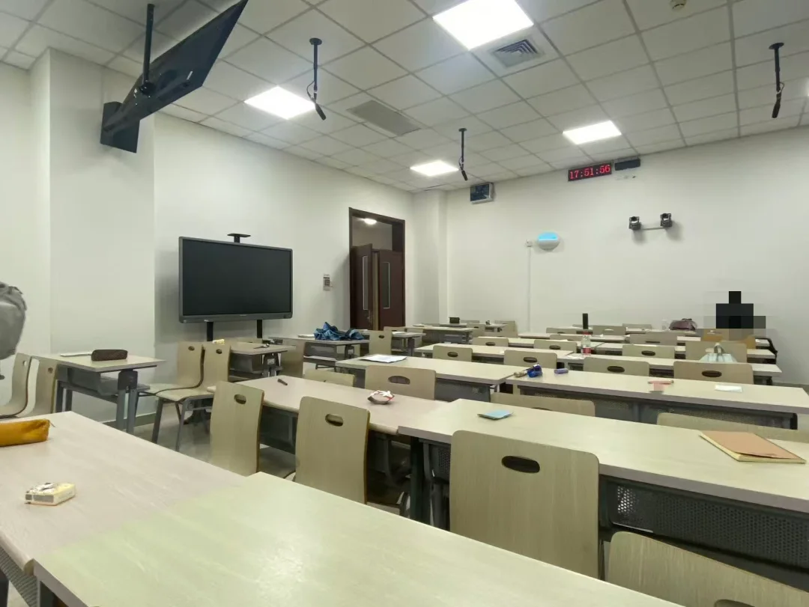
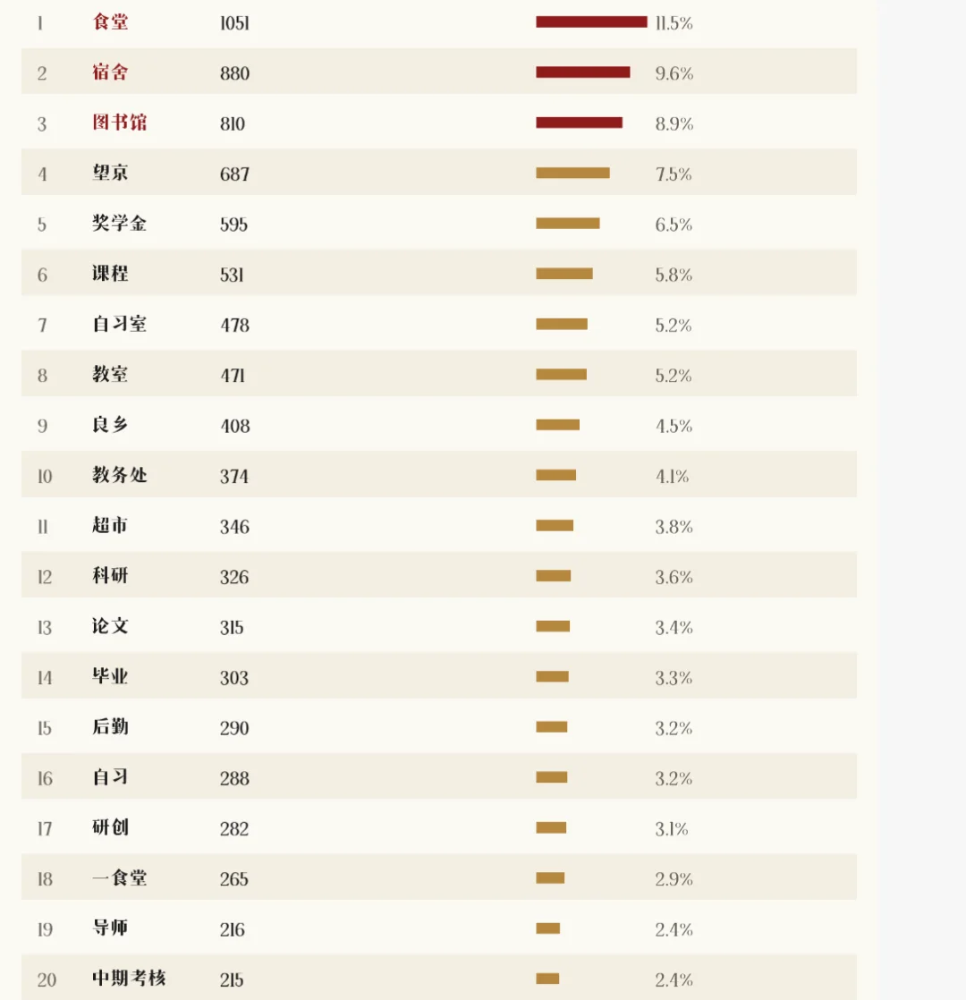

**请相关部门及时关注并跟进问题。**

## 1 供暖

“投稿：

最近降温幅度太大，然而试供暖的暖气片温度根本达不到让屋子里变得不冷的要求，每天在宿舍里打寒战。通过接诉答询反映，后勤那边说是试供暖期间只能低温供暖。希望学校尽快敦促锅炉房提高温度，要考虑到近期的特殊情况，不要机械执行升温时间。”

## 2 占座吐槽

“第一次碰到良乡研教楼教室占座，使用物品包括但不限于笔记本、笔袋、纸巾、一次性咖啡杯套、特意把ipad拆走的外壳……物品真是荒谬的五花八门，占座本身就不是礼貌行为，甚至不是接下来的课都要占座（明天上午也不是），没考虑过中间会在这上课的同学们的感受吗?每个人走进来都一脸懵圈退出去看看教室走错没有。（无力）第一次碰到良乡研教楼教室占座，使用物品包括但不限于笔记本、笔袋、纸巾、一次性咖啡杯套、特意把ipad拆走的外壳……物品真是荒谬的五花八门，占座本身就不是礼貌行为，甚至不是接下来的课都要占座（明天上午也不是），没考虑过中间会在这上课的同学们的感受吗?每个人走进来都一脸懵圈退出去看看教室走错没有。（无力）。

”

## 3 远程访问系统

“投稿：

最近校外访问不了图书馆，历史院提供的电子书下载链接校外是用不了的，试问安装中国社会科学院大学远程访问系统有什么用？你们脑袋是长在屁股上了吗？这样的服务，能做到一流高校的水平？”

## 4 六号楼之谜

“投稿：

投稿，六号楼在某一天晚上，不知道发生什么的疏散之后，楼梯道的防火门的顶门块全去掉了。本来过道就小，堪堪推开一扇门更是费劲，稍微带点东西压根不方便过。本来就没有很宽敞的楼梯，能不能考虑下日常的方便。防火门常闭有意义吗，又不是八部电梯不用走楼梯？”

## 5 人文之光社论的五周年

不知不觉，社论已经是第五年了。从第一篇推文《如何办好我们的\<社科大\>》到现在的第719期推文，无论是社科大还是人文之光社论都走过了一段漫长的旅程，而如果这个平台真的为所有曾经投稿的同学以及教职工们做过什么的话，那我们也算是不虚此行。不管是否能为大家解决问题以及大家是否认可我们还是讨厌我们，我们都想要感谢一路以来支持我们的读者朋友们，感谢你们选择相信了我们。我们也要感谢学校的行政老师们，因为从来稿数量上来看，学校的行政水平应该是大有提升，不然也不会出现一周只有个位数稿件而让我们也不好排版的情况。

虽然如此，但个位数稿件所透露出的问题，依然是我们希望学校可以去进一步完善的。就本学期以来的来稿情况而言，前往良乡站或房山东站的摆渡车问题；每年奖助评选期间的各类质疑以及食堂的问题是被多次提及的。社论编辑部也在此希望学校可以进一步完善相关规定，同时听取同学们的诉求，解决同学们的痛点问题。人文之光社论想要做到的，就是提供一个同学们以及教职工老师在不违反党纪国法的前提下，可以为学校建设以及自身诉求发声的平台，因此只要还有一个同学想要投稿，我们从本期开始都会刊发，即便某日只有一篇稿件，我们也会进行推送。

本还想写一些感谢煽情的话，但思来想去果然还是不耽搁各位读者的宝贵时间，比起千万次的感谢，或许将感谢之情化作行动，继续为同在小院的同学们以及教职工老师们服务才是我们最好的回报。

下附成立五年来投稿热点词云图及高频词统计，我们在此公开，希望同学们以及教职工老师们看看哪些问题已经解决，又还有哪些问题需要全校共同努力。

## 6 编辑部声明

编辑部近期注意到，有不少读者朋友在关心公众号为何迟迟没有恢复原名称「人文之光社论」，也有不少猜测在同学中间流传。

为了解答同学们的疑惑，我们作一个简单的说明：

本公众号系创始成员早年通过购买方式取得的企业主体账号。近日，由于账号原注册主体遭受举报，账号相关权益受到限制，公众号已无法再进行更名操作。就目前情况来看，「人文之光社论」这一原名称已基本无法恢复。编辑部曾尝试多种补救途径，但均无法绕过平台底层的规则限制。

现说明这一实情，既是不愿让关心我们的读者朋友徒劳等待，也是为了防止各类无端谣言与误读继续传播扩散。

至于导致这一结果的举报，我们无意揣测其动机。但一个以呈现师生声音为宗旨的平台，被反复举报到无法更名，消耗的是社论作为师生发声平台的效力。这一行为真正损害的绝非编辑部一隅，也不是某一个具体的人，而是以「让社科大变得更好」为共同旨归的全体社科大师生。对于这种举报行为，编辑部为之感到深切的悲哀。如果想要沟通，可以随时联系公众号后台或投稿至邮箱，我们也在此公开呼吁对公众号有意见或者不满的读者朋友，可以直接私信表达不满，我们会一一回复。

名称可以被剥夺，但平台不会因此消失。本公众号的投稿渠道不变，保护投稿人隐私的原则不变，呈现争议诉求、如实反映师生声音的宗旨也不变。无论顶着怎样的账号名称，编辑部始终欢迎各位读者朋友继续投稿、继续批评指正。

人文之光社论

2026年 11月 15 日
