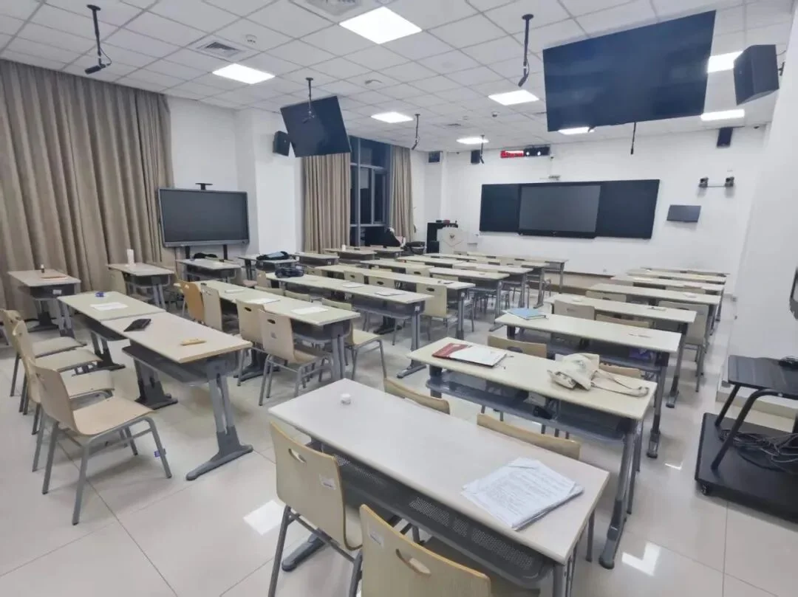

**请相关部门及时关注并跟进问题。**

## 1 离谱占座

“致某六字经济学院硕士班同学：

大家都知道社科大自习区域有多紧张，空教室有多难找。我们这群没有固定工位的自习人，工作日每天像野狗一样背着书包在教学楼里流动打游击，哪有空位钻哪。结果今天下午5点多推开教室门直接给我气笑了：空荡荡的教室，大半个班的书本精准铺满每一张桌子，一看课表，好家伙，今晚压根没课，这是准备从今天17:00一路硬占到明天13:50上课是吧？整整二十多个小时，你们的书比人还金贵，连夜在教室里坐禅呢？非常愤怒！你们算是彻底惹到我们野狗自习丐帮了，这事必须道歉。

在此正式通知：公共教室不是你们班的私人储物柜。以后再让我遇到这种离谱的跨天集体占座，我将善意合规地借用教室，并本着拾金不昧的精神，善意地把所有占座物品统统送去失物招领处，方便各位同学下课后慢慢认领。望周知，好自为之。

此致敬礼

普通良乡自习民

”

## 2 校歌会补充

“校歌赛的话想补充一下  校外评委是有劳务的呢

”
