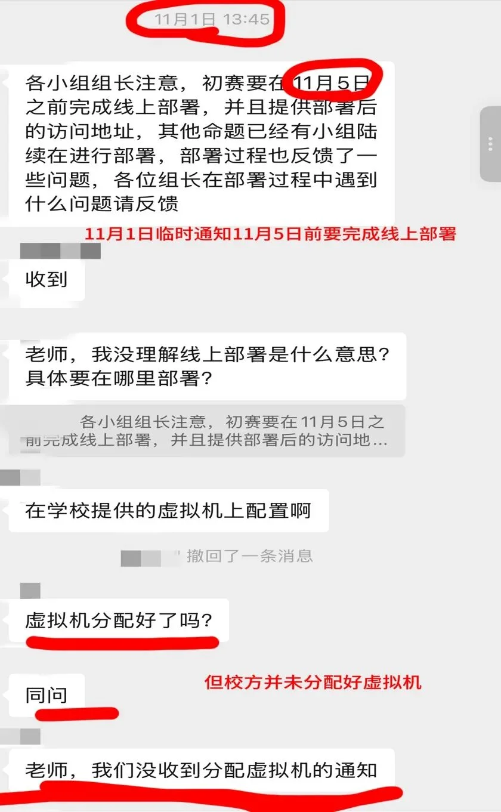
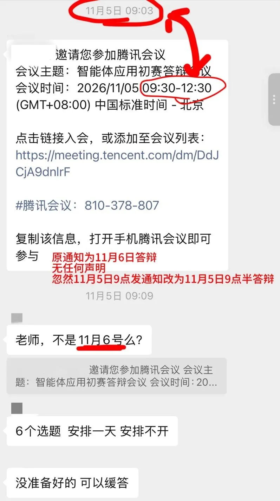
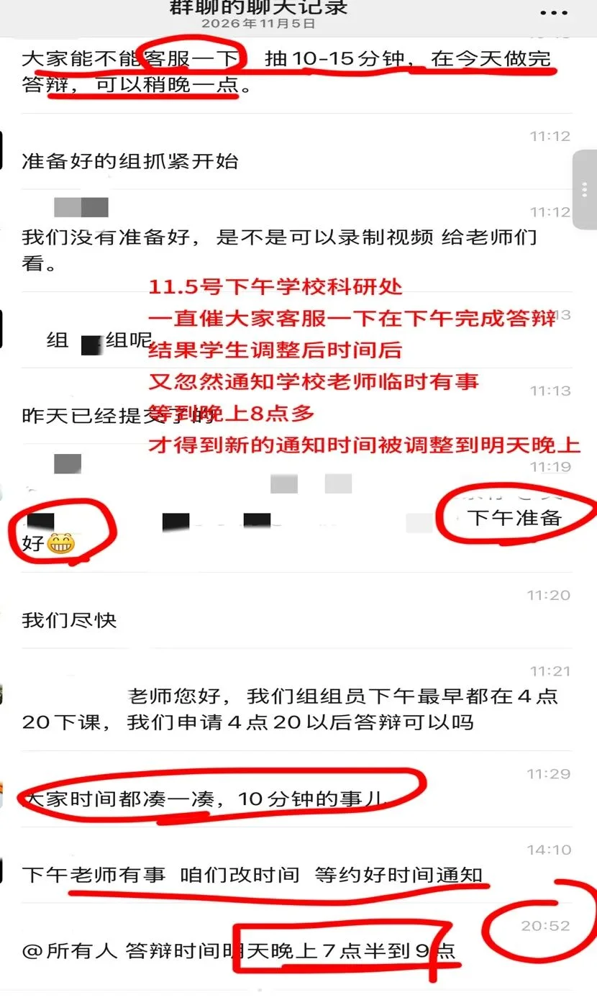
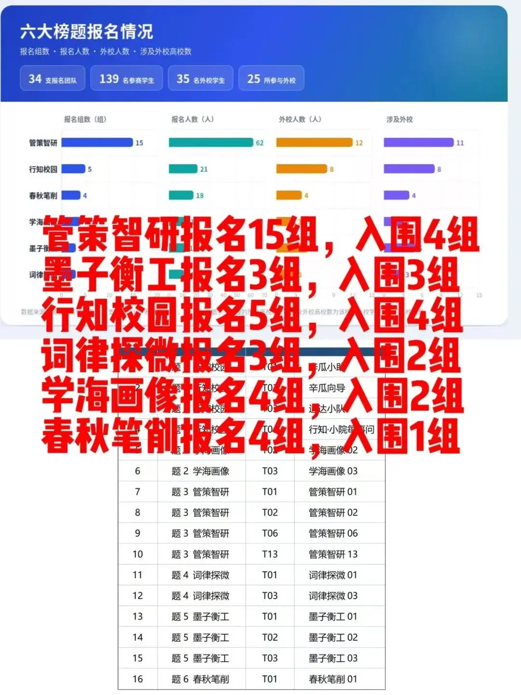

**请相关部门及时关注并跟进问题。**

## 1 后勤

“寒风里的期待：盼望供暖更稳更暖

近日大风降温，寒意骤增，不少宿舍难以维持稳定温度，尤以走廊尽头、迎风面的宿舍感受最为明显。

我们已经报修，维修师傅上门检测后确认暖气片硬件本身并无故障。问题不在于单组暖气设备，而在于整体供暖供给：供热温度忽高忽低，没法维持稳定的暖意。这不是个别宿舍的情况，很多同学都有同样感受。

寒冬之中，稳定适宜的室温是安心学习、休息的基础。在此恳请后勤部门结合大风寒潮天气的特殊情况，适当上调供暖供水温度、延长供暖时段，保障迎风、端头宿舍也能持续恒温，让同学们不必在凛冽寒风里挨冻，在宿舍里拥有安稳温暖的学习生活环境。”

“ 投稿：

天气越来越冷了，热水也越来越重要了。不知道学校有没有全天供热水的条件。或者可以改一下供应时间，在中午到下午增加一段热水供应。想顺便请问一下，如果有这类建议或疑问，可以向后勤处咨询吗，后勤处会回复吗”

“ 别再以安全之名搞一刀切！

近期，宿舍楼内公共服务间原有的插座被全部封闭。这一操作实在令人费解，甚至可以说荒谬至极！

公共服务间之所以叫“公共服务间”，理应具备为学生提供基本生活便利的功能。 如今，学校直接封闭全部插座，让学生连使用自带吹风机这样基本的日常需求都难以满足。试问，这样的公共服务间，究竟还提供了什么服务？

如果学校认为吹风机属于违规电器，那么我们有理由进一步追问：在宿舍生活区内使用大功率电器，与在专门设置的公共服务间内使用，难道不应该有所区分吗？ 在具备相应电路承载能力的公共区域正常使用吹风机，与在宿舍内部私拉乱接电线、违规使用电器，难道能简单等同吗？

安全管理应当消除的是安全隐患，而不是学生的正常需求。如果只要存在风险就一律禁止，那管理倒是省事了，学生的生活又该由谁来考虑？

而这样的管理方式，不禁让人想起另一件事：往年迎新季，宿舍楼都会张贴新生宿舍群的二维码。然而去年，在有同学对部分不合理规定提出质疑后，校方不仅没有给出正面回应，反而在不久后解散了原有的宿舍群，此后也再未建立新群！堂堂一流高校，面对学生提出的合理质疑，解决问题的方式竟然不是回应问题本身，而是直接取消提出问题的渠道，实在令人啼笑皆非！

我们在此呼吁：学生不是只需要服从管理的对象，更是校园生活的直接参与者。宿舍也不只是学校需要管理的场所，更是学生每天实实在在生活的地方。希望学校能够正面回应学生诉求，拿出真正解决问题的办法，而不是一次次用最省事的方式，让学生承担所有的不便！！”

## 2 人文薪火智能体大赛疑问

“一、赛事资源保障不到位

比赛承诺的资源未能落实。 学校前期通知中承诺提供的知识库、数据库等资源，在实际比赛过程中并未得到完整提供，实际资源与前期通知存在明显差距，直接影响团队项目开发。另外通知公告中提到的算力支持学生从始至终都没有拿到，参赛团队投入成本巨大。

校方提供的虚拟机和堡垒机部署问题拖延。 如图所示。

学校直到比赛结束前4天才提供虚拟机，此前参赛团队对相关资源毫不知情。开放后，虚拟机及堡垒机又存在大量技术故障，部分成员无法正常登录。同时，相关权限仅开放给团队队长，其他成员无法独立使用，严重影响团队协作。这些本应由赛事组织方解决的基础技术问题，最终却成为参赛团队的额外负担。

二、赛事组织管理混乱

指导教师与科研处相互推诿。 参赛团队遇到问题后，指导教师要求联系科研处，科研处又要求联系指导教师，导致团队提出的问题长期得不到解决。请问，学校举办比赛，却连基本的问题反馈和责任协调机制都无法建立。

答辩时间反复临时变更（仅针对我们所在的第三个榜题）。 最初通知11.6号下午答辩，直到11.4号仍未明确答辩顺序；随后又临时调整至11.5早上，11.5下午的答辩拖延到11.5晚上通知改到第二天晚上7点半到9点半，晚上仍在召开线上会议协调相关安排。答辩时间一直根据科研处老师空闲时间随意调整，但是始终没给学生确定时间。

难道老师的时间就是时间，学生的时间就不重要了吗？实在很令参赛选手心寒。

具体

如图所示。

三、晋级及评审机制缺乏透明度，公平性存疑

针对我们团队报名的是管策智研赛题，共有15支队伍报名，最终仅4支队伍晋级。相比之下，墨子衡工赛题3支队伍报名、3支晋级；行知校园赛题5支队伍报名、4支晋级；词律探微赛题3支队伍报名，2支晋级；学海画像4支队伍报名，2支晋级；春秋笔削4支队伍报名，1支晋级（另不统计报名之后退出比赛的），晋级名额严重分配不均。

不同赛题之间难度差异很大且评判依据各不相同，（例如我们在不同ai平台上对6类赛题的难易程度进行排序，所在第3组都难度较大）最终结果上不同赛题之间晋级比例差异非常明显，但科研处并未在报名阶段提前告知不同赛题晋级比例。第三组呈现出15:4的晋级比例，远低于其他赛题，我们认为这并不公平。

请问：

各赛题晋级名额究竟依据什么标准分配？

是否存在不同赛题之间统一的评审标准和评分体系？

具体各组在哪些评分维度上不符合晋级要求扣分？

此外，评审结果只公布了一个公众号上的晋级名单，却没有给出任何有说服力的评价依据，我们申请科研处评委老师公示评分细则与各组评分表。”

## 3 校歌赛后续

“投稿：

前两天学生会的同学不是天天在下面振振有词评论吗，怎么遇到难回答的事就不吱声了。这次怎么不回应一下《爱爱爱》的好朋友是什么专业评委参与打分？有没有拿劳务了？不回应就天天问，钉在社论上”
