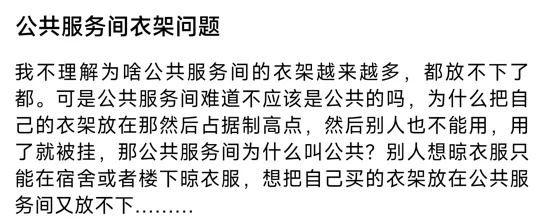
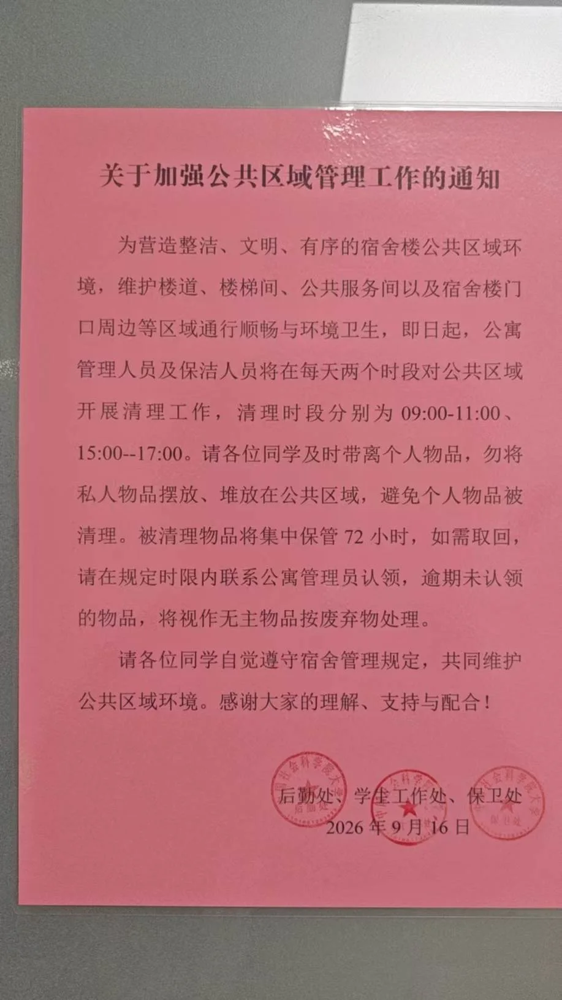
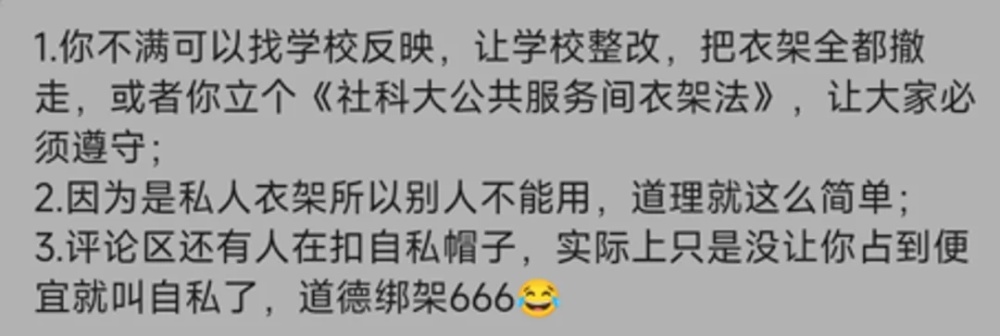
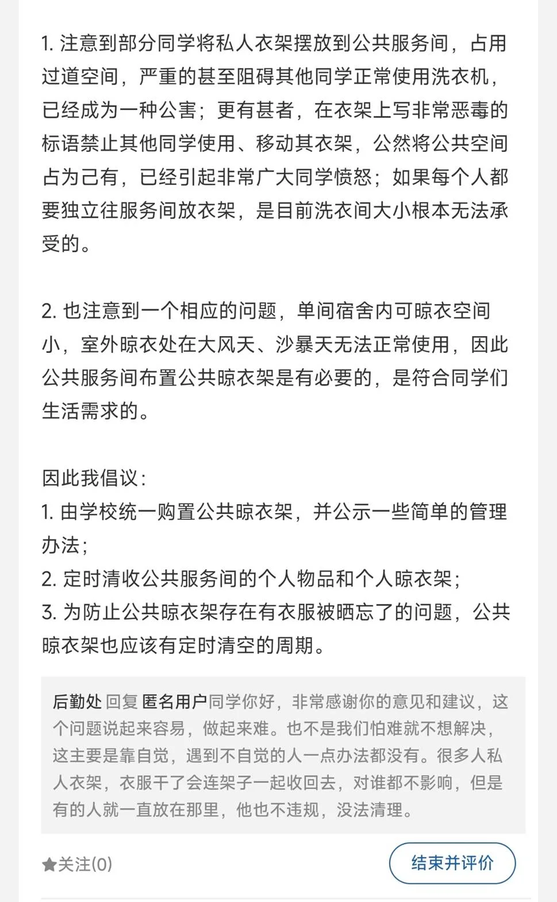

**请相关部门及时关注并跟进问题。另外看来是公众号更新太慢导致投稿少，而不是大家希望的原因才稿子少，对此公众号运营深感遗憾。为了防止类似误会再次发生，我们会保持一天一更的。**

## 1 请别代表我

“投稿：

在来学校之前，我听说学校内有一个叫做人文之光社论的平台，可以对学校内一些自己感到不满意的事情进行评论，甚至听说老校长也会看社论的一些观，我感到十分震惊，但更多的是激动。在初高中，学校经常在校园管理中存在或多或少的问题，但面对学生的意见，学校很少在意，并对于提出意见的同学或是平台往往是一个铁拳就砸了。所以，面对能自由表达自己观点的人文之光社论平台，我更加确定自己选择社科大这所学校是正确的。

但是在两个多月以来，人文之光以及校园社科汇树洞上的一些情况引发了我的思考。人文之光平台上自中秋节前两周起就对学校社科汇文创售卖提出各种各样的问题。提出问题当然是好的，对于社科汇售卖食品资质、与校方关系等问题的质疑当然是合理的。但是对于社科汇方的回应为何一直置若罔闻？简直是和想象中的对手在作战。是否只有社科汇承认你所说的他们就是借着学校的名号在赚钱，说难听些是在为学校在敛财你才能认为这是做出了回应？是否只有承认学校是错误的才能满意？

校园歌手大赛学生会团委的同学耗费了多少力气才能够正常举办。不知道是投稿者觉得自己哪位欣赏的歌手未能入选，遂开始批判评委的公正性，甚至表示这是有什么利益相关。我只想问一下一个无盈利无奖金的比赛究竟从何而来的利益相关？至于那位校外评委的劳务，我只想问难道你自己愿意分文不取纯做公益的去到外校去为他们学校的活动做贡献？我想如果学校真的不提供劳务的话，你又会表达对学校抠门的吐槽吧。

更好笑的是前段时间有一条投稿表达了对常闭式防火门关闭的气愤。这样的行为实在是无力评价了。党和国家能把你保护得这么好，实乃大德。

诚然，学校的工作绝对不是尽善尽美，和同学也时常吐槽学校的水质，体测和体育考试冲突等问题，也对于吸烟点设立过多的问题感到无语，但是我想绝大部分的工作学校做的都是相对可以的。各种活动和相关的人文关怀我觉得绝对是全国前列的。可能是我的生源地比较差，没有什么特别好大学的同学，每当我和高中同学提起学校给同学们的种种关怀，他们都表示特别羡慕。学校不断电无门禁无校园跑。这些束缚同学自由生活的形式主义，学校通通没有，升米恩斗米仇，有的人似乎只有学校全部按照他的观点运行才能够满意。

另外，我想向社科汇树洞提出一个意见，实在不想写两遍就发到这里了，在此对造成运营同学的麻烦提前说声抱歉。树洞是否应该建立初步的审稿机制？我对于非异性恋并无任何其他看法，我认同一切爱的观点，但是无论何种取向，都不应该对于同学发表一些很下头的言论。这样的观点从开始就不应该成功发表。试想一位男同学在树洞上发评论二食堂有很多很sao的女生。这样的评论应当被直接审核掉，而不是在事后再删帖，毕竟同学们的眼睛也是需要保护的。

大多数人对学校的工作感到满意，因而他们不会在树洞和社论上发表自己的观点。反而让他们成为了被代表的一部分，明明线下绝大多数同学都对学校感到相对满意，但在社论和树洞上，学校疑似是被千夫所指。如果有同学表达了学校做得很好了等观点还会直接被扣上“护校党”的帽子。我实在想不明白，攻击自己的学校对自己究竟有什么好处？学校有多个平台能反映你的意见，有意见提意见，有问题反映问题就可以了，难道充满戾气的辱骂就能解决问题了么？

接诉即办10.20的一条帖子我觉得说的很对，学校在处理接诉即办问题时应该做好学生意见的收集，不要让个体意见转变为普遍民意，应当避免“一诉一改”。

就是这样，我想大部分同学和我一样不愿意表达自己的观点，可是我们的意见同样是重要的，我想请求那些同学们，麻烦你们不要代表我，也不要代表其他没有表达自己观点的同学们，你们的论战我们并不想参与，我们只希望过好自己的校园生活。请不要觉得自己是在为民请命，你们的观点我们并不一定同意。

社论的第一篇是“如何办好我们的社科大”，我想社论的最主要的目的就是办好社科大，而不是攻击社科大。我们的社科大太过年轻，并没有大部分学校办校数十年的经验，我们只能逐渐摸索。请求同学们给社科大一些耐心，也给社科大一些包容。我相信我们一定能办好我们的社科大。

祝社科大的同学们生活顺利、学习进步。感谢人文之光编辑部的运营，感谢你们创立这个平台，能表达社科学子的意见。

祝社科大越来越好。

”

## 2 社科大圈地运动问题研究报告

“投稿：

不出乎我们的预料，公共服务间装载私人衣架的问题又一次爆发了，为了让大家深入的了解私人衣架问题的前世今生，我们认为有必要对社科大圈地运动作一番详尽的考察：

早在一年前，学生会权益部就已经严格在其职责范围内反映过私人衣架的问题，楼长是这样回答的：

*这个问题我们也是很难办了，近期你们也看到了，楼长每天都是拉着车收个人衣架，提示贴了同学也不管，该放还放，我们已经收了很多了，这两天消杀完还会继续收，但是权益部也很我们一起呼吁大家，希望大家都自觉遵守公共区域的规定，共同维护公寓的居住环境！！*

看来这个问题确乎是相当难办的，毕竟近一年来圈地运动生生不息，在今年九月份后勤处张贴过这样一副公告：

看呐，“开展清理工作”，“视作无主物品按废弃物处理”，下面还大言不惭的盖了三个章，事情的结果我们都是知道的，衣架依旧堆积如山，圈地者还堂而皇之的倒打一耙，将早已盖棺定论的事情称之为道德绑架：

那么，社科大圈地运动就应当多快好省大张旗鼓的继续搞下去吗？我们就没有一丁点对策吗？也并非如此，有同学曾毕恭毕敬的向后勤部提议，试图在公共服务间增设公共衣架，不仅可以让同学们挂衣服更加方便，还方便管理，岂不一举两得，没想到后勤部是这样回复的：

看看这套回复的话术，一层一层倒挺讲究。

第一是抢跑式的自我辩护。"说起来容易，做起来难""也不是我们怕难就不想解决"——先把"难"字摆出来，在"不作为"的指控落到头上之前，把帽子摘掉。可规则本来就写着，9月份就公布了，照着办就行，难在哪里？

第二层是拿老实人给钉子户开脱。"很多人会连架子一起收回去，对谁都不影响。"——对，守规矩的人一通知就会收。可制造问题的从来不是这些人，是那些把铁丝拧死在栏杆上、在衣架上贴诅咒、占着不放还斤斤计较收费的少数人，现在后勤却拿多数人的自觉来证明"不管也没事"，这不是在解决问题，是让守规矩的人替破坏规矩的人买单，而且连句感谢都没有。

接下来是整套话术的点睛之笔："主要靠自觉，遇到不自觉的人一点办法都没有。"看呐，把公共空间的秩序维护，翻译成了每个学生的个人道德水平。走廊堵了，不是规则没执行，是你不自觉；衣架占地，不是没人清理，是你不自觉。后勤部从责任主体摇身一变，成了站在旁边摇头叹息的旁观者——"我们也没办法呀"！！

这种转移有个很实用的好处：它让问题永远无法被解决，同时又永远有人可以责怪。因为"自觉"没有标准，也无法问责——你没法给"自觉"定一个期限，没法要求"自觉"公示进度，更没法在"自觉"没做到的时候找谁对账。于是事情悬在那里，年复一年，衣架还在，海报还在，"我们也没办法"还在。

更何况这套逻辑在日常生活里根本行不通。小区里乱停车，业主不会说"靠大家自觉"，会要求物业划车位、装地锁、贴罚单。马路上有人逆行，没人会说"靠司机自觉"，因为有交规、有摄像头、有扣分。怎么一到公共服务间，公共秩序就突然变成了一件只能靠道德自律、不能靠规则治理的事？难道学生就天然比别人更自觉？还是说，这里根本不缺自觉，缺的只是有人把那份早就在那的规定亮出来、执行下去？

行文至此，我们要提出的诉求如下：

把规则亮出来。那份"公共区域不得存放个人物品"的规定贴到楼道里，让每个人知道规则在哪。别再藏着，然后对外说"无法可依"。

把执行跟上去。规则亮出来之后，划定区域、集中清理、定期复查。对占着不放的少数人，该收的收，该处理的处理，然后统一订购新的公共衣架，摆在南向窗户下边向所有人开放，并按照规定统一管理。

把责任钉住。哪天公示、哪天清理、谁来负责、什么时候复查，写清楚，到期拿出来对账。让"没办法"三个字不再是一句永远成立的免责声明。

当然，还有同学会问，如果真要制定规则会搞成什么样？这个规则有没有行政效力，会不会还是像吸烟点那次一样，一开始什么都没通知，然后拍脑袋整出来点逆天的？

事实上，有些规则还是有效力的，之前不是说要把宿舍外走廊给清空吗，那次之后清空的很干净，现在即使有一点点的卷土重来的迹象，但是也大不如前了，学校其实想执行是执行的下去的，无非是懒政罢了！”

## 3 二食堂的日常

“投稿：

逆天二食堂，本周总共来二食堂（除自选）进食两次，两次都吃到这个不知道是什么编织袋的绿色塑料。这东西特小，不排除很多同学根本没注意就吃进去了。两家不同的档口都出现同样的问题，是否二食堂档口的整个流程都有问题？希望学校注意点吧，前几天社论也有同学不止一次反映了二食堂的食品安全问题，貌似没看到学校有任何整治措施\[憨笑\]吃的好不好暂且不论，食品安全都无法保证的话，我不知道学校食堂还有什么优点。

”

## 4 禁烟倡议

“投稿：

请同学们不要在新综三楼的任何地方抽烟，烟会在这儿停留很久，飘得很远。\[抱拳\]”

“投稿：

建议社科大全校禁烟。向某些高校学习，校内任何地方全面禁烟，创造无烟学习环境。今天在宿舍楼附近有男生毫不避讳的迎面而来点燃一支烟，甚至他旁边就是一堆枯叶，很难想象如果随意扔烟头造成何种影响。”

“投稿：

教学楼内禁止吸烟本来应该是共识，但有些同学仿佛游离于三界之外，不在五行之中。每次晚上路过新综三楼走廊，总能闻到一股烟味。一次两次就算了，实在是太多次了。没人愿意在封闭的教学楼里被迫吸二手烟，这是很不尊重其他同学的行为。希望大家能自觉遵守禁烟规定，不要在走廊吸烟；也希望学校相关部门能加强提醒和管理。”

## 5 图书馆

“投稿：

良乡校区图书馆部分人用游戏鼠标我忍了，你用不知道什么轴体的游戏键盘是何意味？？”
