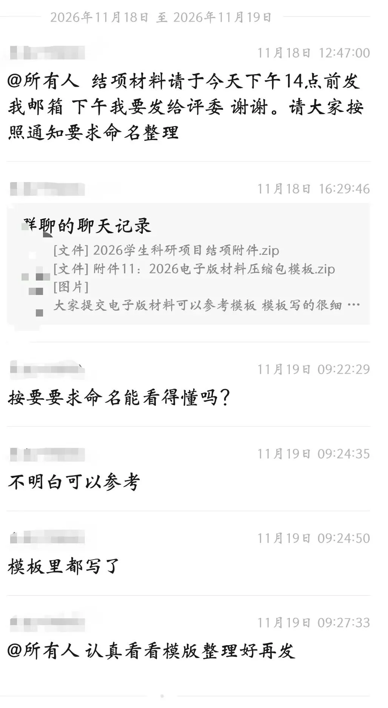

**请相关部门及时关注并跟进问题。**

## 1 十四行诗

“致榆木（十四行诗）

不想被代表的同学们啊，其实没人真想代表你们。

有人不避抨击、不顾针对，积极去改变现实，

你们一边享着这改变的光与暖，

一边诋毁那些事，护着陈旧体系的安稳——这是奴性。

你可以不说，慢慢享受舒适生活，

但不必自觉得善解人意、体恤八方，

义正辞严地去抨击那些想改变的人——

哪怕只帮到一个人，那改变也有存在的意义。

改变在于行动，行动以群体的思想为先导；

你们没有权利不让别人说话。

大可蒙住耳朵、戳瞎双眼，继续过美妙生活，

直到某天触及你们利益，才堂而皇之开口——

那就去和你们维护的美妙原状谈判罢。

不知你们是否知晓人文社科的精神？不知是否用空洞的大脑想过他人处境？不知是否想过利己之外的林林总总？

社科大优秀本就因为有足够多的人文人才，理应让所有人都说话、努力、改变

”

## 2 宿舍管理和接诉答询

“

后勤处、接诉即办：

回复了，然后呢？

11月22日晚23时15分，宿管人员突然敲响我的宿舍门，既未主动表明身份，也未说明来意。在我询问后，对方才表示要求清理门口垃圾，同时未经允许转动宿舍门把手，并特意提及门口设有监控。

我从未反对宿舍卫生管理，但提醒清理垃圾，何以需要在深夜采取这样的方式？未经允许转动学生宿舍门把手，是否符合管理规定？又为何要特意强调监控的存在？

随即我向学校“接诉咨询”平台反映了情况。几个小时后，后勤处回复称，宿管人员每天23时都要“不辞辛苦”地巡楼，宿舍楼道属于应急通道，不能堆放垃圾，工作人员“也是出于善意提醒”，希望理解。

那么学生呢？就因为晚饭后的外卖垃圾没有及时拿下楼，就要在深夜面对不表明身份的敲门和未经允许转动门把手的行为吗？还好我的门上了锁，如果没有呢？

后勤处的回复没有回答我的任何一个问题，却花了不少笔墨解释宿管人员如何辛苦、楼道卫生如何重要。难道解释了管理的必要性，就等于证明了管理方式的合理性？

太荒唐了！

“接诉即办”平台设立之初，大受好评。后来改名为“接诉咨询”，仿佛真的变成了一个咨询平台。学生提出意见，有关部门只是避开问题、说些套话，最后再附上一句“希望理解”，这样的回复究竟有什么意义？

几个小时就能收到回复，效率确实不低。可答非所问的回复再快，又能解决什么问题？

“人天生是政治的动物。”人类天生就需要通过公共体来实现自己的生活。参与公共事务是人的本性。如此之“接诉”，即使拥有表达渠道，我们参与校园公共事务的权利是否得到了尊重？

”

## 3 答辩安排

> “社论君我要投稿，新闻传播学院的新苗答辩安排非常不合理，首先答辩只有三分钟的时间，如何将整个新苗计划讲清楚呢。其次，既然研究生的研创计划可以做到线下，那是否可以争取一下也做到线下进行答辩呢，而不是被某负责老师一句轻飘飘的没有老师想来房山就过去了。第三，效率真的好低，在上午12点钟的时候负责老师发了下午2点前提交结项材料，但是下午4点才发格式，又让大家回去返工。不知道是这位老师的问题，还是同学们的问题，每次提交东西，基本都要同学们返工”

