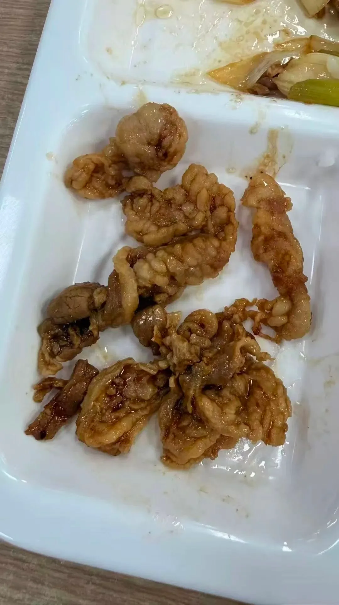

**请相关部门及时关注并跟进问题。**

## 1 水之问

> “求问有没有同学最近觉得新图书馆一楼的饮水机的水静置之后再喝有异味。一直怀疑是我的吸管杯有问题，今天换成矿泉水且静置了，喝起来是没异味，可能是图书馆的饮水机有问题，求问有没有同学有同感，如果有的话明天我去给图书馆工作人员反映一下/:@)”

## 2 肉之问

> “投稿：一食堂的葱爆羊肉不如改名叫葱爆肥肉吧/::~一口下去满满的脂肪（第一眼以为是淋巴肉，后来找了个学生物的说是脂肪，那就是吧/:--b）”

## 3 药之问

“投稿：

良乡校区医务室吐槽

连蒙脱石散都没有的医务室建议我们腹泻腿软肚子疼就拉到好为止不用吃药

今天中午吃了食堂之后，回去后开始腹泻，下午多次完全不成型，肚子痛有肠鸣音，腿软头晕，晚上来到了夜间门诊。

如实告诉医生之后医生：不用吃药拉到好就行

我大为震惊 追问这不应该吃蒙脱石散吗 我已经拉的都快站不稳了

医生：没有蒙脱石散

气笑了，平常医务室门口也写着，发热或腹泻直接来夜间门诊这边，谁成想夜间门诊连蒙脱石散都没有，腹泻来这边就建议不用吃药，是为了让本来就拉到心慌乏力的学生感受一下什么是白跑一趟吗”
